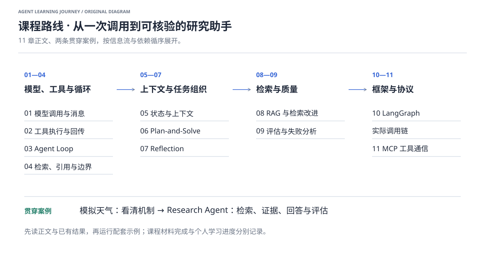

<div align="center">

# Agent 学习手册

### Agent Learning Journey

**从模型调用、工具与上下文出发，逐步构建医疗险资料比较 Agent。**

[开始阅读](docs/learning/model-calls.md) · [章节目录](#章节目录) · [环境配置](docs/getting-started.md) · [综合实战](docs/insurance/course-guide.md)

</div>

## 项目介绍

这是一套以 [Datawhale Hello-Agents](https://github.com/datawhalechina/hello-agents) 为主要教材的中文 Agent 学习资料。适合能阅读 Python 函数、字典和循环，希望理解并亲手修改 Agent 的学习者。

课程先用小例子讲清消息、工具、循环、上下文、规划和检索，再把这些能力用到医疗险资料比较。每章直接提供关键代码、输出、图解和练习；无需先配置 API 才能阅读。

全书采用“基础机制 → 进阶能力 → 框架与协议 → 综合实战”的组织方式。天气查询用于解释工具调用，课程资料问答用于练习检索与引用，医疗险 Agent 是综合项目。课程保持单体 Agent 范围，框架选学 LangGraph，协议选学 MCP。

## 章节目录

章号属于本手册；与 Hello-Agents 的对应关系见 [教材映射](docs/roadmap.md)。建议按目录顺序阅读，每章页首可直接进入配套示例和核心实现。

| 部分 | 章节 | 核心内容 |
| --- | --- | --- |
| 一、模型、工具与循环 | [01 模型调用与消息](docs/learning/model-calls.md) | 消息角色、模型输入与响应 |
| | [02 工具调用与结果回传](docs/learning/tool-feedback.md) | Action、函数执行、Observation |
| | [03 Agent Loop 与停止条件](docs/learning/agent-loop.md) | 历史消息、请求预算、完成状态 |
| | [04 检索、引用与资料不足](docs/learning/retrieval-and-citations.md) | 工具检索、证据编号、引用检查 |
| 二、上下文与任务组织 | [05 状态与上下文](docs/learning/state-and-context.md) | 预算提示、历史筛选、规则摘要 |
| | [06 Plan-and-Solve](docs/learning/planning.md) | 计划、依赖步骤、执行历史 |
| | [07 Reflection](docs/learning/reflection.md) | 草稿、反馈、修订与停止 |
| 三、检索与质量 | [08 RAG 与检索改进](docs/learning/rag.md) | 切分、索引、证据与回答 |
| | [09 Agent 评估](docs/learning/evaluation.md) | 检索指标、引用检查、失败分析 |
| 四、框架与协议 | [10 LangGraph 与调用链](docs/learning/langgraph.md) | 状态、节点、条件边与检查点 |
| | [11 MCP 入门](docs/learning/mcp.md) | 工具发现、跨进程调用与结果回传 |
| 五、综合实战 | [12 医疗险资料比较 Agent](docs/insurance/course-guide.md) | 需求、版本取证、保障比较、会话与验收 |



## 综合实战：医疗险资料比较

围绕“我关心普通门诊和续保，这两份医疗险资料有什么区别？”完成一个完整任务：整理需求、读取指定版本的资料、检查证据、生成九维比较表，并列出仍需确认的条件。

[第 12 章](docs/insurance/course-guide.md) 按输入、代码、工具轨迹和报告逐步讲解。[项目资料入口](docs/insurance/README.md) 汇集任务书、数据规范和运行记录；本地网页、Python、LangGraph 与 MCP 入口使用相同的比较规则。

资料分为自拟教学方案与官方公开资料节选。当前采用人工核对的事实目录；自动 PDF 导入、实时报价与核保接口尚未接入。

## 学习与实践

先阅读正文中的代码和结果，再通过 [配套示例](examples/README.md) 复现实验，最后完成 [学习目标与阶段验收](docs/course-map.md)。安装、环境变量和模型服务统一在 [环境配置](docs/getting-started.md) 中说明。

补充阅读：[实现架构](docs/architecture.md) · [源码调用链](docs/practice/source-reading.md) · [概念对照](docs/concepts.md) · [实验记录](docs/evidence.md)

## 仓库结构

```text
docs/learning/        第 01–11 章：原理、代码、图、输出与练习
docs/insurance/       第 12 章与综合项目资料
docs/practice/        章节补充练习与源码阅读
docs/assets/          课程图示
docs/runs/            基础章节的实验记录
examples/             与章节对应的运行入口
src/agent_learning/   配套实现与医疗险业务模块
tests/                逻辑与集成检查
scripts/              文档、示例与图示维护
```

## 参考与贡献

知识内容以 Hello-Agents 为主；课程导航参考 [Microsoft AI Agents for Beginners](https://github.com/microsoft/ai-agents-for-beginners)，保险应用参考 [AWS Frictionless Insurance Advisor](https://github.com/aws-samples/sample-frictionless-insurance-advisor) 的资料比较组织。具体借鉴与本项目取舍见 [参考说明](docs/references.md)。

欢迎按 [贡献说明](CONTRIBUTING.md) 完善已有章节、资料和案例。正文及教材衍生资料采用 **CC BY-NC-SA 4.0**；原创实现、测试与原创图示采用 [MIT License](LICENSE)。第三方资料保留原有权利，准确范围见 [NOTICE](NOTICE.md)。
