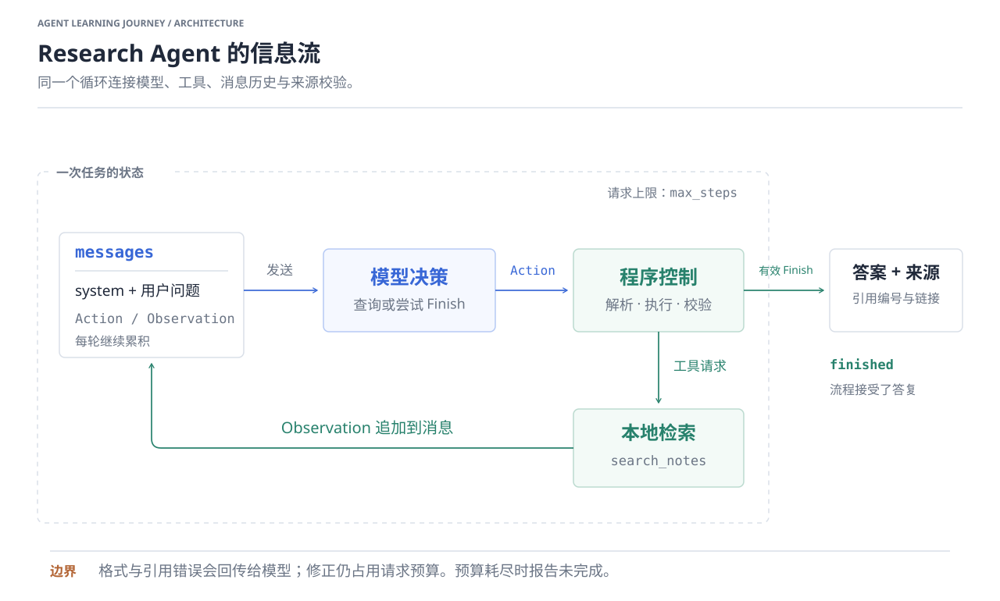

# 架构与执行过程

[返回首页](../README.md) · [先读 Agent Loop](learning/agent-loop.md) · [能力演进](practice/research-agent.md)

本页作为实现参考；各知识点的解释与实验从首页导航进入。

## 组件职责

| 层 | 文件 | 责任 |
| --- | --- | --- |
| 接口 | `cli.py` | 参数检查、配置加载、退出码与错误提示 |
| 模型适配 | `config.py`、`llm.py` | 服务配置、一次请求、检查空响应或截断 |
| 运行控制 | `loop.py` | 保存消息、限制模型请求次数、解析 Finish、回传错误 |
| 任务 | `agents/research.py` | 工具说明、当前任务已检索来源、查询去重、引用校验 |
| 工具与数据 | `tools/notes.py`、`data/notes.json` | 真实读取本地资料，按标签匹配并保留来源 |

工具结果进入消息后，模型下一次请求才能看到它。终端输出仅用于观察，不会自动成为模型上下文。程序保存的计数器、查询集合和来源字典也不会自动发给模型。

## 一次查询

1. CLI 把问题交给研究助手；研究助手为本次任务创建独立的来源记录与查询集合。
2. 循环发送 system 与 user 消息，模型返回 `Action: search_notes(query="...")`。
3. 程序只接受约定的工具名和参数格式，执行本地检索；不会 `eval` 模型生成的代码。
4. Action 以 assistant 消息保存，工具结果以程序构造的 user 消息保存，内容以 `Observation:` 开头。这是教学文字协议的简化实现。
5. 下一次模型调用接收累积的消息。它可换词检索，或返回 `Action: Finish[回答及引用]`。
6. 程序检查引用来自本次检索，再输出答案与记录中的来源链接；失败则把具体错误加入下一轮上下文。

## 停止与错误

| 情形 | 行为 |
| --- | --- |
| 有效 Finish 且引用检查通过 | 返回 `finished`，CLI 退出码为 0 |
| 查询无结果 | 回传资料不足提示，仍计一次实际工具执行 |
| Finish 外多写解释 | 回传格式修正提示，不执行新工具 |
| 引用缺失或编号未返回 | 回传具体错误，可用编号仅用于修正提示，不自动补写答案 |
| 重复相同查询 | 不再次读取资料，回传已有查询提示；仍占用本次模型请求预算 |
| 最后一轮仍无有效 Finish | 返回 `step_limit`，答案为 `None`，CLI 退出码为 1 |
| API 超时或服务错误 | 停止并给出简短错误，不输出原始异常体或密钥 |

这里的模型请求数与工具次数不同。格式纠错需要额外模型请求；Finish 不调用检索工具。达到上限并不会额外调用模型强行生成总结。

## 来源与限制

循环参考 [Hello-Agents 第四章 §4.2](https://github.com/datawhalechina/hello-agents/blob/main/docs/chapter4/第四章%20智能体经典范式构建.md)。本地标签检索、来源编号检查、去重与 `step_limit` 状态是本项目的教学简化或工程扩展。

模型的自然语言输出仍可能违背约定，`资料不足` 的文字判断也不是语义事实核验。当前架构用于观察这些行为，后续再比较结构化输出、状态管理与检索策略。
