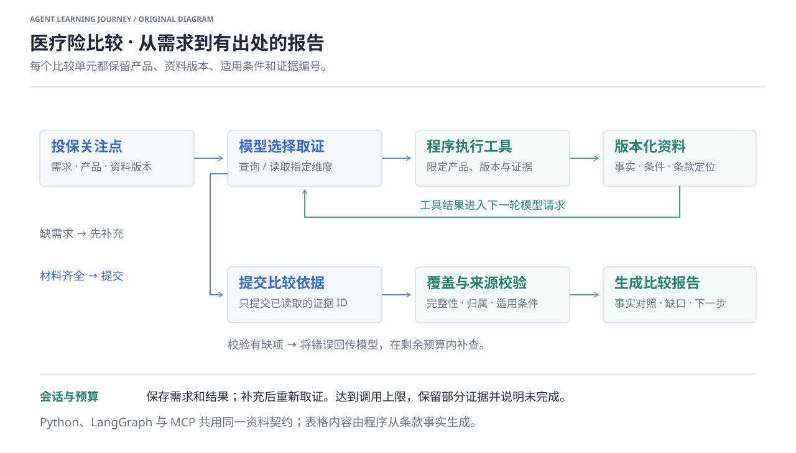

# 课程例题与综合项目的实现

[手册目录](../README.md#章节目录) · [第 12 章：医疗险综合实战](insurance/course-guide.md) · [调用链阅读](practice/source-reading.md)

仓库分为两层：第 01–11 章用天气、资料问答等例题拆解 Agent 机制；第 12 章把需求、取证、校验与会话连接成医疗险资料比较项目。例题保持独立入口，综合项目有自己的业务数据与完成条件，共用模型配置。

## 目录分层

| 层次 | 资料位置 | 实现入口 |
| --- | --- | --- |
| 课程例题 | `docs/learning/`：01–11 章；`docs/practice/`：资料问答、迁移与源码练习 | `examples/` 中各章脚本；`src/agent_learning/` 下的循环、任务、检索与集成模块 |
| 综合实战 | `docs/insurance/course-guide.md`：第 12 章；同目录中的任务书、资料规范与项目说明 | `src/agent_learning/insurance/`；`examples/insurance_compare.py` |
| 共用支持 | 环境配置、运行记录、测试与维护说明 | `config.py`、`tests/`、`scripts/`、`.github/workflows/` |

下文 Python 路径均相对于 `src/agent_learning/`。命令与运行模式集中列在 [示例索引](../examples/README.md)。

## 课程例题：分别观察一种机制


| 课程部分 | 实现模块 | 用途 |
| --- | --- | --- |
| 模型、工具与循环（01–04） | `llm.py`、`loop.py`、`agents/weather.py`、`agents/research.py` | 一次请求、工具反馈、停止条件与引用范围 |
| 上下文与任务组织（05–07） | `context.py`、`agents/planning.py`、`agents/plan_solve.py`、`agents/reflection.py` | 选择本轮输入、计划执行、评审修订 |
| 检索与质量（08–09） | `tools/retrieval.py`、`agents/rag.py`、`evaluation.py` | 切分、检索、证据选择与质量检查 |
| 框架与协议（10–11） | `integrations/` | 用 LangGraph 表达流程；用 MCP 调用另一个进程的工具 |

资料问答有两个练习入口。`python -m agent_learning` 让模型在三条基础摘要上逐轮选择查询，使用完整历史并验证 Finish；`examples.rag_research` 用课程语料执行固定的检索、证据选择和报告流程。默认 RAG 报告是离线摘录，添加 `--live` 才生成回答。两者服务于不同章节，不是综合项目的两个版本。

天气入口提供规则摘要与逐轮预算提示。规划、Reflection、LangGraph 和 MCP 例题各自组织流程，复用部分工具函数；这些选项没有自动组合成一套通用 Agent。

## 综合实战：医疗险资料比较



| 模块 | 职责与边界 |
| --- | --- |
| `insurance/web.py`、`insurance/static/` | 本机聊天工作区、需求与产品选择、后台进度、报告与证据抽屉；HTTP 只绑定 `127.0.0.1`，写操作检查同源与 CSRF |
| `insurance/cli.py` | 创建、恢复、查看会话及导出 Markdown 报告 |
| `insurance/service.py`、`insurance/conversation.py` | 整理待确认需求；调用比较工作流；限定报告追问使用的证据；管理模型客户端与结果保存 |
| `insurance/runs.py`、`insurance/execution.py` | 有界后台队列、运行事件、幂等提交与合作取消 |
| `insurance/workflow.py` | 检查需求，维护本次产品与版本范围，校验证据，构建九维比较与缺口 |
| `insurance/agent.py` | 模型工具循环、参数校验、错误反馈、模型与工具预算 |
| `insurance/catalog.py` | 读取固定版本目录，按产品、维度或关键词提供带出处的事实 |
| `insurance/store.py` | SQLite 单表 JSON 存储；需求版本、消息、运行、当前结果及最多五份历史结果；事务检查会话占用与过期修改 |
| `insurance/integrations.py`、`insurance/mcp_server.py` | 同一比较任务的 LangGraph 调度和 MCP 取证适配 |

网页的需求沟通、比较和追问经过 `RunManager` 后台执行，再调用 `service.run_message` 或 `service.run_session`。保险 CLI 同步调用比较服务；两条路径在执行前都认领会话，避免跨进程重复处理。`examples.insurance_compare` 用于对照 Python、LangGraph、MCP 三种执行方式，直接返回报告，可导出 JSON；它不创建会话。

一次比较沿以下路径进行：

```text
网页聊天 → 后台 intake → run_message → 待确认提案
  → 用户核对需求、选择产品 → 保存确认后的需求版本
  → 后台 comparison → run_session → run_comparison
      ├─ offline：程序按维度读取目录
      └─ live：agent.run_agent 选择工具并接收反馈
  → EvidenceWorkspace.finish → 比较表、来源、缺口
  → 保存报告版本 → 后台 followup → run_message
  → 筛选当前报告证据，按原事实与条件回复

保险 CLI → 提交需求文件 → run_session → 同一比较工作流
网页轮询 → 读取运行状态与新事件，不重新发起模型请求
```

比较表单元来自目录事实及条件，模型负责选择取证操作并提交完成请求。`EvidenceWorkspace.remember` 对照目录核验整批返回内容，`finish` 检查产品版本、证据是否实际读过，以及全部维度是否覆盖。关注维度改变顺序，不删去其他维度的限制和未知项。

需求提案只包含明确提供的年龄、医保、预算和关注维度，不直接应用，也不替用户选择产品。确认后的需求变更会让旧报告标为过期；追问只允许使用当前有效报告的来源。后台运行与报告具有不同状态：任务正常返回也可能只是提示补充信息或说明资料不足。

本地状态写入 `outputs/insurance-sessions/state.sqlite3`。事务检查需求版本、运行归属和重复提交；旧 JSON 会话按需迁移并保留原文件。取消采用合作检查，重启后中断任务不自动重发模型请求。对象、接口与恢复边界见 [第 12 章状态与执行设计](insurance/architecture.md)。

资料目录分为自拟教学示例与官方条款节选。年龄、医保和年度预算保存在需求中；当前实现没有报价或核保接口，因此报告列出待确认事项，不计算保费、排名或承保结论。缺少报价可以得到 `completed_with_gaps`：比较流程已完成，资料缺口仍然存在。

## 框架与协议适配在哪里

| 适配 | 章节例题 | 医疗险综合项目 |
| --- | --- | --- |
| LangGraph | 三步问答 `understand → search → answer`，另有天气条件循环 | `intake → research → verify → deliver`；缺需求时转 `clarify → deliver`。research 调用原有比较工作流 |
| MCP | 暴露模拟天气、基础摘要工具；模型桥接将工具结果写回 `role=tool` | 服务端暴露条款搜索与读取；客户端校验证据后纳入本次任务，完成检查仍在本地 |
| 状态保存 | 三步问答图的 `--checkpoint` 使用进程内快照 | 网页与 CLI 由 `SessionStore` 保存；恢复后按当前需求重新取证，不是从图节点续跑 |

医疗险 LangGraph 适配在工作流外组织节点，没有把模型循环内的每一步都拆成图节点，也没有配置 checkpoint。MCP 改变取证的传输边界，完成校验与报告格式仍复用同一业务实现。

## 模型输入与停止状态

模型接入共用 `config.py` 创建客户端。文本例题由 `llm.py` 提取回复；MCP 模型例题和医疗险 `service.model_adapter` 保留原生 `tool_calls`。工具结果必须明确写入下一次请求，程序变量、终端打印和持久化文件都不会自动成为模型上下文。

| 流程 | 停止与结果含义 |
| --- | --- |
| 天气与基础资料问答循环 | 有效 Finish 返回 `finished`；请求耗尽返回 `step_limit` |
| 计划与反思例题 | 由执行、评审与各自预算决定是否完成；保留未完成步骤或未通过草稿 |
| RAG 例题 | 区分证据摘录、生成回答、资料不足与格式/引用失败 |
| MCP 模型例题 | 区分有成功工具结果后的最终文本、无成功证据与预算耗尽；尚无程序化引用校验 |
| 医疗险比较 | `needs_input` 等待补需求；`completed` / `completed_with_gaps` 通过完成校验；`call_limit` / `tool_limit` / `model_error` / `cancelled` 保留已有证据并说明停止原因 |
| 医疗险对话 | `needs_confirmation` 表示需求仍是提案；`needs_report` 要求先查证当前需求；`answered` / `partial_answer` 区分报告能否完整回答追问 |

医疗险未知工具、参数错误和缺失证据会反馈给模型；预算耗尽后不追加隐藏的总结调用。普通文本不能代替 `finish_comparison`。各层的具体输入、反馈和测试位置见 [源码阅读](practice/source-reading.md)。

实现按课程与业务需要组合函数，没有插件注册、云部署或多 Agent 调度层。教材分层线索来自 [Hello-Agents 第四章](https://github.com/datawhalechina/hello-agents/blob/main/docs/chapter4/第四章%20智能体经典范式构建.md) 与 [第六章](https://github.com/datawhalechina/hello-agents/blob/main/docs/chapter6/第六章%20框架开发实践.md)；本页描述本仓库当前实现。
