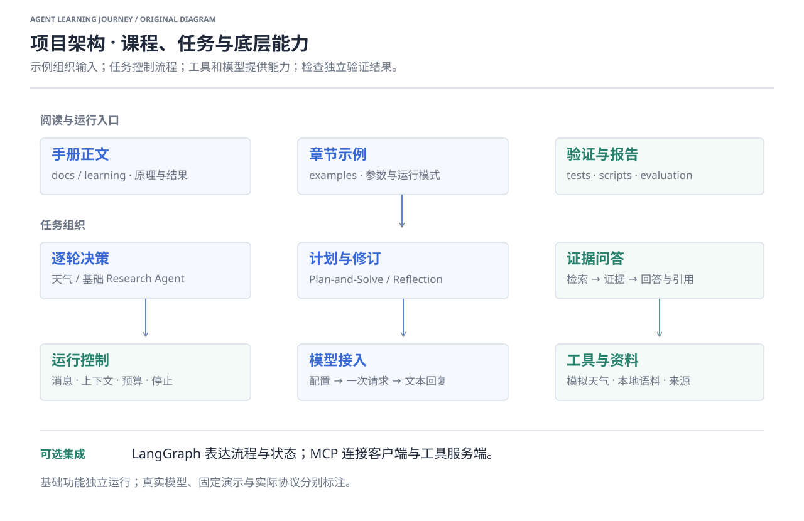

# 项目架构与执行边界

[手册目录](../README.md) · [贯穿项目](practice/research-agent.md) · [调用链阅读](practice/source-reading.md)

本项目将教材与配套实现放在同一个仓库。章节负责解释机制；示例负责选择参数和运行模式；核心包提供可组合的模型、任务、工具与检索能力。基础版本保留，后续能力通过独立模块接入，便于按课程比较。

## 目录与职责

| 区域 | 主要文件 | 职责 |
| --- | --- | --- |
| 教材 | `docs/learning/` | 11 章原理、代码、图、输出、练习与答案 |
| 入口 | `examples/`、`cli.py` | 参数检查、运行模式、配置、退出状态 |
| 模型适配 | `config.py`、`llm.py` | 服务配置和一次模型请求；不隐式保存会话 |
| 循环与上下文 | `loop.py`、`context.py` | 原始历史、选择本轮输入、预算、Finish 与反馈 |
| 基础任务 | `agents/weather.py`、`agents/research.py` | 工具说明、查询去重、当前任务来源范围 |
| 任务组织 | `agents/planning.py`、`plan_solve.py`、`reflection.py` | 计划生成、顺序执行、有限评审与修订 |
| 检索与研究 | `tools/retrieval.py`、`agents/rag.py` | 文档切分、排名、证据、回答校验和报告 |
| 数据与工具 | `tools/weather.py`、`tools/notes.py`、`data/` | 本地模拟数据、基础摘要、课程语料与评估题 |
| 评估 | `evaluation.py` | 检索与引用指标，保留逐题结果与失败项 |
| 可选集成 | `integrations/` | 真实 LangGraph 工作流、MCP 客户端与服务端 |
| 质量维护 | `tests/`、`scripts/`、`.github/workflows/` | 控制逻辑、协议/框架集成、文档与图示检查 |

以上 Python 文件均位于 `src/agent_learning/`，完整示例索引见 [配套入口](../examples/README.md)。

## 两个研究助手入口怎样衔接

基础版 `python -m agent_learning` 继续使用三条摘要与有限 Agent Loop。模型选择 `search_notes`，程序执行、保存来源并验证 Finish；适合观察模型逐轮选择行动。

课程成品 `python -m examples.rag_research` 使用独立的课程语料，按固定工作流完成检索、证据选择与报告。默认生成离线证据摘录，`--live` 才让模型依据证据生成结论。这里的检索顺序由程序规定，不把固定 RAG 流程描述为自主规划。

保留基础版，是为了复现早期真实实验，包括“旧资料库无法回答 checkpoint 问题”。新语料不会悄悄改变旧章节的输入和验收。

## 一条信息怎样进入回答

1. 示例入口检查参数，选择固定演示、真实模型或真实本地集成。
2. 任务函数组织输入，明确原问题、当前阶段、已有资料与预算。
3. 需要模型时由 `llm.py` 发送一次请求；需要工具时调用明确的 Python 函数或协议工具。
4. 程序保存实际结果。后续请求只看到被选入输入的内容，无法自动读取其他变量或文件。
5. 控制逻辑检查格式、预算和当前来源范围，决定继续、结束或报告未完成。
6. 报告与评估保留模式、状态和来源；格式合格与引用合法不替代事实核验。

## 可替换的边界

模型接入集中在配置与一次请求函数，章节示例复用它们。离线模式注入固定回复时，必须标成演示适配器调用，不能统计为真实 API 质量证据。

检索输出携带资料编号、内容、出处与排名，生成模块围绕这些字段组织证据。词法检索可以在保持输出契约的前提下替换为语义向量检索；两者的含义和限制在第 08 章说明。

LangGraph 提供状态与控制流表达，MCP 提供跨进程工具通信。两者是可选适配层，基础模型调用、工具函数和本地资料并不依赖框架或协议才能工作。

## 停止、失败与预算

| 流程 | 何时停止 | 如何解释结果 |
| --- | --- | --- |
| Agent Loop | 合法 Finish 或请求上限 | `finished` 是流程结束，`step_limit` 是未取得有效最终答复 |
| Plan-and-Solve | 计划执行完或调用预算耗尽 | 保留已完成步骤，不能把部分结果冒充总答案 |
| Reflection | 评审通过或修订/调用预算耗尽 | 未复审或未通过的草稿仍标未通过 |
| RAG | 无证据、生成完成或格式/引用失败 | `evidence_only` 是摘录；回答仍需核对支持关系 |
| LangGraph | 到达结束节点或配置边界 | 节点状态与执行顺序可以检查，图本身不保证答案正确 |
| MCP | 一次会话完成或协议/工具报错 | 工具结果、协议完成、模型作答是不同事件 |

API 超时、无权限与输出截断由入口给出简短错误；密钥不进入报告。对于明确的预算不足等教学边界，退出码 1 可能是预期结果，应结合状态理解。

## 为什么不做一个万能框架

代码围绕课程中可以解释清楚的机制组织。模型、工具与运行控制保持可分辨，后续框架章节再映射到现成抽象。可复用函数和明确数据契约足以支持本课程；不增加尚无教学用途的插件注册、服务部署或多 Agent 调度层。

来源：[Hello-Agents 第四章](https://github.com/datawhalechina/hello-agents/blob/main/docs/chapter4/第四章%20智能体经典范式构建.md)、[第六章](https://github.com/datawhalechina/hello-agents/blob/main/docs/chapter6/第六章%20框架开发实践.md)。本页描述本项目的实现分层与取舍。
