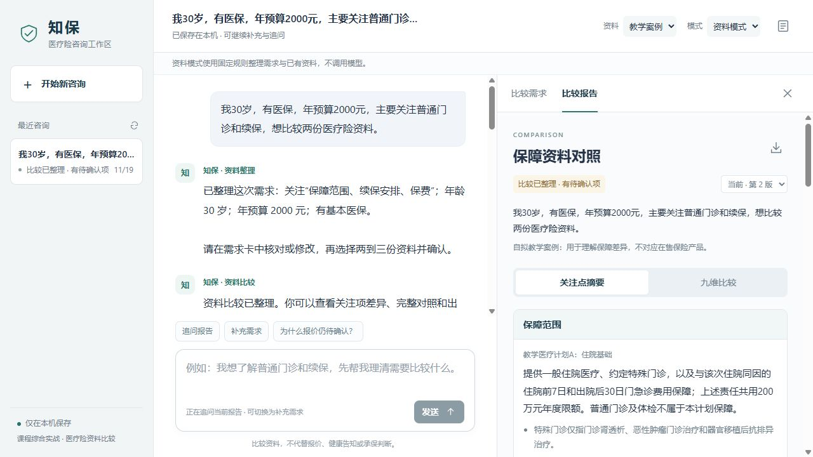

# 综合实战 · 医疗险资料比较 Agent

[课程目录](../../README.md#章节目录) · [开始阅读第 12 章](course-guide.md)

面向中国内地准备了解医疗险的投保用户，把关注点和选定产品资料转成有来源的保障比较。这是前面模型、工具、上下文、检索、框架与协议知识的综合实践。

## 阅读顺序

学习时先读第 12 章，再按需要查阅项目规格；各文档分别承担以下职责。

| 材料 | 解决什么问题 |
| --- | --- |
| [第 12 章：完整案例](course-guide.md) | 从一个需求开始，沿代码、工具输出和报告理解整个过程 |
| [业务任务书](requirements.md) | 明确用户场景、输入输出、业务规则与验收条件 |
| [状态与执行设计](architecture.md) | 理解需求确认、后台任务、报告版本与会话保存的关系 |
| [资料规范](data-guide.md) | 维护产品版本、九维事实、条件与来源 |
| [实验记录](runs/README.md) | 查看案例的实际工具决策、请求记录和报告 |
| [设计与资料来源](references.md) | 对照 Hello-Agents、开源应用与原始产品资料 |

## 项目能力



图为资料模式下的教学案例；会话内容为合成示例。

描述关注点 → 核对需求草稿并选择资料 → 确认并开始查证 → 查看进度、比较与缺口 → 追问报告或补充需求。

比较覆盖保障、免赔额、赔付比例、医院、等待期、续保、免责、保费和健康告知。资料包含三个自拟教学方案与三家保险机构的官方节选；缺少报价或其他条件时明确保留未知项。

当前使用人工核对的事实目录，尚未接入自动 PDF 导入、实时产品搜索或报价接口。节选不代表完整合同、当前在售状态或个体承保结论。

聊天用于整理需求提案，产品与版本由用户选择并确认。比较在后台运行，页面可查看进度或请求停止；报告追问只筛选当前有效报告中的证据，回复保留事实和条件。修改需求后，需要重新查证，已有结果仍可回看。

## 配套实现

[保险业务模块](../../src/agent_learning/insurance/) 实现工具循环、证据检查与会话存储。[同题示例](../../examples/insurance_compare.py) 对照 Python、LangGraph 和 MCP 三种入口；完整调用链见 [源码阅读](../practice/source-reading.md)。

完成统一的 [环境配置](../getting-started.md) 后，可启动本地网页：

```bash
python -m agent_learning.insurance.web
```

网页默认使用“资料模式”，按明确关键词整理需求、按固定步骤读取目录；切换“模型辅助”后，模型可以提取需求字段、选择取证操作和筛选报告证据。其他命令、参数和运行模式集中在 [示例索引](../../examples/README.md)。

需求、消息、运行与报告保存在本机 `outputs/insurance-sessions/state.sqlite3`，不进入 Git。重新打开会话会恢复这些记录；中断任务不会自动重发模型请求，也不从中断的模型调用处续跑。
