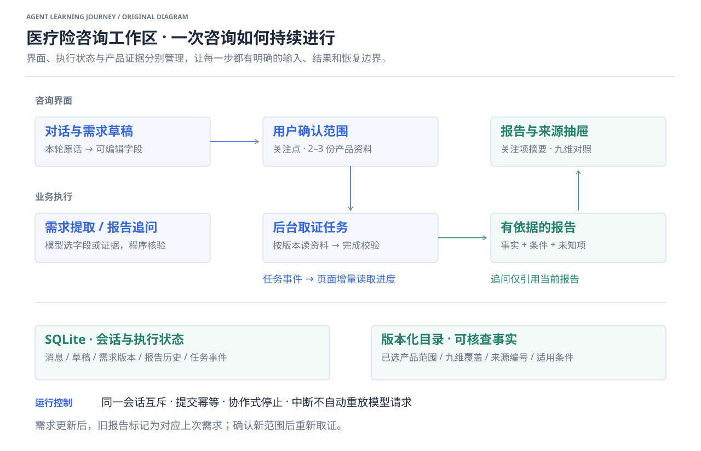
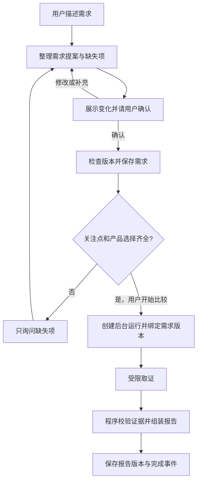

# 医疗险比较 Agent 的状态与执行设计

[返回第 12 章](course-guide.md) · [业务任务书](requirements.md) · [资料规范](data-guide.md) · [设计来源](references.md)

本页是第 12 章的附属设计说明，解释一个比较任务怎样从需求走到报告，以及用户补充信息、切换会话或停止运行时，程序应当保留什么。学习案例仍从 [课程指南](course-guide.md) 开始。

## 1. 从比较器到本地咨询工作区

比较器将用户选择绑定到产品和资料版本，工具返回带条件的目录事实，程序检查九维证据后组装报告。对话、后台任务和报告追问围绕这条取证链组织；业务事实仍由相同目录与校验规则约束。

| 范围 | 实现入口 | 当前职责 |
| --- | --- | --- |
| 产品与证据 | [Catalog](../../src/agent_learning/insurance/catalog.py)、[EvidenceWorkspace](../../src/agent_learning/insurance/workflow.py) | 校验产品版本、九维事实与来源，限定本次取证范围 |
| 需求与追问 | [conversation.py](../../src/agent_learning/insurance/conversation.py)、[service.py](../../src/agent_learning/insurance/service.py) | 整理待确认字段；筛选当前报告证据，按原事实和条件组织追问回复 |
| 取证与报告 | [agent.py](../../src/agent_learning/insurance/agent.py)、[execution.py](../../src/agent_learning/insurance/execution.py) | 工具循环、进度回调、合作取消、确定性的事实表与缺口 |
| 后台与会话 | [runs.py](../../src/agent_learning/insurance/runs.py)、[store.py](../../src/agent_learning/insurance/store.py) | 有界线程池、独立运行记录、SQLite 事务、需求版本检查与运行占用检查 |
| 网页 | [web.py](../../src/agent_learning/insurance/web.py)、[本地界面](../../src/agent_learning/insurance/static/index.html) | 聊天、需求与资料区域、报告和证据抽屉；通过轮询查看后台任务 |
| 框架与协议 | [LangGraph 与 MCP 适配](../../src/agent_learning/insurance/integrations.py) | 运行同题比较，用来对照执行组织与工具边界，不承担网页任务的断点恢复 |

这里没有接入自动合同上传、PDF/OCR、实时产品搜索或报价服务。目录中的官方内容是人工核对的少量概括；教学产品也不是完整保险合同。

## 2. 会话、需求、运行与报告各管什么

“这一轮聊天”“正在执行的任务”和“上一次比较结果”具有不同生命周期。把它们放在一个不断覆盖的结果对象中，容易造成改了需求却仍展示旧结论、切换会话后收到另一任务的回复等问题。

| 对象 | 保存的内容 | 变化规则 |
| --- | --- | --- |
| 会话 | 标题、资料目录、当前已确认需求、消息与报告的关联、最近活动 | 用户重新打开时恢复工作区，不自动发起模型请求 |
| 已确认需求 | 关注维度、可选年龄/医保/预算、用户选择的产品及版本 | 确认变更后产生新修订；模型提案不直接覆盖它 |
| 消息 | 用户原话、澄清问题、待确认提案、报告摘要或报告追问；关联所用需求或报告 | 追加记录；普通聊天历史不能自动扩大取证范围 |
| 后台运行（run） | `kind`、`payload` 中的需求版本与本次参数、执行状态、事件序列和返回结果 | 每次明确启动形成独立运行；执行期间占用会话，页面加载和进度轮询不启动任务 |
| 报告快照 | 本次完整需求、产品版本、目录指纹、九维表、实际证据、缺口、执行来源 | 保存为当前 `result`；被替换的结果进入 `history`，最多保留五份旧结果 |

实现中要区分三类版本：**产品资料 `version`** 决定读取哪份事实；**需求 `brief_version`** 用于拒绝过期修改，`confirmed_version` 记录用户确认；**报告 `revision`** 标记第几次保存结果。`result_brief_version` 记录报告使用的需求，和当前需求不一致时，`result_stale` 为真。

例如，用户先比较 A、B，随后把 B 换成 C。A、B 的报告仍可回看，但会标为旧需求结果，不能继续显示成 A、C 的当前依据。当前追问入口只使用最新且未过期的报告；没有选择历史报告版本继续问答的接口。

上游可核对的交互依据是 AWS 按客户隔离消息与会话的 [useAgentChat](https://github.com/aws-samples/sample-frictionless-insurance-advisor/blob/main/react-frontend/src/hooks/useAgentChat.ts)，以及 Agent Chat UI 以会话标识切换内容的 [Thread](https://github.com/langchain-ai/agent-chat-ui/blob/main/src/components/thread/index.tsx)。这里进一步拆分需求、运行和报告，是本项目的本地数据设计。

## 3. 从自然语言到确认后的任务

用户说“我更在意普通门诊，预算两千”，可以帮助程序准备关注点与预算提案，却没有授权模型替用户选择产品或修改已经确认的资料版本。

图中的箭头表示业务依赖，不表示每个方框都是一次模型调用或 LangGraph 节点。离线规则与模型都可以参与整理提案，但确认、版本检查、工具执行和报告保存由程序负责。

提案保存在独立的 `proposal` 中，携带完整需求草稿、缺失问题、摘要、`base_version` 和对应用户原话。模型仅提取 `age`、`annual_budget`、`social_insurance`、`focus`；程序核对类型与原话，并通过 `prepare_request()` 校验。提案不直接修改 `request`。用户确认后才更新需求并清空提案，旧版本的提交会被拒绝。

产品选择来自当前目录中的明确条目。模型可以说明还缺比较对象、提示用户查看哪些维度；不能因为用户说“帮我选一个”就悄悄填入某款产品并当作已确认选择。

这一交互借鉴 AWS 的逐步收集与字段确认规则，见 [agent/app.py](https://github.com/aws-samples/sample-frictionless-insurance-advisor/blob/main/agent/app.py)。Moneta 的 [保险协调器](https://github.com/Azure-Samples/moneta-agents/blob/main/src/backend/foundry/orchestrators/open_ai_insurance_orchestrator.py) 则帮助区分需求信息与产品查询职责。本项目面向投保用户，只收集当前比较需要的字段，不移植顾问 CRM 或自动推荐流程。

## 4. 模型解释与业务事实之间的边界

模型可以把一句话整理为提案、在预算内选择取证工具，或从报告中选择与追问相关的依据。它不能修改目录事实、替换用户选定版本，或自行生成比较单元中的金额和保障条件。

| 工作 | 模型可参与的部分 | 程序必须执行的检查 |
| --- | --- | --- |
| 需求澄清 | 解释用户关注点，提出字段变更与补充问题 | 字段类型、允许维度、版本有效性与用户确认 |
| 比较取证 | 选择搜索、读取和完成操作 | 产品版本隔离、工具预算、事实与目录一致、九维证据齐全 |
| 比较表 | 选择何时提交取得的证据 | 用目录事实与条件组装各格，保留未知与冲突 |
| 报告追问 | 从当前有效报告中筛选相关证据 ID，并判断资料是否足够 | 编号必须属于报告 `sources`；回复正文由原事实与条件组成，模型自由文字不进入回复 |

报告追问例如“这份报告为什么说保费未知”。`answer_report()` 先检查当前 `result` 是否已完成、是否过期、需求版本是否一致且来源非空，再从其 `sources` 构造输入。`completed` 和 `completed_with_gaps` 可以追问；中断或预算耗尽的部分结果仍可查看，但不能当作已完成报告进入问答，也不为此创建模型客户端。模型模式最多选择八条证据，资料模式按明确维度关键词匹配，优先并排保留各产品；超过证据额度时标为部分回答。程序不重新搜索其他产品、不自动换用最新目录，也不将另一份报告的证据混入回答；回复关联本次 `report_revision`。若用户新增产品或修改需求，必须重新查证后才能追问。

引用编号应逐个检查是否属于所绑定的报告。合法编号只能证明来源范围正确，不能单独证明解释受到条款支持；教学评估仍需检查条件、否定词和结论强度。报价未知不能写成价格过高，健康告知待确认也不能写成拒保。

AWS 的 [SourceCollector](https://github.com/aws-samples/sample-frictionless-insurance-advisor/blob/main/agent/sources.py) 从工具结果收集候选来源，提供了“链接来源不能由模型任意编造”的参考。它允许处理会话历史，本项目的报告追问进一步限定为某份报告快照。Moneta 的 [policies_functions.py](https://github.com/Azure-Samples/moneta-agents/blob/main/src/backend/foundry/agents/insurance/policies/policies_functions.py) 将查询封装为业务工具；本项目保留自己的证据 ID、产品、版本与定位，不沿用其移除分块编号的做法。

## 5. 后台任务与可解释的执行进度

发起任务与查看任务是两种操作。创建接口先返回运行标识，后台执行器处理已保存的输入；网页按游标轮询新事件，刷新页面后仍可查看该运行。轮询本身不消耗模型调用。

事件通过运行标识归属，携带递增 `seq`、`type`、`message` 和证据数量等详情；运行记录另有创建与更新时间。最多保留 1000 条事件。界面展示需求已确认、正在读取某方案、已取得证据、校验完成、任务停止等业务状态；工具参数与证据编号放入可展开区域。没有后端事件时，页面只显示等待，不凭计时器推进百分比。

| 情况 | 本地任务协议的处理约定 |
| --- | --- |
| 同一次操作重复提交 | 幂等键与请求内容一致时返回原运行；同一键对应不同内容时拒绝，避免重复请求模型 |
| 同一会话已有运行 | 不允许另一运行同时修改需求或提交结果；提示等待或请求取消 |
| 页面断线或刷新 | 按运行标识与事件游标继续查看，不重新创建任务 |
| 需要取消 | 记录取消请求；执行器在请求模型、执行下一工具及提交最终结果前检查 |
| 模型请求正在途中 | 页面显示取消处理中；已经发出的请求可能仍完成并产生用量，不能声称立即撤回 |
| 进程重启 | 确认旧运行已无有效执行者后，将未结束任务标记为 `interrupted`；保留记录，不自动重复 API 请求 |
| 需要重试中断任务 | 用户明确创建新运行，使用新的幂等键和输入快照；旧运行保留停止原因 |

`RunManager` 默认使用两个工作线程、六个额外排队位置。运行状态为 `queued`、`running`、`cancelling`，结束状态为 `succeeded`、`failed`、`cancelled`、`interrupted`。`succeeded` 不等于报告完整：返回内容仍可能是 `needs_confirmation`、`needs_report`、`partial_answer` 或预算停止；`model_error` 则使后台运行标为 `failed`，同时保留业务返回内容。界面需要同时读取 `run.status` 和 `run.result.status`。

网页接口集中在 [web.py](../../src/agent_learning/insurance/web.py)：

| 操作 | 接口与关键字段 |
| --- | --- |
| 列表与恢复 | `GET /api/sessions`；`GET /api/sessions/{id}` |
| 创建会话 | `POST /api/sessions`，提交需求与 `catalog` |
| 确认需求 | `POST /api/sessions/{id}/brief`：`request`、`expected_version`、`confirm: true` |
| 需求沟通或报告追问 | `POST /api/sessions/{id}/messages`：`message`、`intent: intake/followup`、`mode`、`expected_version`、`client_request_id` |
| 启动比较 | `POST /api/sessions/{id}/runs`：`mode`、`max_calls`、`expected_version`、`client_request_id`；返回 HTTP 202 与运行记录 |
| 增量进度 | `GET /api/runs/{id}?after_seq=N`：只返回序号大于 N 的事件，同时返回运行当前状态 |
| 请求取消 | `POST /api/runs/{id}/cancel`，空 JSON 对象 |
| 导出当前报告 | `GET /api/sessions/{id}/report?format=json` 或 `format=markdown` |

消息接口同样返回 HTTP 202。写请求使用 `/api/bootstrap` 提供的 CSRF token，并通过同源检查；版本或会话占用冲突返回 HTTP 409。旧 `/api/sessions/{id}/run` 保留兼容入口，仍等待后台任务结束，不是新界面的增量进度入口。

事件与工具展示参考 AWS 的 [事件消费代码](https://github.com/aws-samples/sample-frictionless-insurance-advisor/blob/main/react-frontend/src/hooks/useAgentChat.ts) 和 Agent Chat UI 的 [ToolCalls / ToolResult](https://github.com/langchain-ai/agent-chat-ui/blob/main/src/components/thread/messages/tool-calls.tsx)。本项目采用增量轮询，幂等与中断恢复规则是自己的本地任务契约。取消采用合作方式，因为 Python 的运行中任务不能仅靠 `Future.cancel()` 强制终止，见 [CPython Future 源码](https://github.com/python/cpython/blob/3.13/Lib/concurrent/futures/_base.py) 与 [官方说明](https://docs.python.org/3/library/concurrent.futures.html#concurrent.futures.Future.cancel)。

## 6. SQLite 事务与旧 JSON 会话迁移

应用状态保存在本机 `outputs/insurance-sessions/state.sqlite3`，由 Python 标准库 `sqlite3` 读写，不增加独立数据库服务。单表 `records(key, payload)` 中的 `payload` 仍是 JSON，`schema_version` 为 2；`session:`、`run:`、`request:` 三类 key 分别保存会话、运行和幂等记录。每条记录上限 8 MB，每个会话最多 200 条消息。执行前为整轮消息检查剩余位置，避免已经调用模型却无法保存回复；空间不足时提示新建咨询。模型客户端沿用已有配置，可选 LangGraph/MCP 依赖用于课程对照。

[store.py](../../src/agent_learning/insurance/store.py) 使用 WAL，更新操作在 `BEGIN IMMEDIATE` 事务中读取、校验并写入；异常时回滚。事务内有两种业务检查：

1. `expected_version` 必须匹配 `brief_version`，阻止旧页面覆盖新需求。
2. 会话存在 `active_run` 时，只有通过 `store.execution(run_id)` 标识的同一运行可以写入；其他运行或普通修改被拒绝。已经失去会话占用的旧工作线程也不能提交结果。

创建运行时，需求版本检查、同会话占用检查、运行记录和幂等记录写入发生在同一事务内。幂等内容包含任务类型、需求版本及参数：相同 `client_request_id` 与相同内容返回原运行，内容不一致则报冲突。模型请求在事务外进行，不持有数据库写锁等待网络。

同步 CLI 与直接调用业务服务也先通过 `claim_session()` 认领会话，再读取需求和调用模型。后台任务已经持有运行标识时复用这一占用；因此网页与另一个 CLI 进程不能同时为同一会话执行比较。服务层同时检查外部取消回调与持久化的取消标志。

旧 `<会话编号>.json` 在 `load()` 或 `list_sessions()` 时按需导入。程序校验编号与基本结构，补齐新版字段并存入数据库，**保留原 JSON 文件不改动**；之后以数据库记录为准。迁移后的 `confirmed_version` 默认是 0，需要重新确认需求后才能从新界面开始比较。

恢复逻辑检查未结束运行的 `owner_pid`：进程明确不存在时标为 `interrupted`，进程存在或无法确定其已退出时不冒然中断。当前没有跨机器租约或进程启动时间识别，因而不把 PID 检查描述成通用分布式恢复。对于已经发出而结果未保存的模型请求，本地记录无法证明远端是否执行，因此不会自动重放。

事务控制依据见 [Python sqlite3 文档](https://docs.python.org/3/library/sqlite3.html#transaction-control) 和 [SQLite 的事务说明](https://www.sqlite.org/lang_transaction.html)。SQLite 负责原子提交和写入并发控制；需求版本、运行归属和幂等语义仍由本项目代码实现。

恢复会话是重新打开需求、消息、报告与运行记录。它不是 LangGraph checkpoint，也不保存 Python 调用栈或从某次模型请求中间续步。[同题框架与协议适配](../../src/agent_learning/insurance/integrations.py) 仍用于比较图组织和工具通信方式，不承担网页后台任务恢复。

## 7. 界面围绕用户当前任务组织

| 区域 | 默认展示 | 需要时展开 |
| --- | --- | --- |
| 会话列表 | 问题标题、更新时间、最近状态 | 历史结果与运行记录 |
| 聊天 | 用户问题、澄清、需求提案、报告追问 | 取证步骤和错误详情 |
| 需求与资料 | 已确认关注点、用户条件、产品与版本 | 九维资料状态、来源性质与适用范围 |
| 比较报告 | 当前报告版本、关注项优先的九维表、缺口 | 已保存的历史结果和执行记录；历史结果当前只用于回看 |
| 证据抽屉 | 当前单元引用的事实、条件、定位与官方链接 | 核对日期、资料快照说明和来源编号 |

在宽屏中，让聊天与报告同时可见；窄屏按区域切换，保留选中的会话与报告。点击证据时打开同一报告的来源，不能暗中切到新的目录记录。修改需求后，旧报告继续可读，但需要标明其使用的旧需求；只有新的比较结束才产生新结果。

“确认需求并开始查证”是一个明确的复合动作：界面先保存并确认需求，成功后再提交后台任务。两步使用不同接口；任务提交失败时，已确认需求仍然保留。聊天发送只产生提案或追问，取消按钮只请求停止后续操作。

若提交后没有收到可解析响应，页面保留该次操作标识，通过“重新连接这次提交”找回原任务。同一页面内切换咨询时，未发送文字和未确认的表单修改按会话分别保存；刷新前会提示未保存内容。手动编辑需求卡后，需要先确认或撤销，避免随后收到的聊天提案覆盖修改。历史报告的追问按钮会明确切回当前有效报告。

布局参考 AWS 的 [ComparatorPage](https://github.com/aws-samples/sample-frictionless-insurance-advisor/blob/main/react-frontend/src/components/ComparatorPage.tsx)、Agent Chat UI 的 [会话列表](https://github.com/langchain-ai/agent-chat-ui/blob/main/src/components/thread/history/index.tsx) 与 [报告侧栏机制](https://github.com/langchain-ai/agent-chat-ui/blob/main/src/components/thread/artifact.tsx)。Agent Chat UI 已于 2026 年 11 月 3 日归档；这里只借鉴交互分工，不将其作为本项目的维护中运行依赖，归档状态见 [上游仓库](https://github.com/langchain-ai/agent-chat-ui)。

## 8. 用故障场景检查设计是否成立

| 场景 | 必须观察的结果 |
| --- | --- |
| 自然语言提到预算，却未确认提案 | 已确认需求不变，也没有自动开始比较 |
| 用户没有选择产品 | 提示选择，不由模型默选两款 |
| 提案生成后用户手动修改了需求 | 旧提案不能覆盖新值，提示重新核对 |
| 连续点击两次开始，使用同一操作标识 | 只有一个运行，模型调用没有因重复提交增加 |
| 两个进程同时修改同一需求版本 | 一个成功，另一请求得到冲突；数据库中的需求保持完整 |
| 网页与 CLI 同时运行同一会话 | 只有认领成功的执行者进入模型或工具调用 |
| 切换会话时旧任务返回事件 | 事件留在原运行与会话，不进入当前报告 |
| 模型请求期间点击取消 | 显示取消处理中；不再继续后续工具或模型调用 |
| 关闭服务后重新启动 | 孤立任务标为中断，不自动请求模型，也不误伤其他有效执行者 |
| 需求修改后追问旧报告 | 返回 `needs_report`，不请求模型；重新比较后再问当前报告 |
| 当前报告有效，但目录后来已变化 | 追问只使用报告保存的来源，不悄悄读取更新事实 |
| 缺少报价或条款条件 | 保留资料缺口，不根据预算生成价格或承保结论 |

这些检查分别覆盖用户意图、并发、执行恢复和证据范围。界面显示得顺畅不能替代这些行为验证，完整业务条件见 [任务书](requirements.md)。

---

本文为本项目的架构改编与设计说明，参考边界见 [设计来源](references.md)。文字采用 [CC BY-NC-SA 4.0](../../LICENSES/CC-BY-NC-SA-4.0.txt)。
