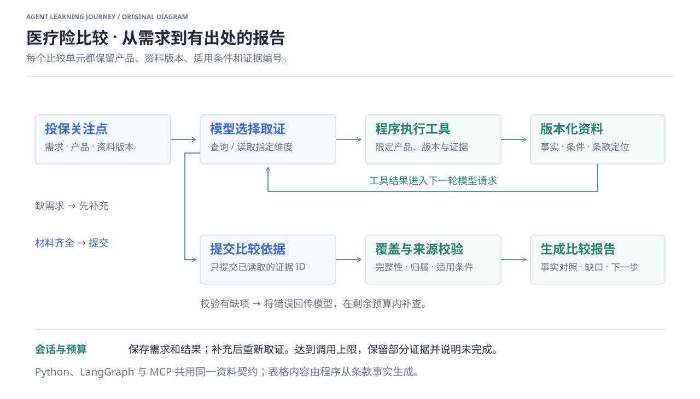
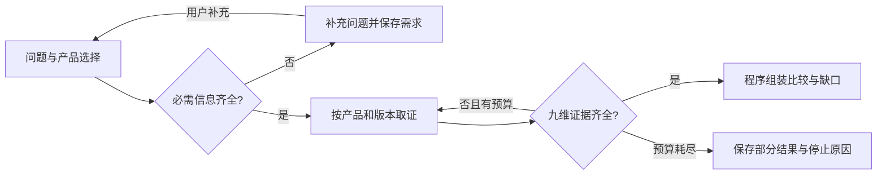
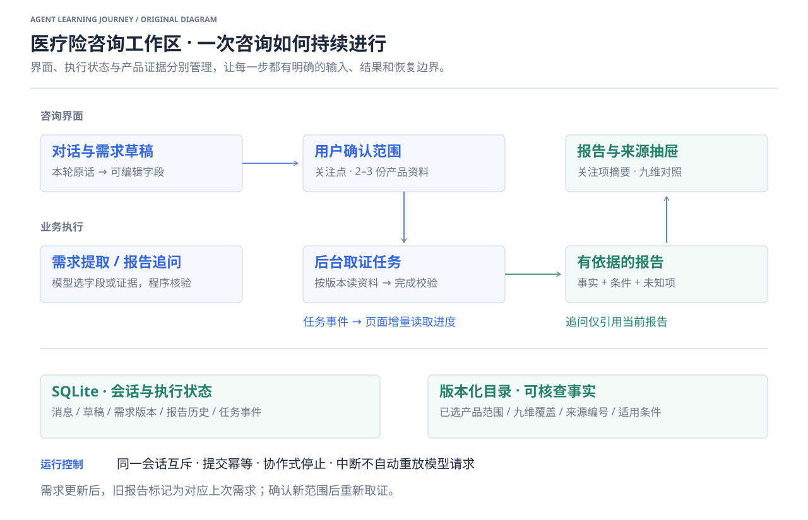

# 第 12 章 · 医疗险资料比较 Agent

[章节目录](../../README.md#章节目录) · [上一章：MCP](../learning/mcp.md) · [项目资料](README.md)

**本章目标**：沿一个投保前的比较任务，解释需求、工具、证据校验、报告和会话怎样协作，并核对资料缺口。

**配套示例**：[同题比较入口](../../examples/insurance_compare.py) · **核心实现**：[业务流程](../../src/agent_learning/insurance/workflow.py)、[模型工具循环](../../src/agent_learning/insurance/agent.py)。

本章综合实战围绕一个投保前的问题展开：**我关心的保障条件，在这几份资料里分别怎样写，哪些内容还不能确定？** 教材机制与开源应用的对应见 [设计参考](references.md)，输入输出规格见 [业务任务书](requirements.md)。

主要教材为 [Hello-Agents 第四章：智能体经典范式构建](https://github.com/datawhalechina/hello-agents/blob/main/docs/chapter4/第四章%20智能体经典范式构建.md) 与 [第八章：记忆与检索](https://github.com/datawhalechina/hello-agents/blob/main/docs/chapter8/第八章%20记忆与检索.md)。本章用自己的保险案例连接工具取证、上下文和证据检查。

基础章节中的消息、工具、循环和引用，在这里分别承担具体工作：保存用户需求、读取选定版本的条款、补齐比较依据、报告差异与缺口。本章先阅读输入和报告，再沿着代码解释它们怎样连接起来。



## 12.1 从普通门诊和续保这个问题开始

示例用户关心普通门诊和续保，年度预算为 2000 元。我们选择两款自拟教学产品：计划 A“住院基础”和计划 B“门诊与住院”。产品标识、版本与关注维度必须明确，才能继续取证。

请求保存在 [insurance_request.json](../../examples/insurance_request.json)：

```json
{
  "question": "比较这两份医疗险资料。我关心普通门诊和续保安排，年度预算2000元；哪些差异有依据，哪些还需要确认？",
  "profile": {
    "focus": ["coverage", "renewal"],
    "annual_budget": 2000,
    "age": 30,
    "social_insurance": "yes"
  },
  "selections": [
    {"product_id": "demo_hospital", "version": "demo-v1"},
    {"product_id": "demo_outpatient", "version": "demo-v1"}
  ]
}
```

这是教学场景，不对应某位投保人的记录。`focus` 告诉程序优先展示哪些维度；年龄、医保和预算作为需求保存，不能凭这些值自行计算保费或承保结果。

九个比较维度是保障、免赔、赔付比例、医院、等待期、续保、免责、保费和健康告知。关注普通门诊，并不意味着其他限制可以从比较中消失。

## 12.2 先看报告应该让人读懂什么

下面按照 [教学目录](../../src/agent_learning/data/insurance_demo.json) 中的事实整理关键差异。产品条件仅用于本课程，完整条件仍需与相应资料一起阅读。

| 关注点 | 计划 A：住院基础 | 计划 B：门诊与住院 |
| --- | --- | --- |
| 普通门诊 | 普通门诊不属于保障；另有约定特殊门诊及同次住院前后门急诊责任 | 包含普通门急诊，年度限额为 1 万元；仍须符合医院和责任条件 |
| 住院医疗 | 与约定的其他医疗责任共用 200 万元年度限额 | 住院年度限额为 100 万元，与普通门急诊限额分别计算 |
| 续保 | 保险期间 1 年，不保证续保；期满重新申请，经审核形成下一年度合同 | 保险期间 1 年，不保证续保；下一年度重新申请并审核 |
| 保费 | 没有报价，不能判断是否符合预算 | 没有报价，不能从门诊责任推算保费或价差 |

保障依据为 `DEMO-HOSP-V1-COVERAGE`、`DEMO-OUT-V1-COVERAGE`；续保依据为对应产品的 `RENEWAL` 条目；保费依据为对应产品的 `PREMIUM` 条目。目录中每个条目同时保存事实、条件与定位；官方目录中的文字是少量概括，不是合同全文。

这个比较回答了三个具体问题：

1. “门诊”不是一个没有条件的统一标签。A 的住院相关门急诊和 B 的普通门急诊不能混写。
2. 两款计划都不保证续保，不能因为 B 多了普通门诊责任，就推断它的续保也更有保障。
3. 年度预算已经记录，但两款计划都没有适用报价，预算匹配仍然未知。

报告保留条件，例如 A 的特殊门诊有明确列举，B 的普通门诊不包含预防性体检、保健和美容。仅比较责任名称或限额，会漏掉这些影响理解的内容。

## 12.3 需求检查把“缺什么”变成下一步

[workflow.py](../../src/agent_learning/insurance/workflow.py) 的 `prepare_request()` 先检查输入，再决定是否可以开始比较。

| 输入情况 | 后续处理 |
| --- | --- |
| 没有关注维度 | 返回 `needs_input`，询问用户想比较什么 |
| 只有一个产品 | 返回 `needs_input`，请用户补充比较对象 |
| 不存在的产品或版本 | 报出选择错误，不自动换用其他版本 |
| 年龄、医保或预算未提供 | 保留未知项；不妨碍阅读已有条款 |
| 关注点明确，选择有效 | 生成任务计划，进入取证 |

注意“暂停”和“错误”的区别：缺少关注点可以通过补充需求继续；一个不存在的版本需要先纠正选择。系统不会为了继续运行而猜一个可用版本。

可以把处理过程画成下面的流程：



当前任务计划由程序根据关注点组织，模型在这个范围内决定怎样搜索、读取和完成比较。要区分“业务步骤的计划”与“每一步具体工具动作的选择”。

## 12.4 后一步为什么需要前一步的结果

同一句“比较医院和续保”，选择不同产品或版本后，应该使用的依据就会改变。计划必须携带已经确定的输入：

| 阶段 | 依赖什么 | 产生什么 |
| --- | --- | --- |
| 确定比较范围 | 用户的关注点、产品和版本 | 本次允许读取的产品集合 |
| 搜索与读取 | 允许范围、当前维度或查询词 | 带条件、来源和证据编号的事实 |
| 补齐其他维度 | 已取得的证据与尚缺维度 | 完整的比较依据，包括未知项 |
| 完成比较 | 本次工具返回的全部必需证据 | 通过校验的报告，或明确错误反馈 |

这与第 6 章销量题的关键区别在于，产品事实并不包含在用户的问题中。模型需要通过工具取得它们，并依据返回的编号继续执行。

证据由 `EvidenceWorkspace` 保存。其 `allowed` 限定产品和版本，`evidence` 保存当前任务取得的事实，`trace` 保存工具操作。它们都是程序状态；模型能使用的部分仍需放入下一次请求。

## 12.5 三个工具怎样分工

[agent.py](../../src/agent_learning/insurance/agent.py) 提供原生工具定义：

| 工具 | 输入 | 返回或作用 |
| --- | --- | --- |
| `search_product_clauses` | 产品、版本、查询词 | 在该版本内检索事实，返回条件与来源 |
| `read_product_clauses` | 产品、版本、维度列表 | 按维度读取完整事实，可一次读取九个维度 |
| `finish_comparison` | 证据编号列表 | 校验本次比较依据，交给程序组装报告 |

搜索和按维度读取都会把结果加入证据工作区。搜索命中未知项也属于正常结果，例如“没有保费报价”本身就是需要保留的证据。

模型回复的 `tool_calls` 由程序解析，工具执行后，以带 `tool_call_id` 的 `tool` 消息回传。普通文字回复不能代替 `finish_comparison`。这延续第 2–3 章的机制，但工具协议由文字 Action 变成原生函数调用结构。

### 从工具轨迹看比较怎样完成

主案例的调用过程如下。每轮模型选择一个工具，程序执行后把证据交给下一轮：

| 模型请求 | 模型选择的工具与对象 | 程序执行结果 |
| --- | --- | --- |
| 第 1 次 | `read_product_clauses`：计划 A 的九个维度 | 返回 9 条事实，包含保费未知项 |
| 第 2 次 | `read_product_clauses`：计划 B 的九个维度 | 再返回 9 条事实 |
| 第 3 次 | `finish_comparison`：提交这 18 个证据编号 | 校验通过，组装九维报告，状态为 `completed_with_gaps` |

这里共请求模型 3 次，执行工具 3 次；完成操作也计入工具次数。模型决定读取什么和何时提交依据，**报告文字与条件由程序从已取得的事实组装**，完成后没有再请求模型撰写总结。年度预算虽然是 2000 元，两份资料都没有报价，报告保留了这一缺口。

完整调用记录见 [主案例记录](runs/insurance-demo.md) 与 [请求、响应 JSON](runs/insurance-demo.json)；结构化比较结果见 [工作流报告](runs/report-demo.json)。

换成官方摘录后，模型采用了不同的取证顺序：

| 模型请求 | 模型选择的工具与对象 | 程序执行结果 |
| --- | --- | --- |
| 第 1 次 | `read_product_clauses`：平安资料快照的九个维度 | 返回该快照的 9 条记录，包括未摘录项 |
| 第 2 次 | `read_product_clauses`：太保资料快照的九个维度 | 返回另一快照的 9 条记录 |
| 第 3 次 | `search_product_clauses`：平安资料的等待期、续保与费率调整条件 | 命中已读过的等待期、续保记录 |
| 第 4 次 | `search_product_clauses`：太保资料的等待期与续保条件 | 命中已读过的等待期、续保及健康告知记录；健康告知仍为未摘录 |
| 第 5 次 | `finish_comparison`：提交 18 个证据编号 | 校验通过，状态仍为 `completed_with_gaps` |

这次共请求模型 5 次，执行工具 5 次。两次搜索都在同一目录内进行，返回了已有记录，不能补上目录尚未摘录的内容。报价仍然未知，也不能据此声称增加调用提升了比较质量。判断检索是否有用，应检查它是否取得新依据或解决了具体疑问。

工具决策见 [官方摘录案例记录](runs/insurance-official.md) 与 [请求摘要、响应 JSON](runs/insurance-official.json)；记录省略重复的条款消息正文，保留原始工具请求和请求哈希。各维度及缺口见 [工作流报告](runs/report-official.json)。这些快照用于核对片段，不表示完整合同内容或当前销售状态。

### 证据齐全不等于每个答案都已知

两款产品、九个维度，当前教学目录共需要十八条事实。保费条目虽然标为 `unknown`，仍然必须进入完成时的证据集合。

`finish()` 的关键检查如下，摘自 [workflow.py](../../src/agent_learning/insurance/workflow.py)：

```python
if set(evidence_ids) - self.evidence.keys():
    raise ValueError("不能引用本次工具没有返回的证据。")
required = {fact["evidence_id"] for item in self.state["request"]["selections"]
            for dimension in self.state["dimensions"]
            for fact in self.catalog.facts(item["product_id"], item["version"], dimension)}
missing = required - set(evidence_ids)
```

程序既检查“引用是否取得过”，也检查“是否遗漏必需维度”。如果只保留有利的保障事实，漏掉未知保费或责任限制，就不能完成比较。

## 12.6 比较表由事实组成

在 [catalog.py](../../src/agent_learning/insurance/catalog.py) 中，一条事实带有以下信息：

| 字段 | 作用 |
| --- | --- |
| `product_id`、`version` | 说明事实属于哪份产品资料 |
| `dimension` | 说明事实用于比较哪一项 |
| `status` | 区分 `known`、`unknown` 与 `conflict` |
| `text`、`conditions` | 保留资料内容及其适用条件 |
| `evidence_id`、`locator`、`source` | 支持逐条回查来源 |

报告单元的文字与条件从这些字段组装，模型不能直接提交一段新的产品属性来替换它。这样，读取动作的选择和保险事实的呈现承担不同职责。

固定资料流程会按顺序读取两款产品的九个维度，再调用同一份完成校验。它可以用来检查比较表和来源绑定；模型流程则用于观察取证选择、工具参数及错误反馈。两条路径共享目录和输出规则。

完成报告会同时给出 `rows`、`sources`、`gaps` 和 `next_steps`。对于本例，保费未知会进入缺口，填写预算不会让缺失报价自动出现。

| 流程状态 | 阅读方法 |
| --- | --- |
| `needs_input` | 先回答补充问题 |
| `completed_with_gaps` | 资料比较完成，但还有明示的未知事项 |
| `completed` | 本次已读取资料没有触发缺口标记；仍须阅读适用条件 |
| `call_limit` / `tool_limit` | 对应预算耗尽，查看部分结果与停止原因 |
| `model_error` | 模型请求或返回不完整，不能视为完成 |

这些状态描述流程，不是当前在售、预算可接受或可以承保的判断。

## 12.7 把一次比较接成持续咨询

输入完整 JSON 可以研究取证循环，但面对用户时，需求通常从一句话开始：

> 我30岁，有医保，年预算2000元，主要关注普通门诊和续保，想比较两份医疗险资料。

网页先整理一张可编辑的需求卡，再由用户选择两到三份产品资料，点击“确认需求并开始查证”。模型提出的是草稿；用户确认后的需求版本才限定后续比较范围。



### 草稿、确认与报告是三种不同状态

[conversation.py](../../src/agent_learning/insurance/conversation.py) 的 `propose_needs()` 让模型通过工具提交年龄、预算、医保和关注点，每个字段附本轮用户原话。程序检查原话是否存在，数值是否对应，再保存 `proposal`。产品与版本不会由这个工具替用户选择。

原话检查可以挡住部分无依据填充，却不能证明模型对意思的理解始终正确。例如一句话里同时出现自己和父母的年龄，仍需用户在需求卡中确认本次被保险人。资料模式使用有限的关键词规则；模型辅助模式才调用模型提取，两者都需要确认。

| 内容 | 何时变化 | 用来做什么 |
| --- | --- | --- |
| 消息 `messages` | 每次描述或追问 | 保留咨询过程 |
| 草稿 `proposal` | 解析新需求后 | 等待用户核对，可继续补充 |
| 已确认需求 `request` 与 `brief_version` | 用户确认需求卡后 | 固定本次关注点、产品和版本 |
| 任务 `run` | 提交、执行、取消或结束时 | 展示实际进度与停止原因 |
| 报告 `result` 与 `revision` | 保存新一轮结果后 | 展示证据、差异和缺口 |

用户补充“我还在意医院范围”时，草稿增加 `hospital`。确认新需求后，旧报告会标为“对应上次需求”；重新取证完成后，新结果成为当前报告，旧结果进入历史。关注点影响顺序，但九个维度的条件和未知项都保留。

### 报告出来后，追问怎样使用证据

例如追问“普通门诊保障有什么区别？这些资料能否说明2000元预算够不够？”：[answer_report()](../../src/agent_learning/insurance/conversation.py) 把当前报告的来源交给模型选择相关编号，程序再用这些编号对应的原有事实与条件组织回答。

门诊的差异可以核对；两款产品均无报价，预算够不够仍然无法确定。这个过程中不重新搜索其他产品，也不让模型补写新的条款。改变需求或产品之后，应先重新查证；历史报告可回看，追问只针对当前未过期的报告。

配套 [完整咨询示例](../../examples/insurance_consultation.py) 展示描述需求、明确确认产品、比较和追问四个阶段。它用临时会话保存过程，其中产品确认是脚本明确模拟的用户动作，不能解读成模型自主决定投保对象。实际输出与调用记录见 [咨询实验](runs/README.md)。

### 页面离开之后，任务和报告怎样保存

[runs.py](../../src/agent_learning/insurance/runs.py) 管理后台任务；页面按序号读取已经发生的事件，不用固定计时动画假装进度。[store.py](../../src/agent_learning/insurance/store.py) 用 SQLite 保存会话、任务、当前报告和最多五份历史报告。刷新页面可以恢复查看；服务退出后未完成的任务标为中断，不自动重放付费请求。

同一会话同时只能执行一个任务，重复提交相同请求编号会返回原任务。点击停止后，程序在下一次模型请求或工具执行前检查取消状态；已经发送的网络请求可能仍要等待返回。补充需求后重新取证与中断后精确续步是两种能力，本项目目前实现前者。分层与恢复边界详见 [架构设计](architecture.md)。

## 12.8 和基础课程怎样衔接

| 基础章节 | 在保险任务里观察什么 | 练习重点 |
| --- | --- | --- |
| 01–03 模型、工具、循环 | 原生工具请求、执行结果回传、预算停止 | 找出结果进入 `tool` 消息的位置 |
| 04 检索与引用 | 已选产品版本、本次证据集合、完成校验 | 尝试引用另一产品的编号，解释为什么被拒绝 |
| 05 状态与上下文 | 需求、证据工作区、请求消息、会话历史 | 区分保存过与本次模型收到过 |
| 06 Plan-and-Solve | 需求先于取证、取证先于比较的依赖 | 画出业务计划，再标出模型选择的工具动作 |
| 07 Reflection | 对照条款检查比较表述与条件 | 用具体反馈修订一段过度结论；本版表格事实由程序保留 |
| 08–09 RAG 与评估 | 范围受限的检索、缺口、逐条证据核查 | 分开检查资料覆盖、引用范围和内容支持 |
| 10–11 LangGraph 与 MCP | 用状态转移或独立工具服务承接同一业务 | 先理解本地调用链，再检查适配是否保持相同事实 |

第 6 章的模型规划器、第 7 章的评审修订循环是独立的基础练习。保险首版采用程序任务计划、模型工具循环和确定性证据校验；阅读时应看清这些机制的实际组合，而不是把所有章节名称当成已叠加的功能。

在 [integrations.py](../../src/agent_learning/insurance/integrations.py) 中，LangGraph 将流程表示为需求检查、取证、证据校验和交付节点，缺少需求时转到澄清分支。它复用现有比较器，并未将每次模型调用拆成图节点，也未增加检查点续步。

MCP 适配将搜索和读取放到独立进程，通过协议返回证据；选择范围、证据工作区与完成校验仍留在本次任务中。可以比较这两种变化：LangGraph 改变流程的组织方式，MCP 改变工具的调用边界，两者都不应该改变同一条款的内容。

## 12.9 动手与验收

先阅读输入与结果，再改一个条件。网页与 [CLI](../../src/agent_learning/insurance/cli.py) 共用业务服务；配套入口不改变产品资料与判断规则。

**练习一：需要先问什么？** 将 `focus` 改为空列表，保留两款产品。预测返回什么、是否应该开始读取产品。然后补回 `coverage`，说明哪些输入可以沿用。

<details>
<summary>参考解析</summary>

应返回 `needs_input` 并询问关注维度，不创建模型比较任务。产品、预算等已有需求可以保留；补齐关注点后，用完整的新请求重新取证。

</details>

**练习二：读取重点就够了吗？** 已经得到两款产品的保障与续保四条证据，能否提交完成？给出缺少的维度及理由。

<details>
<summary>参考解析</summary>

还缺免赔额、赔付比例、医院、等待期、免责、保费和健康告知。`focus` 决定重点，不缩小九维完成条件；未知保费也是要提交的事实，不能因为没有数值就省略。

</details>

**练习三：不同优势怎样核对？** 改为比较计划 A 与计划 C，关注医院和续保。分别找出医院范围与续保条件，解释为何不能只根据续保期间长短给出整体排名。

<details>
<summary>参考解析</summary>

教学目录中，A 的医院范围为二级及以上公立医院普通部，C 为三级公立医院普通部。C 的首个保证续保期间为六年，但交费、期间总限额与下一期间审核等条件仍须保留，费率也不保证固定。用户常去的医院和对续保条件的关注需要分别核对，不能把一个维度替代全部需求。

</details>

**练习四：未知报价会随预算改变吗？** 将年度预算由 2000 改为 5000，再查看保费与缺口。说明新增了什么信息，什么信息仍未取得。

<details>
<summary>参考解析</summary>

增加的是用户愿意承担的年度预算，没有增加保险方报价。当前目录无法据此判断任一产品是否符合预算，也不能推算两款产品的价差。

</details>

完成练习时，提交一份输入变化表、对应状态、关键证据编号和缺口说明。只截图“运行完成”不能证明需求、条件和依据都处理正确。

---

教材出处与开源设计借鉴见 [资料与设计参考](references.md)。本文采用 [CC BY-NC-SA 4.0](../../LICENSES/CC-BY-NC-SA-4.0.txt)。
