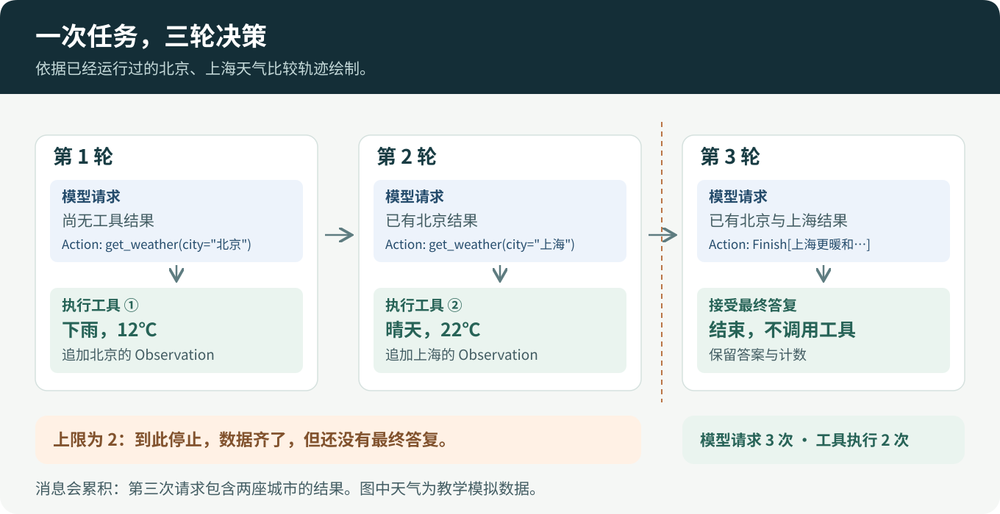

# 第 3 章 · Agent Loop 与停止条件

[章节目录](../../README.md#章节目录) · [上一章：工具结果回传](tool-feedback.md) · [下一章：检索与引用](retrieval-and-citations.md)

本章参考 [Hello-Agents 第四章 §4.2，重点 §4.2.3](https://github.com/datawhalechina/hello-agents/blob/main/docs/chapter4/第四章%20智能体经典范式构建.md)。本项目沿用行动与反馈交替的思路，省略 Thought 长文本；请求计数与 `step_limit` 状态是自己的实现约定。

## 3.1 从固定回传到多轮决策

上一章的程序预先安排了两次请求：第一次取得工具请求，第二次组织回答。

现在的任务是：“分别查询北京和上海的模拟天气，再比较哪里更暖和。”

模型第一次可能只查北京。拿到结果之后，还需要查上海；取得两地数据后，才具备比较的依据。程序需要允许模型继续提出行动，而不是固定在第二次请求后结束。

Agent Loop 在本项目中做的是：**把当前消息交给模型，执行它提出的操作，再把结果带入下一次请求**。是否继续调用工具由模型提出，格式是否有效、是否还能继续请求由程序控制。



图 3-1 根据本项目控制逻辑与已有天气轨迹原创绘制。蓝色表示模型请求，绿色表示工具回传与正常结束，橙色表示预算耗尽；下方对照三次模型请求与两次工具执行。

## 3.2 循环里的核心代码

下面是 [loop.py](../../src/agent_learning/loop.py) 的主路径节选，保留天气任务用到的消息、Finish 和预算逻辑，省略打印以及研究助手的引用校验分支。片段位于 `run_agent` 函数内部；`ask_model`、`tool_executor` 分别负责请求模型与执行允许的工具。

```python
messages = [
    {"role": "system", "content": system_prompt},
    {"role": "user", "content": question},
]
tool_calls = 0

for step in range(1, max_steps + 1):
    action = ask_model(client, model, messages, options)
    messages.append({"role": "assistant", "content": action})

    finish = re.fullmatch(r"Action:\s*Finish\[(.+)\]", action, re.DOTALL)
    if finish and finish.group(1).strip():
        answer = finish.group(1).strip()
        return {
            "status": "finished",
            "answer": answer,
            "steps": step,
            "tool_calls": tool_calls,
        }

    result = tool_executor(action)
    if not result.startswith("错误："):
        tool_calls += 1
    messages.append({"role": "user", "content": f"Observation: {result}"})

return {
    "status": "step_limit",
    "answer": None,
    "steps": max_steps,
    "tool_calls": tool_calls,
}
```

这里有四个关键位置：

| 代码 | 它解决的问题 |
| --- | --- |
| `for step in range(1, max_steps + 1)` | 限制模型请求总次数 |
| 保存 assistant 消息 | 留下模型刚才提出的行动 |
| 检查 Finish 并返回 | 将被接受的最终答复转为程序结束状态 |
| 执行工具，再保存 Observation | 给下一轮决策增加实际结果 |

`Finish` 是我们约定的一种文字结束信号。程序需要识别它，才会停止循环；仅在普通文字里写“我回答完了”，并不符合这个实现的结束协议。

错误反馈也会进入消息，让下一次请求有机会修正。但每次修正仍消耗一次模型请求预算，不会获得无限重试。

## 3.3 已有结果：北京、上海各查一次，再比较

下面是已经实际运行过的完整关键轨迹，天气为模拟数据：

```text
问题：分别查询北京和上海的模拟天气，再比较哪里更暖和。

[第 1 轮] Action: get_weather(city="北京")
Observation: 下雨，12℃

[第 2 轮] Action: get_weather(city="上海")
Observation: 晴天，22℃

[第 3 轮] Action: Finish[上海更暖和（22℃ vs 北京12℃），数据为模拟天气。]

任务结束：上海更暖和（22℃ vs 北京12℃），数据为模拟天气。
模型请求 3 次；工具执行 2 次。
```

第一轮结束后，消息中增加了“查北京”的 Action 与“12℃”的 Observation。第二轮是在这些信息基础上进行的，模型提出查上海。

第二轮结束后，消息又增加了“查上海”的 Action 与“22℃”的 Observation。第三次请求因此可以同时接收两座城市的结果，输出比较答案。

| 轮次 | 这次请求新增可见的反馈 | 模型输出 | 随后的程序行为 |
| --- | --- | --- | --- |
| 第 1 轮 | 尚无工具结果 | 查询北京 | 执行天气函数并保存 12℃ |
| 第 2 轮 | 北京的结果 | 查询上海 | 执行天气函数并保存 22℃ |
| 第 3 轮 | 上海的结果，且北京结果仍在消息中 | Finish 与比较结论 | 接受答案，结束循环 |

**第三轮虽然没有调用工具，但仍请求了模型。** 比较结论需要模型生成，所以是 3 次模型请求、2 次工具执行。这是该次实际轨迹的计数，其他模型运行的动作顺序或次数可能变化。

## 3.4 已有对照结果：上限改为 2

同一个问题，已有运行将 `max_steps` 改成了 2：

```text
[第 1 轮] Action: get_weather(city="北京")
Observation: 下雨，12℃

[第 2 轮] Action: get_weather(city="上海")
Observation: 晴天，22℃

达到 2 轮上限，任务未完成。
模型请求 2 次；工具执行 2 次。
```

两条天气数据已经存在消息列表里，但程序不能再发起第三次请求，因而没有收到有效 Finish。

这说明“拿到完成任务所需的数据”与“取得最终答复”是两个阶段。当前程序不会在预算外补一次请求强行总结，而是保留未完成状态。

## 3.5 两种停止状态分别说明什么

| 状态 | 本项目中的含义 | 不能据此推出的结论 |
| --- | --- | --- |
| `finished` | 有效最终答复被程序接受 | 答案一定正确，或原始问题一定被解决 |
| `step_limit` | 在请求上限内没有取得有效最终答复 | 已经查过资料，所以任务其实已完成 |

下一章的研究助手可以用“资料不足”作为最终答复。这种答复能符合流程规则，但原始知识问题仍未得到解答。

因此，程序结束状态与内容质量需要分别判断。它们分别回答“流程有没有被接受的结束结果”和“这个结果是否解决了问题”。

## 3.6 从循环自然引出上下文

`messages`、`step`、`max_steps`、`tool_calls` 都在程序中，但默认模式只把原有消息列表作为显式消息输入传给模型。

这意味着程序知道请求上限和当前轮数，模型却没有收到专门描述剩余预算的动态消息。理解这个区别，就找到了后续“状态与上下文”章节的起点：**程序保存了什么，模型实际看到了什么。**

后续带学已为天气示例增加可选的 `--budget-context` 开关，用于对照“把剩余预算加入消息”的情况。本章已有天气轨迹来自默认模式；三次开关与上限实验的真实结果见 [第 5 章](state-and-context.md)。

本章建立有限工具循环，Plan-and-Solve 与 Reflection 分别在第 06、07 章展开。下一章先复用现有循环，把天气工具替换为资料检索工具。

## 3.8 动手与自查

将天气循环上限设为 2，再设为 3，对照结束状态。假设第一轮输出一个不能识别的 Action，第二轮才正确查询北京：此时模型请求与工具执行各有几次？若最后一次请求发出工具查询并拿到结果，程序还能自动多请求一次总结吗？

<details>
<summary>参考答案</summary>

前两轮共两次模型请求，只有一次实际工具执行。格式错误反馈也会加入上下文，纠正仍消耗调用预算。上限耗尽后不会补发总结请求，返回 `step_limit` 与空答案；工具结果已经存在于程序中，不表示后续模型收到过它。正常两地查询还需要一次模型请求给出 Finish。

</details>

**配套代码**：[循环实现](../../src/agent_learning/loop.py)、[天气任务](../../src/agent_learning/agents/weather.py)。完整研究助手架构另见 [附录](../architecture.md)。

---

本章结合 Hello-Agents 与本项目代码、已有实验重新整理，非教材原文；正文采用 [CC BY-NC-SA 4.0](../../LICENSES/CC-BY-NC-SA-4.0.txt)。图 3-1 为本项目原创图。
