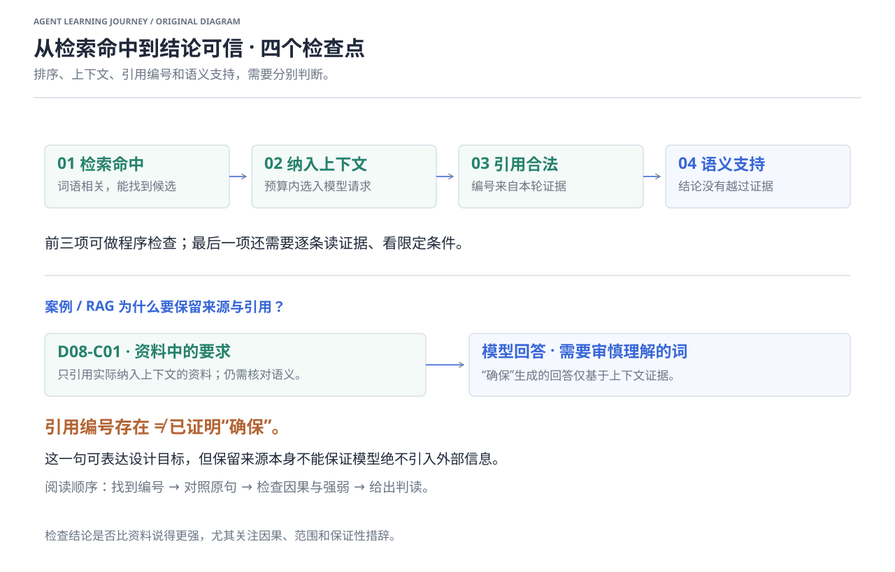

# 第 9 章 · Agent 评估：把能力拆开测

[章节目录](../../README.md#章节目录) · [上一章：RAG](rag.md) · [下一章：LangGraph](langgraph.md)

**本章目标：** 分别检查检索覆盖、排名、引用结构与内容支持，解释各项指标能说明什么及其局限。

**配套示例：** [检索与引用评估](../../examples/evaluate.py) · **核心实现：** [指标计算与逐题报告](../../src/agent_learning/evaluation.py)

主要参考 [Hello-Agents 第十二章 §12.1](https://github.com/datawhalechina/hello-agents/blob/main/docs/chapter12/第十二章%20智能体性能评估.md)。本章围绕课程研究助手，分别评估检索覆盖、排名、引用结构和回答质量，并用失败样本寻找改进方向。

## 9.1 一次成功不能替代评估

“这次回答正确”说明这个输入的一次结果可以接受。修改提示词、模型、知识库或分块参数后，需要在相同题目上重新检查，才能讨论变化。

三类证据分别说明不同问题：

| 验证方式 | 本项目例子 | 能说明什么 | 不能说明什么 |
| --- | --- | --- | --- |
| 程序测试 | 用固定回复检查错误编号被拒绝 | 该输入下的程序行为符合规则 | 模型面对其他输入时会怎样回答 |
| 检索开发集 | 实际运行 BM25 排名 | 指定语料与题目的资料覆盖、名次 | 生成答案是否正确 |
| 回答评估 | 保存模型回答并逐条核对 | 指定模型、参数与样本的表现 | 所有题目都同样可靠 |

离线摘录没有生成结论，因此报告中的 `semantic_answer_accuracy` 为 `null`。它不是 0 分，也不是 100 分，而是本次没有评估这一项。

评估时先明确要诊断哪个环节，再选指标。不能因为一个分数容易计算，就让它代表整套系统：

| 要检查的问题 | 观察什么 | 高分仍可能遗漏什么 |
| --- | --- | --- |
| 需要的资料是否被找到 | Recall@k | 找到的资料可能没有进入证据预算 |
| 第一份相关资料是否靠前 | MRR@k | 多资料问题可能只找到其中一份 |
| 回答是否只引用本次证据 | 引用合法率 | 合法编号对应的文字可能不支持结论 |
| 每条输出是否附有合法引用 | 逐条结论引用覆盖率 | 可能遗漏问题要求，也可能每条都引用错误的事实依据 |
| 引用能否支持所说的内容 | 人工逐条语义核对 | 需要再看问题是否完整回答、资料是否适用于当前场景 |
| 缺资料时能否说明边界 | 无答案题的状态与缺失说明 | 不能通过拒答所有问题来取得有用的整体表现 |

本项目的检索指标计算对象是 `retrieved`，引用范围检查对象是 `evidence`。若预算裁掉了相关块，即使检索 Recall 很高，模型也可能没有足够信息。报告应同时保留这两个列表，才能找准失败发生的位置。

## 9.2 固定题与标注

[eval_cases.json](../../src/agent_learning/data/eval_cases.json) 包含 14 道题：12 道有相关资料、2 道当前语料无法回答。每题保留编号、问题和相关文档编号，完整题面可直接阅读文件。

```json
{
  "id": "E06",
  "question": "BM25 和 Embedding 向量检索有什么区别？",
  "relevant_doc_ids": ["D06", "D07"]
}
```

D06 讲 BM25，D07 讲 Embedding；只找到其中一篇就没有完整覆盖这道题的既定标注。标注写在独立数据文件中，不能根据运行返回了什么再自动生成“标准答案”。资料可能存在部分重叠：例如 D10 也谈关键词与向量检索，但没有 D06 的 BM25 机制说明。Recall 衡量的是对既定标注的覆盖，答案究竟能解释到什么程度，仍需阅读实际证据。

这仍是与语料一起设计的小型开发集，表述较直接，不是盲测。真正比较泛化能力，还应另收集未用于调参的问题、同义问法、多主题问题及没有答案的样本，人工复核标注后冻结测试集。

## 9.3 Recall@k 与 MRR@k

本项目的 `k` 指返回的资料块数。Recall 按相关**文档**去重计数，避免同一文档多个块重复增加覆盖。

```text
Recall@k = 前 k 个资料块覆盖的相关文档数 / 标注的相关文档总数
```

如果 E06 需要 D06、D07，返回 D07、D10、D11，则 Recall@3 = 1/2。

MRR 关注首个相关结果的位置。某题首个相关块排第 r，则该题的倒数名次为 1/r；前 k 中没有相关块记 0。对有答案题取平均：

```text
MRR@k = 所有有答案题的首个相关块倒数名次的平均值
```

上例 D07 排第一，倒数名次为 1。它并不关心第二篇所需资料 D06 是否出现，所以 MRR 很高时 Recall 仍可能不足。两项指标回答不同的问题。

实际实现位于 [evaluation.py](../../src/agent_learning/evaluation.py)，核心为：

```python
recall = len(expected & found) / len(expected)
reciprocal_rank = next((1 / rank for rank, item in enumerate(results, 1)
                        if item["doc_id"] in expected), 0.0)
```

无答案题的相关集合为空，不能用这个 Recall 公式除以零。本项目单独统计它们有多少返回空结果；这只衡量检索器能否不返回候选，不等同于生成模型的拒答正确率。

## 9.4 用失败样本理解分数

执行 `python -m examples.evaluate --k 3`，检查默认检索配置：14 个块，窗口 180 字符、重叠 30，BM25 `k1=1.5`、`b=0.75`。

| 指标 | 结果 | 分母与解释 |
| --- | ---: | --- |
| 平均 Recall@3 | 0.9583 | 12 道有答案题 |
| MRR@3 | 1.0000 | 12 道题的首个相关块均排第一 |
| 无答案题空结果比例 | 0.5000 | 2 道中仅 1 道没有候选 |

逐题结果、语料指纹和索引参数见 [评估记录](../runs/2026-11-19/rag-evaluation.json)。从下面两道题，可以看出总分隐藏了什么：

| 题目 | 实际返回 | 解释 |
| --- | --- | --- |
| E06：BM25 与 Embedding 的区别 | D07、D10、D11 | 找到向量解释，却漏了标注的 D06，Recall 为 0.5 |
| E14：RAG 服务每月收费多少钱 | D05、D08 | 语料没有价格，但主题词重合仍产生候选 |

第一种可以尝试增加召回、调整分词或混合检索，再检查它对其他题的影响。第二种说明检索器不能单凭词重合判断资料是否回答问题。把阈值调高可能减少无关结果，也可能拒绝本来有用的资料，需要同时观察有答案题和无答案题。

E14 的失败发生在“筛出可回答资料”这一步，并不意味着后续模型必然编造价格。正确的后续行为仍可以是：读过候选，发现只有 RAG 原理与引用要求，说明缺少具体服务、计费标准等信息。相反，检索返回空列表也不能证明整个系统会正确处理无答案题；还要检查程序是否直接停止、是否把空结果如实告诉用户。

## 9.5 引用合法率和逐条结论覆盖

引用检查从“已实际纳入请求的证据”出发，而不是允许知识库里所有编号。

```text
引用合法率 = 合法引用项数 / 全部引用项数
逐条结论引用覆盖率 = 引用了至少一个编号且所有编号都合法的结论数 / 全部结论数
```

引用项在每条结论内部去重，并包括正文方括号中出现的编号。同一编号被不同结论引用，各算一项。逐条覆盖还要求正文编号都列入该条 `citations`，否则来源表会遗漏正文引用。没有任何引用时，合法率记 `null`；没有结论时，覆盖率记 `null`，避免把没有输出误判成完美覆盖。

用一个计算例子区分两项指标：第一条结论引用一个合法编号和一个未返回编号，第二条只引用合法编号，第三条没有引用。三个引用项中两个合法，所以合法率为 2/3；三条结论中只有第二条的引用完整合法，所以逐条覆盖率为 1/3。

即使两项都是 1，仍可能出现结论与资料无关、遗漏限定条件或张冠李戴。程序明确输出 `semantic_support=not_evaluated`，语义支持需另行评分。

人工核对时，可以按一条结论一行记录，先给判断，再写依据：

| 判断 | 如何判定 | 该怎样处理 |
| --- | --- | --- |
| 支持 | 引用资料明确陈述或能够直接推出该结论，限定条件一致 | 保留结论，并记下对应证据句 |
| 部分支持 | 一句话包含多项主张，证据只支持其中一些 | 拆成可单独核验的结论；删去或另证未支持部分 |
| 不支持 | 资料没有该事实，或者结论与资料相反 | 不因编号合法而放行，记录具体缺口 |

“根据资料没有查到价格”与“这项服务免费”需要的证据不同。前者是在报告当前证据的范围；后者声称一个价格事实，必须有计费资料。因此，合理说明缺失信息与回答出收费金额应分别记录。



## 9.6 逐条检查回答

现在把上述指标用于第 8 章的两个问题。E07 得到 3 条带引用的结论，E14 说明缺少计费信息。读取请求中的证据和返回的结论后，引用检查得到：

| 检查项 | 结果 | 解释 |
| --- | --- | --- |
| 当前两例状态 | `answered` 1；`insufficient_evidence` 1 | 两种状态各说明不同任务结果 |
| E07 已接受结论的引用合法率 | 3/3 = 1.0000 | 三个编号均在实际证据中 |
| E07 逐条结论引用覆盖率 | 3/3 = 1.0000 | 三条结论均带合法引用 |
| E14 引用合法率 / 覆盖率 | `null` / `null` | 无引用、无结论，不能算满分 |

引用结构满分仍不代表语义完全通过。E07 第一条使用“确保生成的回答仅基于实际纳入上下文的证据”，D08 支持引用范围要求和核查用途，却不提供效果保证；这条应收紧为设计目标。其余两条对数据准备和摘要保留来源的概括有相应依据。E14 的缺失说明符合资料范围，但并未回答具体月费。

这两例分别展示有依据回答和资料不足。要比较模型或提示词，还需扩大问题范围，并在相同题目上重复采样。模型配置、调用用量、审阅方法和各次输出集中保存在 [评估报告](../runs/2026-11-19/rag-evaluation.md)，逐条数据见 [JSON 记录](../runs/2026-11-19/rag-evaluation.json)。

增加评估样本时，按下面的格式整理回答记录：

```json
[
  {
    "case_id": "E07",
    "evidence_ids": ["D08-C01", "D05-C01"],
    "claims": [
      {"text": "资料块需要保留出处供核查。", "citations": ["D08-C01"]}
    ]
  }
]
```

`evidence_ids` 取自发送给模型的证据列表。若把候选全集填进去，会把模型没有收到的资料也计为合法引用，导致指标偏高。

```bash
python -m examples.evaluate --k 3 --output outputs/retrieval-evaluation.json
python -m examples.evaluate --predictions outputs/predictions.json --output outputs/full-evaluation.json
```

第二条命令评价已保存的回答记录。比较版本时，固定题目和知识库，并在记录中保存模型、提示词、代码版本和用量等实验条件。

这个输入接口只检查 `case_id`、`evidence_ids`、`claims`。运行状态需要另行统计：对 `invalid_answer` 记录拒绝原因，对 `insufficient_evidence` 检查缺失说明。这样，零结论既不会被算成引用满分，也不会让格式错误和合理拒答混在一起。

人工评分可逐条使用下表，不把全部要求压成一个含义不清的“成功率”：

| 维度 | 通过条件 |
| --- | --- |
| 事实支持 | 每条关键结论能够被其引用资料直接支持 |
| 问题覆盖 | 回答覆盖题目要求，必要限定条件没有遗漏 |
| 资料不足处理 | 缺少信息时指出缺什么，而不是编造或把未命中说成教材没有 |
| 来源准确 | 编号、原文位置、链接与实际证据一致 |
| 执行约束 | 请求上限、停止状态、工具次数与日志一致 |

## 9.7 练习、参考答案与验收

1. E06 的 MRR 为 1，为什么 Recall 只有 0.5？**答案：**首个相关块位于第一名，但两篇标注资料只覆盖一篇。
2. 将 `--k 3` 改为 `--k 1`，哪些分数可能变化？**答案：**Recall 可能下降；如果首个相关项原本就排第一，MRR 不变；无答案题仍可能有结果。需要实际运行后报告数值。
3. 系统没有输出任何结论，能否称为引用覆盖 100%？**答案：**不能，当前实现返回 `null`，且任务完成情况应另行判定。
4. 为“更换 embedding 模型后能否沿用旧向量”写一道新测试题。**验收：**先人工标注相关资料，再运行；不得直接把返回文档作为 gold。
5. E07 的引用合法率和覆盖率都是 1，能否宣布答案完全可靠？**答案：**不能，实际第一条的“确保”仍需要限定；结构指标没有计算证据与结论的语义支持。

完成本章应能解释分母、未命中的处理与数据来源，给出一个失败样本，并把程序测试、检索指标、模型回答质量分开报告。完整项目验收见 [评估附录](../evaluation.md)。

---

正文与教学评估数据采用 [CC BY-NC-SA 4.0](../../LICENSES/CC-BY-NC-SA-4.0.txt)。题目、指标实现和运行结果为本项目编排，非教材原题或官方基准分数。
