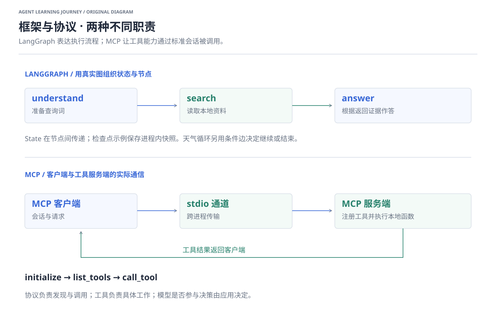

# 第 10 章 · LangGraph 与调用链

[章节目录](../../README.md#章节目录) · [上一章：评估](evaluation.md) · [下一章：MCP](mcp.md)

本章以 [Hello-Agents 第六章 §6.5.1–6.5.3](https://github.com/datawhalechina/hello-agents/blob/main/docs/chapter6/第六章%20框架开发实践.md) 为主线：先做“理解、搜索、回答”三步图，再把已有天气循环映射为节点与条件边。三步图将教材中的外部搜索改成本地教学摘要；循环迁移和进程内快照是本项目扩展。第七章只沿实际调用链选读，见 [源码阅读练习](../practice/source-reading.md)。

## 10.1 图组织的是执行过程

之前的 `for` 循环已经完成了模型请求、工具执行和停止判断。引入 LangGraph 后，这些责任仍然存在，只是被显式表达为状态、节点和边。LangGraph 不替我们判断资料是否支持结论，也不自动把状态中的所有字段发送给模型。

| 图中的概念 | 本项目具体含义 | 容易混淆的地方 |
| --- | --- | --- |
| State | 问题、检索词、资料、答案、执行轨迹 | 程序状态不等于模型输入 |
| Node | 做一次明确工作的 Python 函数 | 节点可以完全不调用模型 |
| Edge | 下一步执行哪个节点 | 普通边固定跳转，条件边读取状态后选择 |
| compile | 将定义检查、组装成可运行图 | 不会在编译时完成问答 |
| invoke | 给图输入并运行 | 才会实际执行节点 |



本图是按项目实现原创绘制的。上半部分对应本章的状态与节点；协议部分将在下一章展开。

## 10.2 三步问答：每一步返回更新字段

[完整实现](../../src/agent_learning/integrations/langgraph_workflow.py) 定义了以下状态：

```python
class QuestionState(TypedDict, total=False):
    question: str
    query: str
    notes: list
    answer: str
    trace: list[str]
```

`TypedDict` 描述字典的字段形状，帮助阅读和类型检查；它不是问题内容正确性的校验器。`total=False` 允许字段随节点执行逐步补齐。

三个节点的分工如下：

| 节点 | 读取 | 写入 | 离线默认模式 |
| --- | --- | --- | --- |
| understand | question | query、trace | 清理问题两端空白，直接作为检索词 |
| search | query | notes、trace | 调用现有 `search_notes` 读取本地摘要 |
| answer | question、notes | answer、trace | 摘录命中内容并附上资料编号 |

把一次执行展开，会更容易看清“状态在变化”是什么意思。下面是默认问题的字段变化示意；省略了摘要正文，不是完整日志：

| 执行位置 | 新增或更新的字段 | 仍然保留的内容 |
| --- | --- | --- |
| 输入图时 | question、空 trace | 原问题 |
| understand 后 | query、`["understand"]` | question |
| search 后 | notes 包含 N02、增加 search 轨迹 | question、query |
| answer 后 | answer、增加 answer 轨迹 | 原问题、检索词、检索证据 |

`search` 不需要重复返回原问题。图会把它返回的字段更新合入已有状态；未返回的字段继续保留。因此节点既不需要复制整个字典，也不能假定返回值已经包含所有状态。

例如搜索节点只返回自己的更新，不改写其他字段：

```python
def search(state):
    notes = search_notes(state["query"])
    return {"notes": notes, "trace": [*state["trace"], "search"]}
```

这里每次显式构造完整的 `trace` 新列表。本例没有设置列表追加 reducer，因此节点返回某字段时，使用的是替换语义。如果只返回 `["search"]`，先前的 `understand` 记录就会丢失。不同项目也可用 reducer 表达合并规则，但不能混用两种思路而导致重复追加。

图的连接来自实际代码：

```python
graph = StateGraph(QuestionState)
graph.add_node("understand", understand)
graph.add_node("search", search)
graph.add_node("answer", answer)
graph.add_edge(START, "understand")
graph.add_edge("understand", "search")
graph.add_edge("search", "answer")
graph.add_edge("answer", END)
app = graph.compile()
```

节点名是图中的标识，函数才执行工作。`START` 与 `END` 是流程入口和终点，不是模型角色。接口语义补充参考 [LangGraph Graph API 官方文档](https://docs.langchain.com/oss/python/langgraph/graph-api)。

## 10.3 真实模型怎样走完三步图

2026-11-19，助教在 Python 3.12、LangGraph 1.2.23 环境中使用 `qwen / qwen-plus` 运行了 `--live --checkpoint`。实际调用模型 2 次，服务商报告共 349 tokens。下面直接保留程序输出和模型原话；[完整运行记录](../runs/2026-11-19/langgraph-checkpoint.md) 与 [逐次请求、响应 JSON](../runs/2026-11-19/langgraph-checkpoint.json) 可核对每次输入。

```text
真实模型模式：qwen / qwen-plus
节点：understand -> search -> answer
检索词：Action 由 Agent 产生，Observation 由 Environment 产生。
资料：N02
回答：根据资料 [N02]：

- **Action** 由**模型**产生，它表达模型希望执行的操作；
- **Observation** 由**程序（或工具调用系统）** 产生，即程序解析请求、调用对应工具后，将实际结果组织为 Observation，供下一次模型决策使用。

注意：打印工具结果 ≠ 将结果作为 Observation 发送给模型，Observation 需被显式构造并传回模型 [N02]。
进程内快照：trace=['understand', 'search', 'answer']；待执行节点=()
```

这次运行有一个值得保留的偏差：understand 的提示要求“只输出检索词”，模型却先写了一句答案。程序没有验证它是不是合适的查询，只把整句作为 query。本地标签检索仍因 `Action`、`Observation` 命中 N02，于是流程完成了。**能跑通不代表每个节点都按预期工作**；若换成更严格的检索器，这种改写可能影响命中。

answer 的第二次请求实际包含原问题和 N02 全文，最终把 Observation 具体解释为程序组织的工具结果，而不是只沿用第一次那句泛称 Environment 的回答。这个变化能沿请求记录核对，不能归因于节点名叫“理解”或“回答”。

`--live` 下，understand 和有资料的 answer 通过现有 `ask_model` 请求模型；搜索仍由 Python 执行。无资料时直接说明资料不足；有资料时要求回答引用本次返回的编号，未知编号或缺少引用会停止。编号合法仍不等于论据足以支持结论。默认不加 `--live` 时，则直接用原问题检索并摘录摘要，供无需密钥的离线对照。

### 三个节点为什么通常只有两次模型请求

understand 用模型把问题整理为检索词；search 只是 Python 本地查找；answer 将原问题与查到的摘要交给模型。节点数、工具次数、模型请求数是三种计数，不能从图上数三个方框就说花了三次 API 调用。

在有命中资料的真实模式下，回答节点构造的用户消息是：

```python
answer_input = {
    "role": "user",
    "content": f'问题：{state["question"]}\n资料：\n{format_results(state["notes"])}',
}
```

模型看到的是这条消息和该节点的系统要求。它不会自动读取 `trace`、上一次完整回复或 checkpoint；哪些状态进入请求，仍由 Python 构造。这里保留原问题，是为了防止回答阶段只围绕简短检索词作答而丢失用户要求。

三步图也是一个固定工作流：边规定 understand 后一定搜索，搜索后一定回答；模型可以改变检索词，却不能自己跳到另一个节点。下一节的条件循环才由模型输出与程序状态共同决定是否继续。两者都可以由 LangGraph 表达，不必把所有图都称作自主规划。

## 10.4 将有限循环迁移成条件图

同一模块提供第二个图，由 `model` 和 `tool` 两个节点组成：

```text
START → model ── 有效 Finish ──→ END
           │
           └─ 其他输出 → tool ── 尚有预算 ──→ model
                            └─ 预算耗尽 ──→ END
```

`model` 保存回复并增加 `requests`；`tool` 解析工具请求、保存 Observation，并增加成功执行的工具次数。节点更新列表时都创建新列表，便于检查上一轮状态。

| 原循环中的职责 | 图中的位置 |
| --- | --- |
| `ask_model` 或固定回复 | model 节点里的 `decide(messages)` |
| 识别有效 Finish | model 节点更新 status 和 answer |
| 工具执行、错误返回 | tool 节点调用既有 `execute_action` |
| 判断还有没有请求预算 | tool 后面的条件边读取 status |
| 保存问题与工具结果 | WeatherState.messages |

`max_steps` 仍然限制模型决策节点的次数。LangGraph 的 `recursion_limit` 是图执行层面的保护，不能直接当作模型请求预算：一次模型决策后可能还要执行工具节点。

同日使用千问执行 `--live --loop`，模型真实返回了下面三次行动；[完整运行记录](../runs/2026-11-19/langgraph-loop.md) 和 [请求、响应 JSON](../runs/2026-11-19/langgraph-loop.json) 保留了原始消息。服务商报告共 774 tokens。

```text
Action: get_weather(city="北京")
Action: get_weather(city="上海")
Action: Finish[上海更暖和（22℃ vs 北京12℃），以上为模拟天气数据。]
```

程序最终输出：

```text
状态：finished；模型决策节点 3 次；工具执行 2 次。
回答：上海更暖和（22℃ vs 北京12℃），以上为模拟天气数据。
```

这次确实是 3 次模型 API 请求和 2 次本地工具执行。第三次请求的 messages 已含北京、上海两条 Observation，模型才有依据比较。天气数据依旧是模拟值；真实 API 调用不改变工具数据的性质。

离线测试另外注入相同形状的三条回复，验证上限改为 2 时返回 `step_limit`，两次工具执行后没有有效答案，第三次模型节点不会发生。这项预算断言来自固定回复测试，不是又做了一次千问采样。

此迁移只包含核心天气循环，没有声称将研究助手的引用纠错、预算提示和摘要功能全部迁入图。能用状态和边表达某个流程，并不意味着应该马上迁移所有组件。

读条件边时可以做一个三步判断：先看 `model` 有没有识别到有效 Finish；没有则看 `tool` 是否把执行结果追加进 messages；最后看本轮 `requests` 是否已到上限。模型决定提出什么请求，程序决定是否执行、如何反馈以及何时停止。把循环改写成图，并没有转移这些责任。

## 10.5 checkpoint：保存图状态的快照

普通 Python 字典保存在当前调用中。给图配置 checkpointer 后，框架可以按执行进度记录状态。我们用 `InMemorySaver` 做最小实验：

```python
checkpointer = InMemorySaver()
app = build_question_graph(checkpointer=checkpointer)
config = {"configurable": {"thread_id": "learning-demo"}}
app.invoke({"question": "Action Observation", "trace": []}, config)
snapshot = app.get_state(config)
```

上面真实模型运行结束后，同一个进程读出的快照为：

```text
进程内快照：trace=['understand', 'search', 'answer']；待执行节点=()
```

`thread_id` 标识一条图执行线程；测试也验证了两个线程的问题、答案没有混在一起。`next=()` 表示此快照没有待执行节点。保存快照不代表模型回答已经正确。

可以将 checkpoint 想成“框架保存的一份执行记录”。它和模型消息历史解决的问题不同：前者供程序读取图状态，后者是发给模型的输入。即使快照里存着 notes，如果回答节点没有把 notes 放入请求，模型也不能据此作答。这正是第 5 章“本地有数据”和“本轮发送了数据”的区别。

这里的存储是内存，进程结束后不会保留。本例验证快照读取和线程隔离，没有实现数据库持久化、人工中断恢复或跨进程续跑。更完整的持久化能力应按 [官方 Persistence 文档](https://docs.langchain.com/oss/python/langgraph/persistence) 继续实验。

## 10.6 运行、比较与自测

安装可选组件后，下面命令默认均不调用模型：

```bash
python -m pip install -e ".[graph]"
python -m examples.langgraph_workflow
python -m examples.langgraph_workflow --checkpoint
python -m examples.langgraph_workflow --loop
python -m examples.langgraph_workflow --loop --max-steps 2
```

最后一条预期退出码为 1，含义是预算耗尽、任务未完成。真实模型模式显式使用 `--live`，会产生 API 用量，例如 `python -m examples.langgraph_workflow --live`。

| 自测任务 | 参考答案或验收点 |
| --- | --- |
| 把问题改成资料库没有的词 | notes 为空，answer 说明资料不足；不能自动补写未知事实 |
| 为什么 trace 需要保留之前的元素？ | 本例字段按返回值替换，没有设置追加 reducer |
| 上限为 2，为何不能靠图自动多生成一次总结？ | 请求预算是业务约束，不能通过框架暗中越过 |
| 两个线程使用同一个 thread_id 会怎样？ | 可能混用同一线程记录，应按任务明确分配标识 |
| 是否只要写成图就更适合小脚本？ | 还要权衡分支复杂度、状态可观察性和新增依赖；简单流程原生函数可能更易读 |

建议把一次练习收敛为一个改动：先在 `answer` 调用前查看构造出的消息，确认有 N02 和原问题；再仅把查询改成没有命中的词，预测会不会调用 answer 中的模型。参考答案是不会：无资料分支直接写入“资料不足”，图仍经过 answer 节点，但这一节点没有请求 API。验证时同时看节点轨迹和实际 API 记录，不只看最后一行答案。

离线测试覆盖三节点顺序、无资料分支、快照隔离、天气工具结果回传、预算停止和未知引用拒绝。见 [集成测试](../../tests/test_langgraph_integration.py)。本章材料与代码已准备，不代表学习者已完成所有练习。

---

以 Hello-Agents 第六章为主线、按本项目代码重新编排，框架 API 以官方文档和已安装版本为准。正文采用 [CC BY-NC-SA 4.0](../../LICENSES/CC-BY-NC-SA-4.0.txt)。
