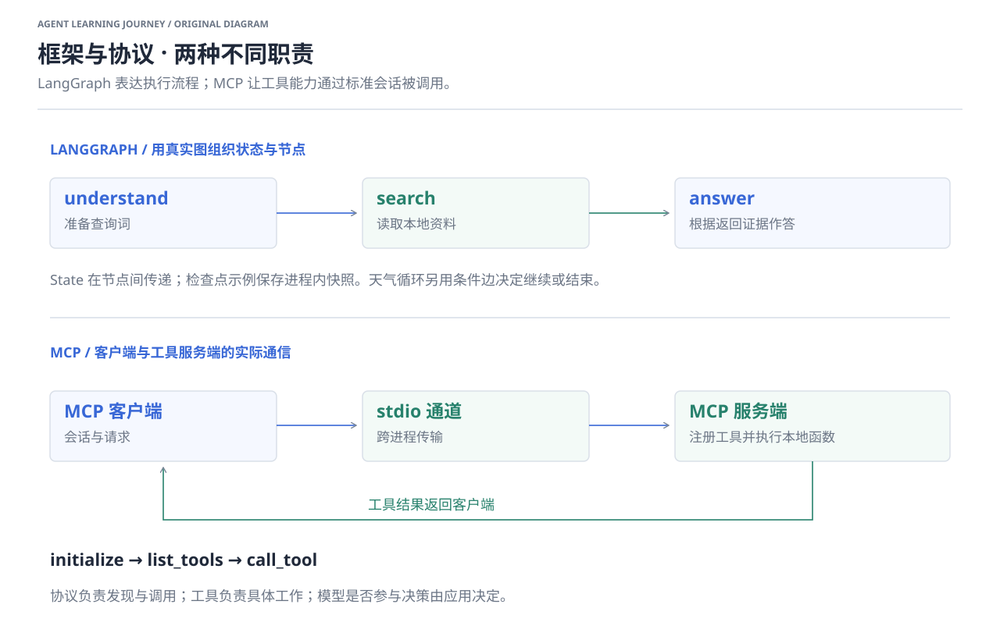
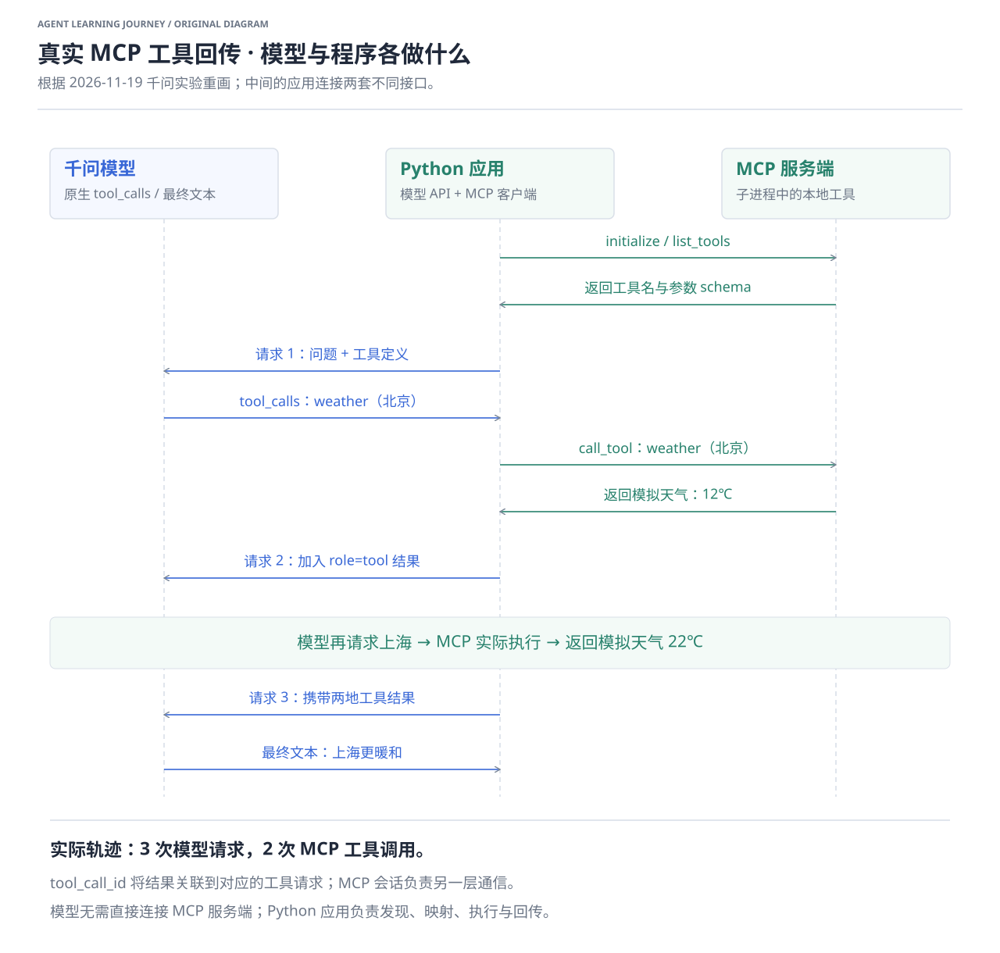

# 第 11 章 · MCP：让工具通过标准协议被调用

[章节目录](../../README.md#章节目录) · [上一章：LangGraph](langgraph.md) · [贯穿项目：Research Agent](../practice/research-agent.md)

本章参考 [Hello-Agents 第十章 §10.2 MCP 协议实战](https://github.com/datawhalechina/hello-agents/blob/main/docs/chapter10/第十章%20智能体通信协议.md)，把天气工具和本地摘要检索放到服务端，再沿工具发现、调用和结果回传理解 MCP。示例使用官方 Python SDK，可以直接看到客户端与服务端的会话边界。

## 11.1 为什么普通函数调用还不是 MCP

以前程序直接调用 `get_weather("北京")`，调用方知道函数位置和参数。MCP 场景中，工具服务可以是另一个进程：客户端先发现它提供哪些工具、各自需要什么参数，再通过协议发起调用。

本项目保留同一个天气函数，让它在服务端执行。变化发生在调用边界，而不是天气数据本身。

| 角色 | 本项目对应物 | 职责 |
| --- | --- | --- |
| Host / 宿主程序 | `examples.mcp_demo` | 组织任务，将工具定义和结果接到模型 |
| Client | `ClientSession` | 初始化会话、发现工具、发送调用 |
| Server | 本地 Python 子进程 | 暴露工具定义，校验参数，调用本地函数 |
| 工具实现 | `get_weather`、`search_notes` | 返回模拟天气或教学摘要 |



宿主把工具说明交给模型，接收模型的选择，再发出 MCP 请求。本章先看客户端怎样调用工具，再接入模型的选择过程；两部分使用同一个服务端。

## 11.2 从初始化到工具调用

演示使用标准输入输出，也就是 stdio。客户端启动服务端子进程，通过两条流交换 MCP 消息。官方 SDK 负责 JSON-RPC 消息、请求编号、初始化通知以及返回值解码。

```text
启动服务端子进程
    ↓
initialize：协商版本与能力
    ↓
list_tools：取得名称、说明、参数 schema
    ↓
call_tool("weather", {"city": "北京"})
    ↓
服务端调用本地 get_weather → 返回结果
    ↓
call_tool("search_notes", {"query": "Action Observation"})
    ↓
结束会话并清理子进程
```

Python 方法名为 `list_tools` 和 `call_tool`，对应协议中的 `tools/list`、`tools/call` 方法。初始化的意义不只是打印“连接成功”，而是让两端确认可以怎样交换后续消息。生命周期与传输细节见 [MCP 初始化规范](https://modelcontextprotocol.io/specification/2025-11-25/basic/lifecycle) 和 [stdio 传输规范](https://modelcontextprotocol.io/specification/2025-11-25/basic/transports)。

## 11.3 服务端：保留原来的工具逻辑

[服务端完整代码](../../src/agent_learning/integrations/mcp_server.py) 创建 `FastMCP`，并注册两个工具。天气工具定义如下：

```python
@server.tool()
def weather(city: str) -> dict:
    """查询本项目模拟天气；北京和上海有数据，其他城市返回暂无天气数据。"""
    if not city.strip():
        raise ValueError("city 不能为空。")
    return {"city": city.strip(), "weather": get_weather(city.strip()), "simulated": True}
```

工具名称、docstring 和类型标注用于构造发现结果。客户端能知道 `city` 是必填字符串；真正的业务检查仍由函数执行。返回值保留 `simulated: true`，避免把练习数据误解成真实天气。

服务端入口调用：

```python
create_server().run(transport="stdio")
```

stdio 模式下 stdout 是协议通道，不能在服务端随意向 stdout 打印调试文字。本项目通过 SDK 的日志通道或 stderr 报告错误。客户端自己的终端输出不占用服务端的协议流。

另一个工具 `search_notes` 读取既有本地摘要，返回资料编号、内容、出处和原文链接。它没有因为经过 MCP 就变成语义搜索，仍遵守原先的标签检索规则。

## 11.4 客户端：发现工具并取得结果

[客户端完整代码](../../src/agent_learning/integrations/mcp_client.py) 使用当前 Python 解释器启动模块，这让客户端和服务端处于同一已安装环境。关键会话部分如下，参数构造和退出处理见源码：

```python
async def exchange():
    async with stdio_client(params) as (read_stream, write_stream):
        async with ClientSession(read_stream, write_stream) as session:
            initialized = await session.initialize()
            tools = await session.list_tools()
            weather = await session.call_tool("weather", {"city": city})
            notes = await session.call_tool("search_notes", {"query": query})
```

这里没有直接导入并调用服务端的 `weather` 函数。调用经过客户端流、子进程中的 MCP 服务端，再到本地工具。`list_tools` 本身不会查询天气，只有 `call_tool` 才触发相应业务函数。

返回值也分层：客户端先检查 `isError`，再读取结构化内容；若 SDK 返回文本块，则解析其中的 JSON。工具调用失败不能被当成正常证据。默认协议演示给整个会话设置了 20 秒超时，并通过异步上下文管理器关闭连接和子进程。

## 11.5 两次工具结果怎样进入三轮对话

将模型请求上限设为 4，下面节选工具发现、调用和最终回答。完整消息见 [运行记录](../runs/2026-11-19/mcp.md)。

```text
问题：分别查询北京和上海的模拟天气，再比较哪里更暖和。
initialize：agent-learning-tools；协商协议版本：2025-11-25
list_tools：search_notes, weather
[第 1 次模型请求] tool_call：weather({"city": "北京"})
tool 结果：{"city": "北京", "weather": "下雨，12℃", "simulated": true}
[第 2 次模型请求] tool_call：weather({"city": "上海"})
tool 结果：{"city": "上海", "weather": "晴天，22℃", "simulated": true}
状态：finished；模型请求 3 次；MCP 工具请求 2 次；错误反馈 0 次。
回答：北京天气为下雨，12℃；上海天气为晴天，22℃。因此，上海比北京更暖和。
```

读这段输出时，先跟踪三次模型请求。第一次只有问题与工具定义；第二次已有北京的 tool 结果；第三次同时带上北京和上海的结果。JSON 记录中，三次请求的消息角色依次是：

```text
第 1 次：system, user
第 2 次：system, user, assistant, tool
第 3 次：system, user, assistant, tool, assistant, tool
```

第二次请求新增北京结果，第三次请求再新增上海结果。`search_notes` 虽然出现在发现清单里，这次模型没有调用它：发现可用工具不等于全部执行。

答案的温度比较正确，但漏掉了系统要求的“模拟数据”说明。工具返回中的 `simulated: true` 限定了这些温度的含义，不能将它们当作实时天气。这里可以检查两个层次：流程是否取得结果并结束，以及答案是否保留数据性质。`finished` 只回答前一个问题；后一个需要输出质量检查。

### 由程序指定工具的调用路径

也可以由程序直接指定查询北京和摘要，无需先让模型选择工具。下面节选协议交互与工具结果：

```text
initialize：agent-learning-tools；协商协议版本：2025-11-25
list_tools：search_notes, weather
call_tool weather：北京，下雨，12℃，模拟数据。
call_tool search_notes：N02
```

后续输出列出 N02 的摘要内容及原文链接。试着把城市改成广州，工具会返回“暂无天气数据”；查询未覆盖的内容时，摘要列表为空。这些都是正常的数据边界，需要完整传给调用方。

`initialize` 返回双方协商的协议版本。升级 SDK 时，应检查版本协商、工具 schema 和结果格式是否仍符合客户端的处理方式。

## 11.6 接回模型：宿主补齐两个方向的转换

由模型选择工具时，[宿主代码](../../src/agent_learning/integrations/mcp_agent.py) 先把发现结果交给模型，再处理它返回的调用请求。宿主负责衔接模型 API 与 MCP 会话。



先分清两套接口。MCP 的 `inputSchema` 描述服务端接受的参数；模型 API 的 `tools` 描述允许模型请求的操作。宿主根据本次发现结果做映射，而不是另写一份可能过期的天气工具定义：

```python
def model_tool_schema(tools):
    return [{"type": "function", "function": {
        "name": tool.name,
        "description": tool.description or "",
        "parameters": tool.inputSchema,
    }} for tool in tools]
```

例如，模型知道 `weather` 要求字符串 `city`，却不知道北京温度；温度还没有查询。这里发送的是能力说明，不能当成证据。函数调用接口与消息格式参考 [百炼 Function Calling 官方说明](https://www.alibabacloud.com/help/en/model-studio/qwen-function-calling)。

### 将工具请求与返回结果配对

本章用原生 `tool_calls`，不再解析 `Action: get_weather(...)` 字符串。以下是消息结构示意，用来阅读字段，不是某次 API 的原样响应：

```python
assistant_message = {
    "role": "assistant",
    "content": None,
    "tool_calls": [{
        "id": "call_example",
        "type": "function",
        "function": {"name": "weather", "arguments": '{"city":"北京"}'},
    }],
}
tool_message = {
    "role": "tool",
    "tool_call_id": "call_example",
    "content": '{"city":"北京","weather":"下雨，12℃","simulated":true}',
}
```

`arguments` 在模型回复里是 JSON 字符串，程序先解析成字典，再交给 `session.call_tool`。服务端收到的是工具名和参数，而非模型的整个会话。得到结果后，宿主把原 assistant 工具请求和对应的 tool 消息一起放回历史；下一次模型请求才读到北京的 12℃。

`tool_call_id` 把结果关联到模型提出的那一个调用。它不是 MCP 的 JSON-RPC 请求编号：前者属于模型 API 会话，后者由 MCP SDK 管理。名字都含“调用”，不代表能混用。

| 阶段 | 谁执行 | 模型已经拿到的信息 |
| --- | --- | --- |
| 初始化与发现 | 宿主、MCP 客户端和服务端 | 尚未请求模型 |
| 第一次模型请求 | 模型 API | 问题、工具定义；没有天气结果 |
| 模型提出工具请求 | 模型返回 `tool_calls` | 仍没有这次工具的实际结果 |
| `call_tool` | 宿主通过 MCP 调用子进程工具 | 结果先回到宿主内存 |
| 下一次模型请求 | 宿主发送更新后的 messages | 原问题、工具请求和对应 tool 结果 |
| 直接返回文本 | 模型 | 宿主将它作为最终回答候选 |

这与第 2 章的结论相同：打印结果不等于模型收到结果。变化是消息格式和工具边界，结果回传的责任仍在宿主。

### 预算、未知工具与失败

`--max-calls` 默认 4，统计模型 API 请求，不统计初始化和发现。一个回复可能提出多个调用，代码逐个处理，因此还单独限制最多 8 次 MCP 工具请求；向模型发送 `parallel_tool_calls=False` 只是要求它逐次选择，不能替代程序自己的检查。

若最后一次模型请求仍要求查工具，程序可以取得工具结果，却不会暗中多请求一次总结。此时返回 `step_limit` 和空答案。未知工具、参数无法解析、MCP 工具错误都会成为带 `isError` 的 tool 反馈；未知工具不会送到服务端执行。错误反馈同样占用后续模型的决策机会。

若模型未成功取得任何工具结果就直接作答，本例返回 `no_evidence`，而不是把这次输出计作完成。`finished` 只说明拿到过成功结果并形成了最终文本，仍需核对答案是否使用了正确的数据。当前 MCP 小例没有复用研究助手的引用校验器；对于知识问答，提示词要求引用本次资料，读者仍要人工核对编号与支持关系。

远程 HTTP 部署、认证、写入类工具、多个 MCP 服务端和动态变更的工具目录不在此练习中。这里的工具均来自本课程固定的本地服务端。

## 11.7 版本、运行与自测

示例固定使用官方 SDK **1.30.0** 的 `FastMCP`、`ClientSession` 和 `stdio_client`，接口见 [该版本说明](https://github.com/modelcontextprotocol/python-sdk/blob/v1.30.0/README.md)。SDK 内的 FastMCP 与独立发行的 `fastmcp` 包并非同一个安装项，阅读示例时应核对导入路径。

```bash
python -m pip install -e ".[mcp]"
python -m examples.mcp_demo
python -m examples.mcp_demo --city 广州 --query "没有匹配的词"
```

默认模式不调用模型、不需要密钥；`--city` 和 `--query` 指定工具参数。客户端自动启动和关闭服务端。

添加 `--live` 后使用配置的模型选择工具并生成答案，会产生 API 用量：

```bash
python -m examples.mcp_demo --live
python -m examples.mcp_demo --live --question "Action 和 Observation 分别由谁产生？"
python -m examples.mcp_demo --live --max-calls 1
```

任务来自 `--question`，工具名和参数由模型选择。最后一条用于观察预算边界：若模型先请求工具，将以 `step_limit` 和退出码 1 结束。每次 MCP 调用最多等待 20 秒，模型请求沿用客户端的 30 秒超时。

| 自测任务 | 参考答案或验收点 |
| --- | --- |
| 调用 list_tools 后，天气已经查过了吗？ | 没有；只得到了工具定义 |
| 广州没有数据，应该怎么返回？ | 保留“暂无天气数据”和模拟性质；不能编一个温度 |
| 把工具结果传给模型的责任在哪？ | 宿主程序；协议返回不等于已经进入模型输入 |
| 为什么禁止服务端随意 print？ | stdout 承载协议消息，混入普通日志会破坏解析 |
| 给服务端增加一个只读工具，客户端自动会使用吗？ | 可通过发现看到新定义，但是否调用仍需宿主或模型决策 |
| 原生 tool_calls 是否说明模型已经执行了 Python？ | 没有；它只返回结构化请求，宿主随后调用 MCP |
| 最大模型请求数设为 1，查到了北京为何仍未完成？ | 第一次返回工具请求，结果尚未经历下一次模型请求来形成答案 |
| 能用 MCP 请求编号代替 tool_call_id 吗？ | 不能；两者属于不同会话层，由不同接口关联请求与结果 |

推荐动手扩展：增加一个返回本地摘要数量的只读工具，检查 `list_tools` 的 schema，再由客户端显式调用一次。验收时分别展示发现结果和执行结果，而不是只展示服务端注册成功。

[MCP 集成测试](../../tests/test_mcp_integration.py) 检查工具发现与服务端调用；[模型桥接测试](../../tests/test_mcp_agent.py) 用固定回复检查结果回传、调用编号、未知工具和预算边界。阅读时重点找出断言检查的是协议、输入消息还是最终答案。

---

参考 Hello-Agents 第十章，按本项目已有工具重新设计；SDK 接口以固定版本的官方实现为准。正文采用 [CC BY-NC-SA 4.0](../../LICENSES/CC-BY-NC-SA-4.0.txt)。
