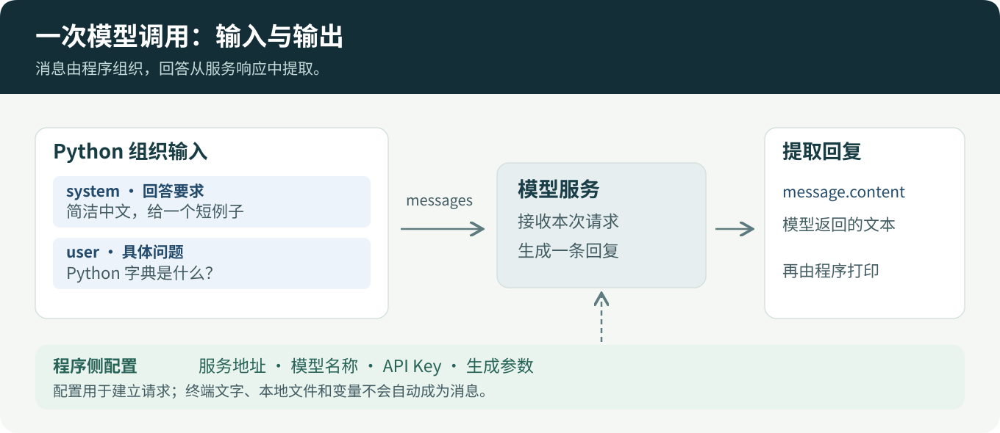

# 第 1 章 · 模型调用与消息

[章节目录](../../README.md#章节目录) · [下一章：工具调用与结果回传](tool-feedback.md)

本章参考 [Hello-Agents 第四章 §4.1](https://github.com/datawhalechina/hello-agents/blob/main/docs/chapter4/第四章%20智能体经典范式构建.md)，通过字典问答案例，理解消息组织、模型请求与回答提取。

## 1.1 从一个问题开始

我们想让模型回答：“Python 字典是什么？”

程序要完成三件事：组织输入，把输入发送给模型服务，读取返回的文本。服务地址决定请求发到哪里，模型名称决定使用哪个模型，API Key 用于服务鉴权；真正需要模型理解的回答要求与问题放在消息列表里。



图 1-1 展示一次请求的输入与输出。终端显示发生在取得回复之后；它不是消息输入的一部分。

## 1.2 消息列表包含什么

当前 [单次调用示例](../../examples/model_call.py) 中的消息如下：

```python
messages = [
    {"role": "system", "content": "请用简洁中文解释 Python 概念，给出一个短例子。"},
    {"role": "user", "content": "Python 字典是什么？"},
]
```

`messages` 是一个 Python 列表，每个元素是包含角色和内容的字典。

| 字段或角色 | 在本例中的含义 |
| --- | --- |
| `role` | 说明这条消息的角色 |
| `content` | 这条消息的文本内容 |
| `system` | 提供本例中的回答要求：简洁、中文、带短例子 |
| `user` | 提供具体问题：解释 Python 字典 |
| `assistant` | 后续保存模型回复时使用的角色 |

模型接收到的输入同时包含“怎么回答”和“回答什么”。这可以影响语言与格式，但提示要求并不等于程序强制执行的约束。

## 1.3 发出请求，再取出文本

下面按实际实现整理出主流程，省略命令行参数和异常处理。配置由本项目封装读取，密钥不写进代码：

```python
from agent_learning.config import load_settings
from agent_learning.llm import ask_model

settings = load_settings()

messages = [
    {"role": "system", "content": "请用简洁中文解释 Python 概念，给出一个短例子。"},
    {"role": "user", "content": "Python 字典是什么？"},
]

with settings.create_client() as client:
    answer = ask_model(
        client,
        settings.model,
        messages,
        settings.request_options,
    )

print(answer)
```

`ask_model` 的核心请求与取值过程如下；实际 [llm.py](../../src/agent_learning/llm.py) 还检查空回复与输出截断：

```python
response = client.chat.completions.create(
    model=model,
    messages=messages,
    **options,
)
text = response.choices[0].message.content
```

这里容易混淆的是 `response` 和回答文本。前者是服务返回的响应对象；程序从候选回复中取出 `message.content`，才得到后续打印或解析的文字。`**options` 把所选服务的生成参数传入请求，不是另一条聊天消息。

本章只需看清这条链：**Python 构造消息 → 调用服务 → 取得响应 → 提取文本**。客户端与参数的完整配置放在配套代码中。

## 1.4 中文问题，英文回答

把回答语言要求改成英文后，`qwen-plus` 的回答如下。这里只节选字典定义和示例；当前代码默认使用中文要求。

```text
Sure! Here's a simple example to explain Python dictionaries:
```

```python
# A dictionary that maps fruit names to their colors
fruit_colors = {
    "apple": "red",
    "banana": "yellow",
    "grape": "purple"
}
```

```text
A dictionary (dict) is a built-in data structure in Python that stores
key-value pairs.
```

最后两行仅去除了原回复的 Markdown 强调标记并重新换行，内容来自该次回答。上面的 `fruit_colors` 是**模型回复中的示例代码**，我们的调用程序没有因此自动执行它。

这次结果说明了两件事。第一，用户问题的语言不决定回答必须使用同一种语言，消息里的回答要求也会影响生成。第二，模型生成一段 Python 代码与程序执行这段代码是两个独立动作。后面学习工具调用时，这个区分会再次出现。

不能从这一个结果推出“提示词可以保证模型永远遵守要求”，也不能把一次文本回复视为完成了工具调用。

## 1.5 连续对话的信息从哪里来

当前 `ask_model` 函数不隐式保存聊天历史，它只接收调用方传入的 `messages`。

假设程序第一次只发送两条消息，第二次仍只发送原来的两条，那么第二次请求的显式消息输入中没有第一次的回答。若要让模型依据之前的回答继续处理，程序需要把相关内容加入下一次请求。

这一点也适用于本地变量、文件内容和终端输出：它们存在于我们的程序或电脑上，并不意味着已经进入模型输入。

## 1.6 从文本回答到工具调用

一次调用包含输入、服务请求和输出提取。消息角色帮助组织输入，提示要求影响输出，而实际执行哪些代码仍由程序决定。

到这里，我们已经能取得回答，但遇到“上海天气怎么样”时，模型还没有从我们的工具中获得天气数据。下一章将把“提出操作请求”和“实际执行函数”连接起来，再把结果交回模型。

## 1.7 动手与自查

将 system 中的语言要求改为英文，其他参数保持不变。运行后指出实际发送的两条消息，并区分原始响应对象与提取出的回答字符串。再预测：程序保存了第一次回答，但第二次仍只发送原来的两条消息，模型这次能否依据第一次回答继续修改？

<details>
<summary>参考答案</summary>

语言要求位于 system，问题位于 user。响应对象包含候选项及元数据，回答文本从 `choices[0].message.content` 取得。保存变量并不会隐式改变第二次输入；若要继续修改第一次回答，应把相关回答作为 assistant 消息及后续修改要求作为 user 消息一起传入。单次语言实验不能保证模型总遵守要求。

</details>

**配套代码**：[单次模型调用](../../examples/model_call.py)、[请求封装](../../src/agent_learning/llm.py)。需要亲自复现时再查看 [环境说明](../getting-started.md)。

---

本章结合 Hello-Agents 与本项目代码、已有实验重新整理，非教材原文；正文采用 [CC BY-NC-SA 4.0](../../LICENSES/CC-BY-NC-SA-4.0.txt)。图 1-1 为本项目原创图。
