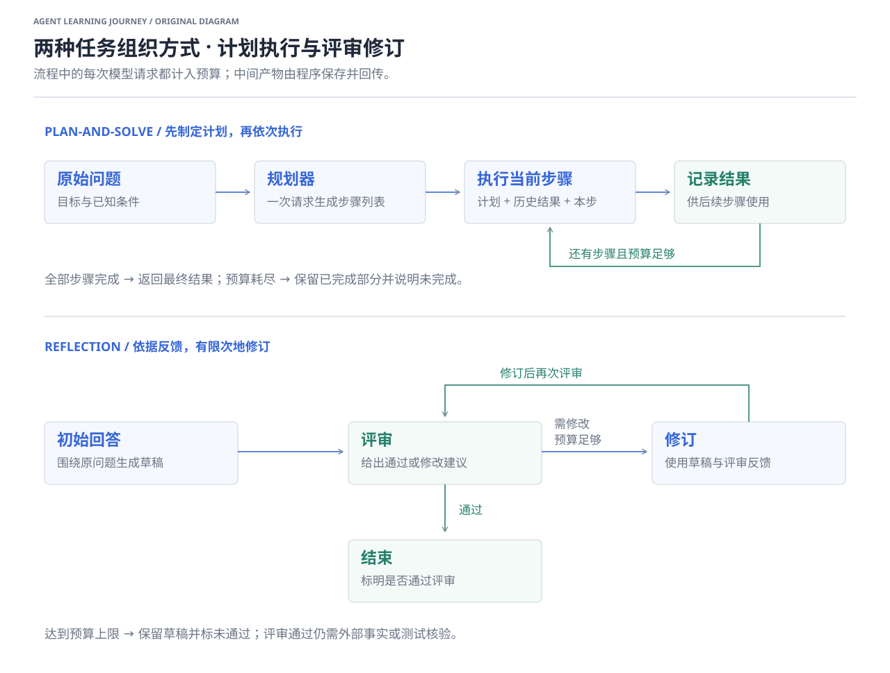

# 第 6 章 · Plan-and-Solve：先规划，再执行

[章节目录](../../README.md#章节目录) · [上一章：状态与上下文](state-and-context.md) · [下一章：Reflection](reflection.md)

本章参考 [Hello-Agents 第四章 §4.3.1–4.3.4](https://github.com/datawhalechina/hello-agents/blob/main/docs/chapter4/第四章%20智能体经典范式构建.md)，实现规划、逐步执行和结果回传。沿用教材三天销量题的数据；JSON 计划、总调用预算和明确的失败状态是本项目的工程扩展。本章已有完整可运行代码及离线演示，不表示学习者已完成实践，也没有把固定回复当成真实模型结果。

## 6.1 先列出步骤，再逐项执行

此前的天气循环每次让模型选择下一个 Action，程序执行后再提供 Observation。Plan-and-Solve 则先得到一个步骤列表，再由执行器按顺序处理。这个列表应说明要做什么，以及步骤之间的依赖。

| 阶段 | 输入 | 输出 | 当前实现状态 |
| --- | --- | --- | --- |
| 规划 | 原始问题与规划要求 | 有序的步骤列表 | 已实现，检查非空与长度上限 |
| 执行 | 原始问题、计划、已有步骤结果、当前步骤 | 当前步骤的结果 | 已实现，每一步使用剩余调用预算 |

规划器和执行器可以使用同一个模型，区别在于每次请求给它的任务和上下文。本练习继续沿用现有模型配置。



图 6-1 为本项目实现的原创概览。上半部分先规划再执行，下半部分展示下一章的评审与修订；它们都是一个程序中的调用流程。

## 6.2 从教材的三天销量题开始

沿用教材应用题的数据，题面重新简述如下：水果店周一卖出 15 个苹果；周二销量是周一的 2 倍；周三比周二少 5 个。求三天总销量。

一份可用的计划示意是：

```json
[
  "根据周一销量计算周二销量",
  "根据周二销量计算周三销量",
  "将三天的销量相加得到总销量"
]
```

这是为了讲解预设的计划，不是实际模型回复。第二步依赖第一步的结果，最后一步需要三天的数据，因此顺序有意义。计划不必固定为三个条目，增加合理的数据整理步骤也可能有效；需要检查它是否完整覆盖问题。

本项目的规划提示明确要求先写要做的步骤，暂不计算中间数值或最终答案，用来区分规划与执行。模型能否遵守，需要看真实输出。

## 6.3 一次请求产生整个计划

下面是 [planning.py](../../src/agent_learning/agents/planning.py) 的请求部分。`PLANNER_PROMPT` 描述规划任务和格式，`parse_plan` 负责解析模型返回的文本。

```python
def make_plan(client, model, question, options):
    if not question.strip():
        raise ValueError("问题不能为空。")
    messages = [
        {"role": "system", "content": PLANNER_PROMPT},
        {"role": "user", "content": question},
    ]
    raw_plan = ask_model(client, model, messages, options)
    print(f"\n[规划器原始输出]\n{raw_plan}")
    return parse_plan(raw_plan)
```

函数中只有一次 `ask_model`。模型一次返回三条计划，不等于执行了三次模型请求，更不等于这三步已经完成。之后打印编号使用的是 Python 的 `enumerate`。

当前应用题不需要天气或检索工具。生成计划时工具执行次数为 0；这与此前 Agent Loop 中模型输出 Action 后再由程序调用工具的过程不同。

## 6.4 把文本变成步骤列表

教材用 Python 列表形式的文本和 `ast.literal_eval` 解析计划。本项目改为 JSON 字符串数组与 `json.loads`，属于输出格式的工程调整；两者在这里的作用都是将计划文本转成可遍历的数据。

当前检查要求：输出为非空列表，每项都是非空字符串。如果整个输出被单独的 JSON 代码块包裹，程序先去掉这层包裹再解析。无法解析或类型不符合时会报告错误，不继续执行，也不在后台重试模型请求。

解析只检查格式。即使下面的内容可以解析，也不是一份有用的销量计划：

```json
["随便给出一个总数"]
```

因此还需要检查步骤是否覆盖目标、依赖是否合理、是否提前编造执行结果。执行器接收的是计划数据，不会执行这些字符串中的 Python 代码。完成计划后仍要单独核对计算结果。

## 6.5 执行器如何知道已经做到了哪一步

完整流程在 [plan_solve.py](../../src/agent_learning/agents/plan_solve.py)。每一步请求都包含四项数据，下面是第三步请求中的结构示意；结果值对应本章的固定离线回复：

```json
{
  "question": "三天的苹果总销量是多少？",
  "plan": ["计算周二销量", "计算周三销量", "合计三天销量"],
  "history": [
    {"step": 1, "task": "计算周二销量", "result": "15 × 2 = 30 个。"},
    {"step": 2, "task": "计算周三销量", "result": "30 - 5 = 25 个。"}
  ],
  "current_step": {"number": 3, "task": "合计三天销量"}
}
```

`history` 是程序保存的执行状态。它通过 `json.dumps` 进入本轮 user 消息，才成为模型可见的上下文。这正好衔接上一章：变量存在与模型收到信息是两个不同的步骤。

以下摘自执行循环，省略了请求构造、打印和错误处理：

```python
for index, step in enumerate(state["plan"], start=1):
    if state["model_calls"] >= max_calls:
        state["status"] = "call_limit"
        return state
    # 将 question、plan、history、current_step 放进 messages。
    state["model_calls"] += 1
    result = request(client, model, messages, options)
    state["history"].append({"step": index, "task": step, "result": result.strip()})
```

程序按计划列表遍历；每个非空结果加入历史，再构造下一次请求。最后一步的结果作为完整流程的答案。若先前结果错误，后续步骤可能继续传播错误，所以“按序执行完毕”不等于“答案已获证明”。

## 6.6 已实际运行的完整离线轨迹

助教运行 `python -m examples.plan_solve --demo`，得到如下输出节选。规划和执行回复都来自预设序列，通过与真实模式相同的控制流程；实际 API 请求为 0：

```text
离线演示：模型回复全部预设，实际 API 请求 0 次。
[规划器原始输出]
["根据周一销量计算周二销量", "根据周二销量计算周三销量", "将三天的销量相加得到总销量"]

[执行 1/3] 根据周一销量计算周二销量
结果：15 × 2 = 30 个。

[执行 2/3] 根据周二销量计算周三销量
结果：30 - 5 = 25 个。

[执行 3/3] 将三天的销量相加得到总销量
结果：15 + 30 + 25 = 70 个。

状态：finished；完成步骤：3/3。
模型适配器调用 4 次；工具执行 0 次。
最终结果：15 + 30 + 25 = 70 个。
```

三条计划用了四次模型适配器调用：一次规划，加上三次执行。在真实模式中，每次适配器调用对应一次 API 请求；离线模式则取一条预设回复。两种模式都没有调用天气或检索工具。

结果 70 还可直接验算：周二 30，周三 25，三天为 15 + 30 + 25。这个简单题用一次模型请求也可能解出；这里拆成多次是为了观察计划、状态和依赖传递，不能据此宣称多阶段一定更准确。

## 6.7 预算必须把规划也算进去

当前有两个不同的约束：

| 参数 | 限制什么 | 默认值 |
| --- | --- | --- |
| `max_calls` | 规划与所有执行步骤的模型调用总和 | 6 |
| `max_plan_steps` | 允许接受的计划条目数 | 5 |

三步计划完整执行至少需要四次调用。若计划比上限长，程序拒绝执行，而不是截掉尾部步骤后声称完成。计划在上限内但调用预算不足时，程序只执行预算允许的前缀，保留已有结果，最终答案仍为 `None`。

实际运行 `python -m examples.plan_solve --demo --max-calls 2`，末尾为：

```text
状态：call_limit；完成步骤：1/3。
模型适配器调用 2 次；工具执行 0 次。
调用预算耗尽；已保留中间结果，未产生完整答案。
```

这两次分别用于生成计划和完成第一步，退出码为 1 符合这个边界实验的预期。

| 情形 | 状态或处理 | 是否有完整答案 |
| --- | --- | --- |
| 所有计划步骤返回非空结果 | `finished` | 有，但仍需检验正确性 |
| 计划格式错误、为空、超出条目上限 | `invalid_plan` | 无，不启动执行器 |
| 调用预算耗尽 | `call_limit` | 无，保留中间结果 |
| 注入的执行器回复为空 | `invalid_result` | 无 |
| 真实 API 连接、服务或响应检查失败 | CLI 报错并退出，不继续请求 | 不宣称完成 |

## 6.8 与 ReAct 的区别和各自代价

| 比较项 | 当前 ReAct 教学循环 | 当前 Plan-and-Solve |
| --- | --- | --- |
| 下一步如何决定 | 每轮由模型结合 Observation 选择 | 程序遍历先前生成的计划 |
| 中途发现新情况 | 下一轮可改选工具或结束 | 本实现不会自动重规划 |
| 信息传递 | 历史 Action/Observation | 原问题、完整计划、已完成步骤与结果 |
| 停止条件 | 有效 Finish 或请求上限 | 执行完计划或预算/错误停止 |

计划遗漏目标时，顺利执行完仍可能得到不完整答案。中间条件改变时，原计划也可能过时。重新规划是可加入的扩展，但本实现尚未提供，不能把提示词允许“指出冲突”理解成已经实现自动重规划。

## 6.9 动手与参考答案

本节的完整离线命令与真实调用入口：

```bash
python -m examples.plan_first --demo
python -m examples.plan_solve --demo
python -m examples.plan_solve --demo --max-calls 2
python -m examples.plan_solve
```

最后一条使用现有 API 配置并产生用量。`plan_first` 继续提供只规划的入口；`plan_solve` 才执行整个计划。真实模型可能生成不同长度的计划，因此应记录实际步骤和调用次数。本章没有已验证的真实规划/执行 API 结果。

| 练习 | 参考答案与检查点 |
| --- | --- |
| 三步计划，`max_calls=3`，能否取得完整答案？ | 不能。规划 1 次，执行 2 次，第三步之前耗尽预算。 |
| 去掉 `history`，模型是否一定算错？ | 不一定，它可能从原题重新计算；但我们不再显式传递已完成结果，不能证明实现了步骤衔接。 |
| 计划只有“计算周二”“计算周三”，程序返回 25，是否完成用户目标？ | 程序遍历完成，用户要求的三天合计却遗漏了。需要检查计划语义。 |
| 把周一销量改为 10，手工验算应得多少？ | 周二 20、周三 15，合计 45；这是数学推导，不是模型实测。 |

读完本章应能找到规划请求、执行请求和历史更新的代码，解释 1+n 次调用，并区分结构校验、流程完成与答案正确。离线检查位于 [规划器测试](../../tests/test_planning.py) 和 [执行测试](../../tests/test_plan_solve.py)。下一章在已有答案之后增加评审与修订。

---

本章结合 Hello-Agents 的两阶段思路与应用题数据重新讲解，代码与示意输出为本项目实现；正文采用 [CC BY-NC-SA 4.0](../../LICENSES/CC-BY-NC-SA-4.0.txt)。
