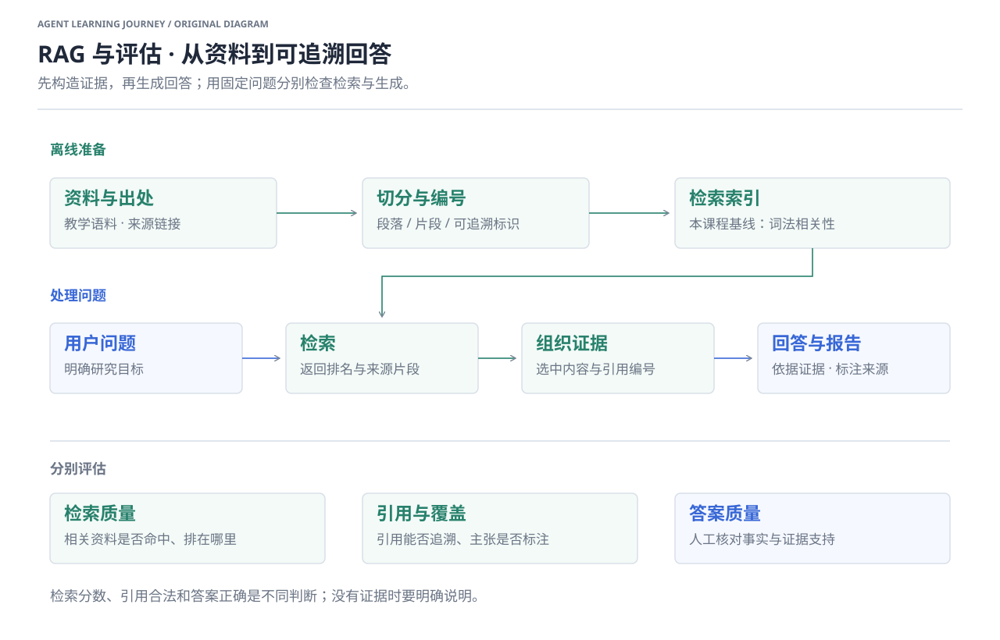

# 第 8 章 · RAG 与检索改进

[章节目录](../../README.md#章节目录) · [上一章：Reflection](reflection.md) · [下一章：评估](evaluation.md)

主要参考 [Hello-Agents 第八章 §8.3](https://github.com/datawhalechina/hello-agents/blob/main/docs/chapter8/第八章%20记忆与检索.md)。本章围绕我们自己的课程资料构建一个可检查的 RAG 工作流：使用标准库实现 BM25 检索，按来源组织证据，再选择离线摘录或真实模型生成。分块、评分与报告格式是项目实现；不依赖教材完整框架，也不把 BM25 称为语义嵌入。

## 8.1 从三条摘要走向完整流程

第 4 章使用三条带标签的摘要，已经演示了“先检索，再让模型看结果”。资料增多后，需要回答更具体的问题：哪一段最相关？它来自哪份文档？上下文放不下时保留哪些段落？最终引用是否确实来自发送给模型的证据？

RAG 的“增强”发生在生成前：外部资料被放进模型本次请求。知识库不直接修改模型参数。一次没检索到资料，也不能证明教材没有写过这个知识点。



本项目有两套互不覆盖的数据：

| 数据 | 用途 | 当前规模 |
| --- | --- | --- |
| [notes.json](../../src/agent_learning/data/notes.json) | 第 4 章的基础工具循环，保持已有实验可复现 | 3 条教学摘要 |
| [corpus.json](../../src/agent_learning/data/corpus.json) | 本章的文档切分、排序、研究报告 | 14 篇短文档 |

两者都是重新整理的教学资料，不是完整教材。扩展语料涵盖循环、上下文、检索、评估、规划和反思。来源链接指向教材章节，文中项目约定和教学扩展另行标明。

## 8.2 数据准备：块需要带着出处走

一个资料块至少保留这些字段：

```json
{
  "id": "D08-C01",
  "doc_id": "D08",
  "title": "RAG 的来源与引用",
  "text": "这里是切分后的资料内容",
  "start": 0,
  "end": 12,
  "source_section": "教材章节",
  "source_url": "https://example.com/source",
  "content_type": "教学摘要，非教材原文"
}
```

上面只演示字段结构；实际来源、内容及偏移由程序产生。`D08-C01` 表示 D08 文档的第一个块。默认窗口是 180 个字符，重叠 30 个字符。当前短文档都没有超过窗口，所以形成 14 个块；切分机制另用长字符串做了边界验证。

以 `ABCDEFGHIJK`、窗口 5、重叠 2 为例，实际切分结果为：

```text
D01-C01: ABCDE  [0:5]
D01-C02: DEFGH  [3:8]
D01-C03: GHIJK  [6:11]
```

下一块从上一块的 `end - overlap` 开始。重叠避免边界内容完全分离，但会增加重复；字符窗口也可能切断一句话，因此这是可检查的基线，后续可按段落和句子切分。`max_chars` 是字符数，不是模型 token 数。

较短块容易匹配具体片段，却可能丢掉前提；较长块保留解释，却会带入不相关内容。修改分块策略后，块编号和排名都可能变化，评估报告应保存语料指纹与分块参数。

## 8.3 BM25 如何给资料排序

本项目将英文按词处理，中文取相邻双字。例如 `Embedding` 变成 `embedding`，`保留来源` 产生 `保留`、`留来`、`来源`。它不需要下载分词或嵌入模型，但对同义表达的覆盖有限。

BM25 对每个重合词累加分数。一个词越少见，区分度通常越高；同一个词出现很多次后，额外贡献会逐渐减小；长度归一化减少长文本仅靠重复命中的优势。

下面是 [retrieval.py](../../src/agent_learning/tools/retrieval.py) 的评分核心，外围遍历已省略：

```python
inverse_frequency = math.log(1 + (total - df + 0.5) / (df + 0.5))
normalizer = frequency + self.k1 * (1 - self.b + self.b * length / self.average_length)
score += inverse_frequency * frequency * (self.k1 + 1) / normalizer
```

`total` 是块数，`df` 是含该词的块数，`frequency` 是该词在当前块中的次数。默认 `k1=1.5`、`b=0.75`。标题与正文一起参与检索，分数相同时按块编号排序，保证离线结果稳定。BM25 分数没有“正确概率”的含义，不宜直接解释成百分比置信度。

## 8.4 BM25、Embedding 和混合检索

| 路线 | 比较什么 | 适合观察的问题 | 主要限制 |
| --- | --- | --- | --- |
| 标签检索 | 查询是否包含预设标签 | 最小工具调用与回传 | 人工标签遗漏时难命中 |
| BM25 | 词频、词的稀有程度与文本长度 | 名称、术语、字面重合 | 同义表达可能没有共同词 |
| 稠密向量检索 | 嵌入模型输出的向量距离 | 用词不同但含义接近 | 需要模型、索引和独立评估 |
| 混合检索 | 合并关键词与稠密向量候选 | 兼顾精确术语与语义表达 | 需去重、融合和调参 |

本章实际实现 BM25。Embedding 路线的实现位置是 `index.search()`：文档与查询用兼容的同一嵌入空间编码，再检索近邻，仍返回相同的证据字段。换嵌入模型通常需要重建文档向量，不能把不同空间的向量直接比较。

相似度高只能说明表示接近，不能替代“这段资料是否回答了问题”的判断。添加向量数据库也不会自动修复错误分块、过期资料或缺失来源。先保留一个可复现的 BM25 基线，再比较新增策略，才能判断变化来自哪里。

## 8.5 从候选结果到模型可用证据

检索返回前 `top_k` 个候选后，程序按排名尝试放入证据预算。预算包含标题、正文和来源等包装；放不下的整个块跳过，避免只截出半个出处。本例默认预算是 1800 个字符，仅覆盖序列化证据，不包含系统提示和问题，不是整个请求窗口上限。

```python
retrieved = index.search(question, limit=top_k)
evidence = select_evidence(retrieved, max_context_chars)
```

这里的 `retrieved` 与 `evidence` 不一定相同。引用检查只允许 `evidence` 内的编号，因为这些内容才真正发给模型。当前实现没有 reranker，入选顺序仍是 BM25 排名。

证据按 JSON 行组织，连同用户问题发送给模型。系统提示明确资料是数据，不是新的执行指令；资料不足时要求说明缺少什么。这能给模型清楚的边界，但仍需要程序和人工核对输出。

## 8.6 生成与引用检查

真实生成入口要求结构化回答：

```json
{
  "status": "answered",
  "claims": [
    {"text": "一条能够由资料支持的结论", "citations": ["D08-C01"]}
  ],
  "missing": ""
}
```

这个对象是格式示意，不是真实模型输出。资料不足时使用 `status=insufficient_evidence`、空 `claims` 和具体的 `missing`。

程序依次检查状态、结论文本和引用列表，拒绝未进入本轮证据的编号。正文若另写方括号编号，也必须列入该条结论的 `citations`，避免正文与来源表不一致。最终链接从资料记录读取；不采用模型自行编写的网址。格式或引用失败返回 `invalid_answer`，不把它当成已接受的答案，也不自动追加模型请求掩盖失败。

这些检查不能证明语义正确。例如“月球由奶酪组成 [D08-C01]”引用了存在的块，依旧得不到这份资料支持。引用合法性与事实支持必须分开评价。

## 8.7 已实际运行的离线结果

助教运行默认问题 `RAG 为什么要保留来源？`。该模式真实执行本地检索并摘录证据，模型请求为 0，状态为 `evidence_only`，不是模型生成答案。排名节选如下：

| 排名 | 资料块 | 标题 | BM25 分数 |
| --- | --- | --- | ---: |
| 1 | D05-C01 | RAG 的检索增强生成流程 | 6.664 |
| 2 | D04-C01 | 摘要保留较早证据 | 4.328 |
| 3 | D08-C01 | RAG 的来源与引用 | 4.326 |

三块均进入证据。最直接讨论引用的 D08 排在第三，说明“有相关资料被找到”与“最相关资料排第一”是两个不同目标。报告中展示所有入选摘录与来源，读者无需运行也能看见关键依据：D08 说明资料块应保留出处、只引用实际纳入上下文的编号，并指出编号合法不保证结论有依据。

默认入口：

```bash
python -m examples.rag_research --output outputs/research-report.md
```

需要真实生成时显式增加 `--live`，复用已有千问或 OpenAI 配置。最多调用一次模型；没有可用证据时直接说明资料不足。生成接口已用固定回复验证数据传递和引用检查，但本次没有请求付费 API。代码区分 `live`、`scripted` 和 `custom`：自定义回调只记录接口调用次数，无法确认其内部 API 用量，不能自动标成真实模型运行。

## 8.8 练习、参考答案与验收

1. 将默认问题改成“RAG 为什么要保留来源与引用？”再比较排名。**参考解释：**增加精确词“引用”可能改变 BM25 权重；不能据此认为问题只要写长就更好。
2. 将 `--context-chars` 设为 `1`。**参考结果：**没有完整证据块能放入，返回资料不足，模型请求为 0。已经检索到候选不等于模型已经收到资料。
3. 查询“RAG 服务每月收费多少钱？”。**参考解释：**当前库不含价格，但“RAG”会命中相关主题资料；检索命中不能直接作为可回答的证明。
4. 对同一份语料改变块大小与 `top_k`，保存评估结果。**参考检查：**比较覆盖、排名、上下文成本及失败题，不只挑成功例子展示。

完成本章应能画出准备与查询两条路径，指出哪条消息带入证据，解释 BM25 与稠密向量的区别，并明确“引用合法”和“结论被支持”的差异。下一章把这些观察变成可重复计算的评估。

---

正文及扩展教学语料采用 [CC BY-NC-SA 4.0](../../LICENSES/CC-BY-NC-SA-4.0.txt)。算法实现和离线报告流程为本项目代码；原教材出处见章首。
