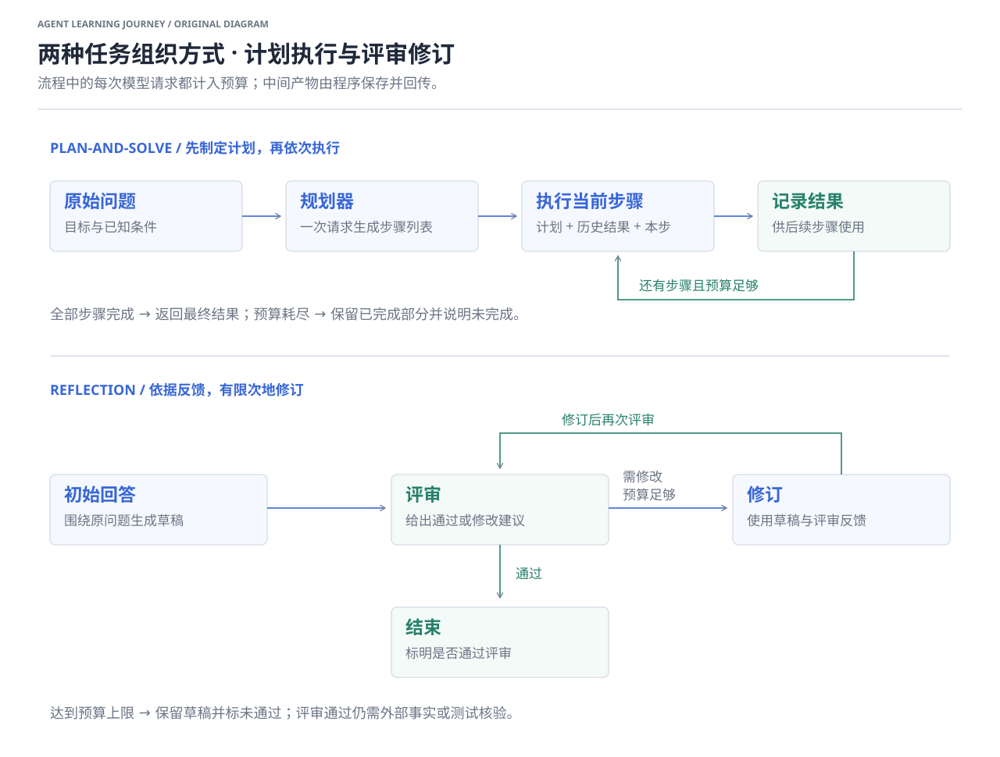

# 第 7 章 · Reflection：评审与有限修订

[章节目录](../../README.md#章节目录) · [上一章：Plan-and-Solve](planning.md) · [下一章：RAG 与检索改进](rag.md)

本章参考 [Hello-Agents 第四章 §4.4.1–4.4.4](https://github.com/datawhalechina/hello-agents/blob/main/docs/chapter4/第四章%20智能体经典范式构建.md) 的执行、评审与改进过程。教材案例是代码生成和优化；本项目改为修订一段 Agent 概念解释，保留迭代机制，避免把执行模型生成的程序混入当前课程。结构化评审、调用预算及明确的未通过状态是本项目的工程扩展。

本章提供完整实现、离线轨迹与边界实验。它们是助教验证的程序行为，未使用真实模型完成质量评估，也不表示学习者已经掌握该主题。

## 7.1 给已有结果增加一个纠错过程

ReAct 和 Plan-and-Solve 都会产生一个结果，但结果可能遗漏条件、混淆概念或推导错误。Reflection 在初稿后增加评审，再把反馈提供给修订请求：

| 阶段 | 需要的输入 | 产生的输出 |
| --- | --- | --- |
| 初稿 | 原始任务及其给定事实 | 第一版答案 |
| 评审 | 原始任务、当前草稿 | 是否接受，以及具体反馈 |
| 修订 | 原始任务、当前草稿、评审反馈 | 新版本答案 |
| 再评审 | 原始任务、新版本答案 | 接受或继续提出修改 |

这些阶段可使用同一个模型，角色由提示词与输入内容区分。本例仍然是一个程序编排调用，不需要多 Agent 框架。



图 7-1 下半部分对应本章的有限修订过程。`accept` 表示评审员接受当前版本，并不是外部事实核验的证明。

## 7.2 用已经学过的概念检查修订是否有依据

本例任务要求解释 Action、Observation 的分工，以及工具结果如何进入下一轮请求。任务中明确给定四项事实：Action 表达模型请求；工具由程序执行；Observation 由程序组织；打印结果不等于回传结果。

这些事实让我们能直接检查修订是否符合要求，不依赖评审员的一句“很好”。离线演示特意预设了一个有遗漏的初稿，用来观察程序如何传递反馈；这不是某个真实模型犯错的记录。

初稿中的问题句为：

```text
模型会自动记住工具结果。
```

它遗漏了程序把结果放入下一次请求的过程。正确的修订应补上这个条件，同时保留模型与程序的职责分工。

## 7.3 反馈需要既能阅读，也能被程序判断

评审返回两个字段：

```json
{
  "verdict": "revise",
  "feedback": "自动记住的表述有误，应说明程序组织 Observation 并将结果加入下一轮请求。"
}
```

`verdict` 只能为 `accept` 或 `revise`，`feedback` 必须为非空文字。程序按完整字段值决定分支，不根据自然语言里是否碰巧出现某个短语停止。解析规则见 [reflection.py](../../src/agent_learning/agents/reflection.py) 的 `parse_review()`。

反馈只有“回答不好”时，即使格式合格，也缺乏可操作的修改方向。实际质量检查应关注它指出了哪个句子、违反哪项约束，以及建议补上什么信息。

以下是实际修订请求的数据结构示意，字段来自当前任务状态：

```json
{
  "task": "解释分工与结果回传条件",
  "draft": "模型会自动记住工具结果。",
  "feedback": "说明程序必须将结果加入下一轮请求。"
}
```

原任务仍然进入修订请求，避免反馈引导模型偏离目标。修订器应核对反馈与给定事实；评审员也可能判断错误，不能把所有反馈自动视作事实。

## 7.4 状态如何保存，又选择哪些信息进入请求

`run_reflection()` 在每次任务开始时创建独立状态：

| 字段 | 含义 |
| --- | --- |
| `draft` | 当前最新草稿，包括尚未通过评审的修订稿 |
| `answer` | 只有 `accept` 后才设置的结果；否则为 `None` |
| `history` | 初稿、各次评审与修订的完整轨迹 |
| `reviews` | 各次评审及其对应草稿版本 |
| `revisions` | 已经执行的修订次数 |
| `model_calls` | 初稿、评审和修订共同消耗的调用次数 |

完整轨迹用于复盘；评审只接收原任务与当前草稿，修订只接收原任务、当前草稿与本轮反馈。这样把“保存所有记录”与“每次发送必要信息”分开，延续第五章的上下文选择原则。

控制流程的关键分支如下，摘自实现，省略打印与轨迹记录：

```python
if review["verdict"] == "accept":
    state.update(status="accepted", answer=state["draft"])
    return state
if state["revisions"] >= max_revisions:
    state["status"] = "revision_limit"
    return state
if state["model_calls"] >= max_calls:
    state["status"] = "call_limit"
    return state
```

`accept` 才会返回被评审接受的答案。需要修订却达到限制时，程序保留草稿，并明确报告没有通过，不会把“循环停了”自动改写成“任务成功”。

## 7.5 已实际运行的离线轨迹

助教运行 `python -m examples.reflection --demo`，以下为实际输出节选。全部模型回复预设，实际 API 请求为 0：

```text
离线演示：初稿、评审和修订均为预设文本，实际 API 请求 0 次。
[初稿]
模型输出 Action，工具执行后产生 Observation，模型会自动记住工具结果。

[评审 1] revise
反馈：自动记住的表述有误，应说明程序组织 Observation 并将结果加入下一轮请求。

[修订 1]
Action 表达模型希望执行的操作；程序执行工具并组织 Observation，再把结果加入下一轮请求。仅打印结果不会让模型收到它。

[评审 2] accept
反馈：已说明模型与程序的分工，并明确回传结果与打印结果的区别。

状态：accepted；评审 2 次；修订 1 次。
模型适配器调用 4 次；工具执行 0 次。
```

四次调用分别是：初稿、第一次评审、修订、第二次评审。修订稿写出来后仍需再次评审，因此一次修订不能只数成“初稿加一次修订”。

这个固定演示说明程序把正确的版本和反馈放进了对应请求。它没有测量真实模型发现错误的能力，也没有证明改写后的回答比所有初稿都更好。

## 7.6 两种预算与未通过状态

默认 `max_revisions=2`，最多修订两次；默认 `max_calls=6`，整个任务最多调用模型六次。若经历 r 次修订并对最终版本再评审，总调用次数为 `2 + 2*r`：一次初稿、r+1 次评审、r 次修订。

`max_revisions=0` 仍允许生成初稿并评审，只是不再修订。若初稿已被接受，总共只需要两次调用。

实际运行 `python -m examples.reflection --demo --max-calls 3` 的末尾为：

```text
状态：call_limit；评审 1 次；修订 1 次。
模型适配器调用 3 次；工具执行 0 次。
尚未获评审接受的草稿：Action 表达模型希望执行的操作；程序执行工具并组织 Observation，再把结果加入下一轮请求。仅打印结果不会让模型收到它。
```

第三次调用刚产生修订稿，预算不足以做第二次评审。即使人工看起来已经正确，程序仍报告未通过，退出码为 1。这避免混淆“写出了答案”与“走完了规定的验收过程”。

| 状态 | 触发条件 | 保存的结果 |
| --- | --- | --- |
| `accepted` | 评审明确返回 accept | `answer` 与最新 `draft` |
| `revision_limit` | 仍需修改，但已达到修订次数上限 | 最新草稿、评审与轨迹，`answer=None` |
| `call_limit` | 初稿后、评审前或修订前没有调用预算 | 最新草稿与轨迹，`answer=None` |
| `invalid_review` | 评审不是可识别的 JSON verdict/feedback | 保留草稿，不默认接受 |
| `invalid_result` | 注入的初稿或修订结果为空 | 保留已有合法草稿，不默认接受 |

真实 API 连接、服务或响应检查失败时，示例立即报错并退出，不执行后续步骤。所有阶段使用相同的总预算，没有“免费”的最后一次总结请求。

## 7.7 Reflection 能解决什么，又留下什么问题

| 机制 | 主要处理的问题 | 本章的区别 |
| --- | --- | --- |
| 格式重试 | 回复不符合解析约定 | 本章结构错误直接报告，不自动重试 |
| 重新规划 | 原计划不再适合任务 | 本章修改答案，不改任务计划 |
| Reflection | 已有结果存在遗漏或错误 | 显式评审，再根据反馈修订 |

同一个模型可能在初稿和评审时重复同一种错误；评审也可能提出多余或有害的修改。因此本实现只把 `accepted` 解释为“评审员接受”。真实项目还应结合检索证据、确定性计算、人工评分或测试用例。改进次数越多不一定质量越高，成本和错误传播机会也会增加。

## 7.8 动手与参考答案

```bash
python -m examples.reflection --demo
python -m examples.reflection --demo --max-calls 3
python -m examples.reflection --demo --max-revisions 0
python -m examples.reflection
```

前三条不读取真实密钥、不请求模型。最后一条使用现有 API 配置，模型可能在第一次评审就接受初稿，也可能需要修订；不能强求它复现预设轨迹。本章尚无真实 API 质量评估结果。

| 练习 | 参考答案与检查点 |
| --- | --- |
| 为什么修订请求必须保留原任务？ | 反馈只是改进建议，原任务提供最终目标和事实约束；丢掉它可能偏离需求。 |
| 一次修订并最终通过，需要几次模型调用？ | 4 次：初稿、评审、修订、再次评审。 |
| `max_calls=3` 的最新草稿为什么不进入 `answer`？ | 尚未得到针对该版本的 accept；程序保留它供查看，但不冒充验收完成。 |
| 评审返回“无需改进”自然语言时会怎样？ | 格式不合格，`invalid_review`；需要合法 verdict/feedback。 |
| 怎样检验 Reflection 是否有帮助？ | 固定一组任务，分别评分初稿和最终稿，记录正确性、完整性、调用数和用量；不能只统计 accept。 |

检查代码见 [离线测试](../../tests/test_reflection.py)，覆盖最新稿与反馈的传递、调用及修订上限、评审格式和任务间状态隔离。下一章把可引用的资料作为回答依据，补上仅靠模型内部评审无法保证的证据来源。

---

本章根据 Hello-Agents 的 Reflection 机制重新编排，文字修订任务、协议、代码与离线轨迹为本项目的教学改编；正文采用 [CC BY-NC-SA 4.0](../../LICENSES/CC-BY-NC-SA-4.0.txt)。
