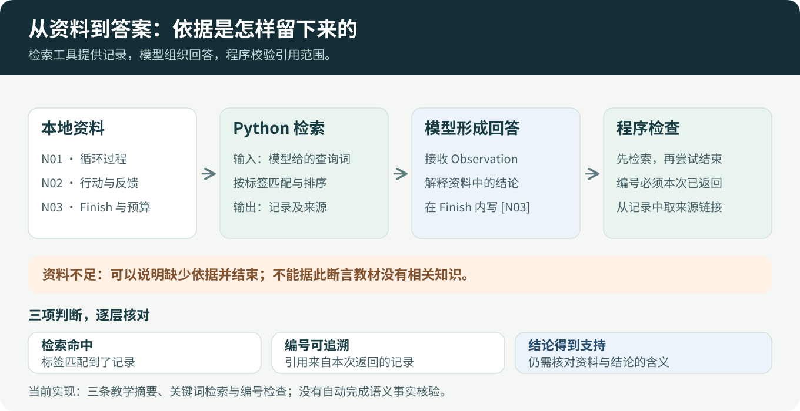

# 第 4 章 · 检索、引用与资料不足

[章节目录](../../README.md#章节目录) · [上一章：Agent Loop](agent-loop.md) · [下一章：状态与上下文](state-and-context.md)

本章在 [Hello-Agents 第四章 §4.2](https://github.com/datawhalechina/hello-agents/blob/main/docs/chapter4/第四章%20智能体经典范式构建.md) 的工具循环思路上扩展我们自己的资料问答案例。本地标签检索、引用编号和资料不足处理均属于本项目设计；本章不是第八章 RAG 的完整讲解。

## 4.1 同一个循环，换一种工具

天气循环从工具取得温度，研究助手从工具取得学习资料。两者的信息流相同：

**模型提出查询 → 程序执行工具 → 回传 Observation → 模型依据结果继续处理。**

变化在于工具的输入、返回内容和答案检查。天气工具接收城市，资料工具接收查询词；天气工具返回天气字符串，资料工具返回带编号和出处的摘要。



图 4-1 根据本项目代码原创绘制。检索命中、编号可追溯和内容得到支持是三项不同判断。

## 4.2 资料从哪里来

本章基础版本的资料库只有三条 [教学摘要](../../src/agent_learning/data/notes.json)。第 08 章使用独立扩展语料，这三条记录保持不变，以便复现本章实验：

| 编号 | 主题 | 能提供的主要信息 |
| --- | --- | --- |
| N01 | Agent Loop 的基本过程 | 决策、执行、反馈与循环 |
| N02 | Action 与 Observation 的分工 | 模型提出请求，程序执行并回传结果 |
| N03 | Finish 与最大步数 | 停止条件与预算限制，以及本项目的未完成约定 |

每条记录同时保存内容与出处。下面节选 N03 的部分字段；为集中说明结构，只保留两个检索标签，正文与来源说明保持原记录内容：

```json
{
  "id": "N03",
  "title": "Finish 与最大步数",
  "keywords": ["finish", "最大步数"],
  "content": "程序识别到 Finish 后提取最终答案并结束。最大步数限制了循环的执行预算，防止持续运行和资源耗尽。达到上限本身不能证明任务完成；在我们的练习中，没有 Finish 就报告未完成。",
  "source_section": "Hello-Agents 第四章 §4.2.3 ReAct 智能体的编码实现；未完成状态说明为本项目的教学扩展",
  "content_type": "教学摘要与已标注的扩展，非教材原文"
}
```

原记录还包含教材链接。`content` 是回答时可用的资料，`id` 让答案能指回该条记录，`source_section` 与链接让读者能进一步核对教材。`content_type` 则明确这是一段教学转述。

## 4.3 检索代码实际做了什么

以下是 [search_notes](../../src/agent_learning/tools/notes.py) 的实现，省略注释但保留逻辑。文件顶部已导入 `json` 并将 `NOTES_PATH` 指向上述 JSON 文件。

```python
def search_notes(query, limit=2):
    notes = json.loads(NOTES_PATH.read_text(encoding="utf-8"))["notes"]
    query = query.strip().casefold()
    if not query:
        return []
    if limit < 1:
        raise ValueError("limit 必须至少为 1。")

    results = []
    for note in notes:
        matched = [
            word for word in note["keywords"]
            if word.casefold() in query
        ]
        if matched:
            results.append({
                **note,
                "matched_keywords": matched,
                "score": len(matched),
            })

    results.sort(key=lambda item: item["score"], reverse=True)
    return results[:limit]
```

这个函数逐条检查查询中是否包含资料标签。英文使用 `casefold` 统一大小写；命中标签多的记录排在前面，最终最多返回两条。

以 `Agent Loop 最大步数` 为例，N01 命中 `agent loop`，N03 命中 `最大步数`，所以两条都可被返回。这个分数是标签命中数，**不等于语义相关度，也不是答案可信度**。

此处没有向量数据库，没有语义重排，也不会访问教材网站下载内容。链接是供读者核对来源的，实际工具读取的仍是本地三条摘要。

## 4.4 已有结果：最大步数问题的两轮回答

问题是：“Agent Loop 为什么要有最大步数？”

下面节选已有真实运行；Observation 只展示与结论直接相关的 N03，省略同轮返回的 N01。为阅读方便，最终答案重新换行。

```text
[第 1 轮] Action: search_notes(query="Agent Loop 最大步数")

Observation:
[N03] Finish 与最大步数
匹配标签：最大步数
摘要：程序识别到 Finish 后提取最终答案并结束。最大步数限制了循环的执行预算，
防止持续运行和资源耗尽。达到上限本身不能证明任务完成；在我们的练习中，
没有 Finish 就报告未完成。
性质：教学摘要与已标注的扩展，非教材原文
出处：Hello-Agents 第四章 §4.2.3 ReAct 智能体的编码实现；
未完成状态说明为本项目的教学扩展

[第 2 轮] Action: Finish[最大步数用于限制 Agent Loop 的执行预算，
防止因未达成终止条件（如未输出 Finish）而无限循环、导致资源耗尽。
它不表示任务完成，仅是安全机制；本练习的约定是：达到上限且没有
Finish 就报告未完成 [N03]。]

模型请求 2 次；工具执行 1 次。
```

第一轮的查询词由模型生成。摘要正文、标签、性质和出处来自 Python 读取的记录，程序把它们组织成 Observation 后回传。

第二轮才是模型依据资料生成的回答。答案中的 `[N03]` 表示引用本次返回的 N03；“本练习的约定”保留了摘要对工程扩展的限定，没有把它说成所有智能体共同遵守的规则。

因此，终端上这“一大段文字”包含不同来源：模型写了 Action，工具提供了摘要，程序组织了 Observation，模型再写出 Finish。不能把整段都当成模型自行生成的知识。

## 4.5 程序怎样检查引用

检索时，程序会把实际返回的记录保存在本次任务的 `retrieved` 字典中。完成回答后，程序提取其中的编号：

```python
def citation_ids(answer):
    return set(re.findall(r"\[\s*(N[0-9]+)\s*\]", answer))

cited = citation_ids(answer)
unknown = cited - retrieved.keys()
```

如果本次只返回 N01 与 N03，答案却写了 N02，那么 `unknown` 中就有 N02。即使 N02 存在于整个资料库中，它也没有出现在这次检索结果里，当前程序会要求修正。

来源链接另由程序从 `retrieved` 中读取，不采用模型自行生成的链接。这样可以避免编号正确、链接却被模型随意写成别的地址。

但这种检查只验证“编号是否来自本次结果”。它不能自动判断摘要是否支持答案里的每一句话。一个答案完全可能引用真实 N01，却用它来解释 N01 没有讲到的知识。

## 4.6 已有结果：资料不足也可以结束流程

我们还问过：“LangGraph 的 checkpoint 有什么作用？”

当前三条摘要不包含回答这个问题所需的资料。以下是另一次已有真实运行的最终答复节选，重新换行方便阅读：

```text
Action: Finish[资料不足：本地教学摘要中未检索到关于 LangGraph checkpoint
作用的任何内容，缺少对其功能、使用场景或实现机制的说明。]

引用来源（本地教学摘要，非教材原文）：
无引用资料；请查看上方资料不足说明。
```

这条结果符合“依据现有资料作答”的边界。它没有解释 checkpoint 的具体作用，因此不能把它计作已经解答原始知识问题。

这里也要区分两个范围：工具没有在当前摘要库中检索到内容，不意味着 Hello-Agents 教材没有相关内容。即便查询中加上 `Agent Loop` 而命中 N01，N01 的循环介绍也不足以支撑 checkpoint 的具体机制。

## 4.7 三个判断不能合并

| 判断 | 当前怎样处理 | 能证明的范围 |
| --- | --- | --- |
| 是否检索到记录 | 标签匹配 | 查询匹配到了本地记录 |
| 引用是否可追溯 | 校验本次返回的编号，读取记录中的链接 | 答案指向了本次结果中的资料 |
| 资料是否支持结论 | 目前需要人工核对 | 结论与依据之间是否成立 |

本项目允许明确的“资料不足”答复正常结束，但这里仍是文字与流程检查，不是语义事实核验。模型输出合法 Finish，也不等于回答已经被证明正确。

至此，我们把模型调用、工具执行、结果回传、循环和引用串在了一个案例里。后续将先讨论状态与上下文，再补规划、反思，之后系统学习检索改进与评估。

## 4.8 动手与自查

比较“最大步数有什么作用”和“LangGraph checkpoint 有什么作用”在本章资料库中的结果。假设回答引用了真实存在的 N01，但本次只返回 N03，程序应当接受吗？若本次确实返回 N01，是否就能用它支持任何结论？

<details>
<summary>参考答案</summary>

最大步数问题有 N03 等资料；checkpoint 问题在本章三条摘要中没有相应内容。未检索到不证明教材不存在相关知识。引用必须属于本次返回的来源范围，不能使用仅在整个库里存在的编号；即使编号合法，还要检查具体结论是否被资料支持。存在、返回、支持是三个判断。

</details>

**配套代码**：[资料检索](../../src/agent_learning/tools/notes.py)、[研究助手与引用校验](../../src/agent_learning/agents/research.py)。进一步的实现关系见 [贯穿案例](../practice/research-agent.md)。

---

本章结合 Hello-Agents 与本项目代码、已有实验重新整理，非教材原文；正文采用 [CC BY-NC-SA 4.0](../../LICENSES/CC-BY-NC-SA-4.0.txt)。图 4-1 为本项目原创图。
