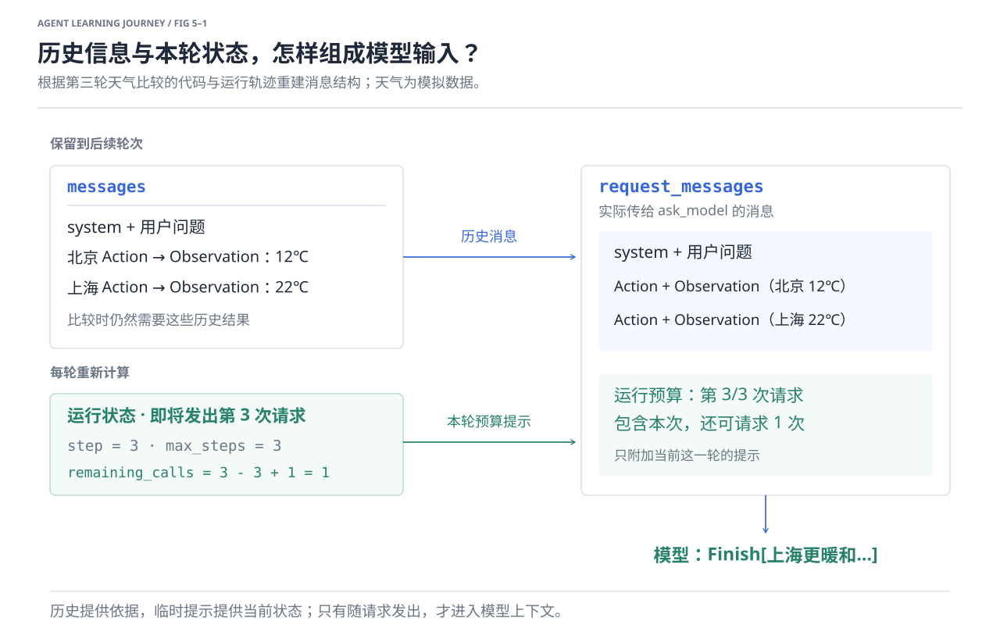

# 第 5 章 · 状态与上下文

[章节目录](../../README.md#章节目录) · [上一章：检索、引用与资料不足](retrieval-and-citations.md) · [下一章：先生成计划](planning.md)

**本章目标：** 区分程序状态与模型上下文，说明预算提示和保留来源的历史摘要怎样进入请求。

**配套示例：** [上下文预览](../../examples/context_preview.py)、[天气循环对照](../../examples/weather_loop.py) · **核心实现：** [请求构造](../../src/agent_learning/loop.py)、[历史摘要](../../src/agent_learning/context.py)

本章参考 [Hello-Agents 第九章 §9.1、§9.2.1、§9.2.3](https://github.com/datawhalechina/hello-agents/blob/main/docs/chapter9/第九章%20上下文工程.md)，讨论每次请求前如何组织模型可见的信息，以及如何整理较早的记录。请求预算提示与天气摘要是本项目的教学扩展。

## 5.1 程序保存的信息，不会自动成为模型输入

天气循环里有 `messages`、`step`、`max_steps` 和 `tool_calls`。这些变量共同描述任务的运行状态，但一次模型请求不会自动读取全部 Python 变量。

在当前实现中，`ask_model` 把收到的消息列表交给模型。决定某条信息是否进入本次消息输入，需要看它有没有被组织进实际传入的列表。

| 信息 | 程序中的保存位置 | 默认是否作为消息内容发送 |
| --- | --- | --- |
| 用户问题 | `messages` 中的 user 消息 | 是 |
| 已回传的天气结果 | `messages` 中的 Observation | 是，在下一次请求发生时发送 |
| 当前轮数 | `step` | 否 |
| 请求上限 | `max_steps` | 否 |
| 工具执行次数 | `tool_calls` | 否 |

这里把**程序状态**理解为程序为执行任务保存的信息，把**模型上下文**理解为本次请求实际提供给模型的内容。消息历史属于程序状态，也可以被选入上下文；两者不是互斥的两堆信息。

## 5.2 把剩余预算变成一条消息

假设总上限为 5，现在即将发出第 4 次请求。包含本次，可用次数是第 4 次与第 5 次，因此：

```python
remaining_calls = max_steps - step + 1
```

计算出一个整数仍然只改变程序状态。要把它交给模型，需要先组织成文字，再加入真正发送的消息。下面是 [loop.py](../../src/agent_learning/loop.py) 中的实际请求构造部分；它位于每轮循环内部：

```python
request_messages = context_builder(messages) if context_builder else messages
if budget_context:
    remaining_calls = max_steps - step + 1
    budget_hint = (
        f"运行预算：本轮是第 {step}/{max_steps} 次模型请求，"
        f"包含本次，还可以请求模型 {remaining_calls} 次。"
    )
    request_messages = request_messages + [{"role": "user", "content": budget_hint}]
    print(f"\n[请求上下文] {budget_hint}")
action = ask_model(client, model, request_messages, options)
```

默认没有 `context_builder`，使用原有完整历史；后文的摘要模式会传入一个负责整理消息的函数。预算开关打开时，在选好的消息后追加本轮预算。最后一行必须传 `request_messages`：如果仍传原来的 `messages`，前面构造的提示就没有进入请求。

此处的“预算”是模型请求次数，不是 token 上限，也不是工具执行次数。提示用于帮助模型决策，真正阻止超出次数的是程序中的循环上限。



图 5-1 展示默认完整历史模式：历史消息持续保留，预算提示每轮重新生成。这里的状态只服务于当前任务，没有跨任务持久化存储。

## 5.3 相同上限下的预算提示对照

仍用“分别查询北京和上海的模拟天气，再比较哪里更暖和”这个问题，观察请求上限和预算提示怎样影响执行过程。

先将上限固定为 2，分别关闭与开启预算上下文。两次的行动与工具结果相同：

```text
[第 1 轮] Action: get_weather(city="北京")
Observation: 下雨，12℃

[第 2 轮] Action: get_weather(city="上海")
Observation: 晴天，22℃

达到 2 轮上限，任务未完成。
模型请求 2 次；工具执行 2 次。
```

开启时，每次请求前还出现了以下两条提示；关闭时没有这些附加消息：

```text
[请求上下文] 运行预算：本轮是第 1/2 次模型请求，包含本次，还可以请求模型 2 次。
[请求上下文] 运行预算：本轮是第 2/2 次模型请求，包含本次，还可以请求模型 1 次。
```

这些打印行显示了提示内容。是否进入模型输入，要看 `ask_model` 收到的 `request_messages`；打印本身不会改变请求。

这次对照没有观察到行动序列或完成状态的变化。它不能证明提示普遍无效，也不能证明模型一定忽略了提示。

## 5.4 增加一次请求后完成比较

第三次运行继续开启预算上下文，只把上限增加到 3：

```text
[请求上下文] 运行预算：本轮是第 1/3 次模型请求，包含本次，还可以请求模型 3 次。

[第 1 轮] Action: get_weather(city="北京")
Observation: 下雨，12℃

[请求上下文] 运行预算：本轮是第 2/3 次模型请求，包含本次，还可以请求模型 2 次。

[第 2 轮] Action: get_weather(city="上海")
Observation: 晴天，22℃

[请求上下文] 运行预算：本轮是第 3/3 次模型请求，包含本次，还可以请求模型 1 次。

[第 3 轮] Action: Finish[上海更暖和（22℃ vs 12℃），数据为模拟天气。]

任务结束：上海更暖和（22℃ vs 12℃），数据为模拟天气。
模型请求 3 次；工具执行 2 次。
```

三次运行可以这样比较：

| 请求上限 | 预算提示 | 实际模型请求 / 工具执行 | 观察到的结果 |
| --- | --- | --- | --- |
| 2 | 关闭 | 2 / 2 | 查完两地，未取得 Finish |
| 2 | 开启 | 2 / 2 | 相同行动，仍未取得 Finish |
| 3 | 开启 | 3 / 2 | 第三轮比较两地并给出有效 Finish |

成功发生在增加请求次数之后，不能把它归因于预算提示；第三章不带预算提示的循环也用了三次请求。这个对照说明了调用预算的作用，尚不足以衡量提示效果。

## 5.5 为什么第二轮之后有数据，却还不能完成

关键是分清“模型请求之前”和“工具执行之后”：

| 请求 | 发出时包含的天气资料 | 模型输出后，程序新增的信息 |
| --- | --- | --- |
| 第一次 | 无 | 执行北京查询后得到 12℃ |
| 第二次 | 北京的 12℃ | 执行上海查询后得到 22℃ |
| 第三次 | 北京与上海的结果 | 模型可以据此组织最终比较 |

上限为 2 时，上海结果已经写入程序的消息列表，也已打印到终端。但第三次请求没有发生，所以这条新结果没有交给后续模型调用。

第三次请求的消息结构如下，省略 system 全文和 Action 的完整参数：

| 消息角色 | 内容 |
| --- | --- |
| system | 天气工具说明与行动规则 |
| user | 查询北京、上海并比较的原始问题 |
| assistant | 查询北京的 Action |
| user | Observation：下雨，12℃ |
| assistant | 查询上海的 Action |
| user | Observation：晴天，22℃ |
| user（本轮附加） | 第 3/3 次请求，包含本次还可请求 1 次 |

在“一次请求只输出一个 Action、每次工具查询一座城市”的约定下，完整执行两个查询再由模型给出 Finish，至少需要三次模型请求。上下文提示无法增加这个执行预算。

## 5.6 消息历史与临时状态分别管理

本例中，北京和上海的工具结果需要保留到比较时使用；剩余次数却会随每轮变化。两者的保存方式因此不同：

| 内容 | 当前处理 | 原因 |
| --- | --- | --- |
| 原始问题、Action、Observation | 追加到任务历史 `messages` | 后续决策仍然需要它们 |
| 当前轮数与剩余请求次数 | 每轮计算，只加入 `request_messages` | 下一轮应使用更新后的数值 |

`request_messages + [...]` 创建一个新列表，没有向原历史列表追加预算。每轮请求只附加当前那一条提示，因此不会因为反复追加而堆积“还剩 3 次、还剩 2 次、还剩 1 次”的旧预算消息。

这只是当前小型天气任务的选择，不意味着所有任务都应该保留全部历史。哪些信息需要保留、更新、筛选或压缩，是后续上下文工程要继续处理的问题。

## 5.7 预算提示与程序上限

每轮请求保留所需历史、刷新当前预算，程序同时检查调用上限。第三次请求收到两地资料后，模型才能完成这次比较；预算提示不会增加可用次数。

下面继续整理消息内容，用规则摘要保留较早的工具结果。本章处理单次任务的请求上下文，token 窗口管理与长期记忆不在这个天气示例中；[LangGraph 章节](langgraph.md) 将介绍进程内检查点。

**配套代码**：[循环中的上下文构造](../../src/agent_learning/loop.py)、[天气示例入口](../../examples/weather_loop.py)、[离线请求快照检查](../../tests/test_agent_loop.py)。需要复现时查看 [配套命令](../../examples/README.md#状态与上下文预算提示对照)。

## 5.8 截断历史会丢掉什么，摘要怎样补回来

北京与上海的两次查询形成四条历史消息。如果只保留最后两条，就只剩上海的 Action 和 Observation。原问题虽然提到了北京，却没有北京的查询结果，不能据此进行有依据的比较。

可以把较早的北京记录整理成一条摘要。[context.py](../../src/agent_learning/context.py) 中的函数如下：

```python
def summarize_records(records):
    """将每条记录的城市、结果、来源写成一行。"""
    lines = []
    for record in records:
        lines.append(
            f'{record["city"]}：{record["result"]}（来源：{record["source"]}）'
        )
    return "\n".join(lines)
```

循环里的城市和调用来源从已识别的天气 Action 取得，`result` 从与它配对的程序 Observation 取得。摘要使用已有结果，不再调用天气工具，也不调用模型生成新事实。整理后的内容为：

```text
较早工具结果摘要（模拟数据）：
北京：下雨，12℃（来源：get_weather(city="北京")）
```

“北京已经查过”只说明执行过操作，仍缺少温度。这里保留城市、完整结果、来源和模拟数据性质；如果结果是“暂无天气数据”，也要原样保留。

**固定输入练习：** [上下文预览](../../examples/context_preview.py) 使用本地模拟天气结果构造消息，不请求模型。三种整理方案的结果如下：

| 方案 | 请求消息数（不含预算提示） | 北京的城市、结果、来源是否保留 |
| --- | --- | --- |
| 完整历史 | 6 | 是 |
| 系统规则、问题 + 最近两条历史 | 4 | 否 |
| 系统规则、问题 + 较早摘要 + 最近两条历史 | 5 | 是 |

第三种方案的实际预览输出：

```text
C. 较早证据摘要 + 最近两条历史：5 条消息
1. [system] 根据工具结果比较模拟天气，不编造数据。
2. [user] 分别查询北京和上海的模拟天气，再比较哪里更暖和。
3. [user] 较早工具结果摘要（模拟数据）：
北京：下雨，12℃（来源：get_weather(city="北京")）
4. [assistant] Action: get_weather(city="上海")
5. [user] Observation: 晴天，22℃
北京的城市、结果与来源均在请求中：True
```

预览中的检查是固定例子的文本检查，不是通用语义评估。这个短例减少了消息条数，但没有测量 token，不能据此宣称降低了成本。原始工具结果没有删减，摘要仍会随记录增多而增长。

## 5.9 将摘要接回每一轮请求

天气示例的 `--context-mode summary` 会把 `build_weather_context` 传给循环。循环在每次模型调用前，用它从完整 `messages` 生成本轮输入：

```python
request_messages = context_builder(messages) if context_builder else messages
```

这里传入的是一个函数，`context_builder(messages)` 表示调用这个函数整理消息。默认完整历史模式不传整理函数。摘要模式内部的最终组装如下，外围的解析与格式检查见完整源码：

```python
summary = summarize_records(records)
summary_message = {"role": "user", "content": "较早工具结果摘要（模拟数据）：\n" + summary}
recent_history = history[-2:]
request_messages = base_messages + [summary_message] + recent_history
```

预算提示接在整理好的 `request_messages` 后面，再把结果交给 `ask_model`。如果这一处误用 `messages + [budget_message]`，就会重新取回完整历史，覆盖刚构造的摘要。

在先查北京、再查上海的轨迹中，输入随轮次变化如下：

| 请求 | 摘要模式选用的历史 | 另外保留的内容 |
| --- | --- | --- |
| 第 1 次 | 无历史 | 系统规则、问题、本轮预算（若开启） |
| 第 2 次 | 北京 Action 和 Observation | 系统规则、问题、本轮预算（若开启） |
| 第 3 次 | 北京摘要 + 上海 Action 和 Observation | 系统规则、问题、本轮预算（若开启） |

因此正常情况下第三次请求前才出现 `[历史摘要]`。模型的选择可能不同，这张表只描述上述指定行动顺序。

完整 `messages` 始终保存原始记录。摘要每轮从这些记录重新构造，不放回历史；旧预算也不进入摘要。接收模型回复后，程序照常追加 Action、执行工具、追加 Observation，再进入下一轮。

当前整理器只支持本项目天气文字协议。它按完整的 Action/Observation 对整理较早消息，最近一对原样保留；若较早消息含解析错误或不能识别的格式，就保留完整历史，避免丢掉纠错信息。研究助手的检索与引用没有套用这套天气规则。

## 5.10 完整历史与摘要的对照

保持模型、问题、请求上限 3 和预算提示不变，对照 `--context-mode full` 与 `--context-mode summary`。命令见 [摘要接入实验](../../examples/README.md#状态与上下文摘要接回循环)。

| 模式 | 实际行动 | 模型请求 / 工具执行 | 最终比较 |
| --- | --- | --- | --- |
| full | 北京查询 → 上海查询 → Finish | 3 / 2 | 上海 22℃ 比北京 12℃暖和，注明模拟数据 |
| summary | 北京查询 → 上海查询 → Finish | 3 / 2 | 同样根据两地温度比较，注明模拟数据 |

完整历史模式第三轮的实际输出为：

```text
[第 3 轮] Action: Finish[上海更暖和（22℃ vs 北京12℃），以上为模拟天气数据。]
```

摘要模式在第二轮工具返回上海结果之后、第三轮请求之前出现以下内容，随后完成回答：

```text
[历史摘要] 2 条较早消息整理为 1 条；保留最近 2 条。
较早工具结果摘要（模拟数据）：
北京：下雨，12℃（来源：get_weather(city="北京")）

[请求上下文] 运行预算：本轮是第 3/3 次模型请求，包含本次，还可以请求模型 1 次。

[第 3 轮] Action: Finish[上海更暖和（22℃ vs 北京12℃），数据为模拟天气。]

任务结束：上海更暖和（22℃ vs 北京12℃），数据为模拟天气。
模型请求 3 次；工具执行 2 次。
```

第二次请求时，北京仍以原始 Action/Observation 形式提供；第三次请求前，Python 才将北京记录整理成摘要。摘要由程序中的 `summarize_records()` 生成，没有额外请求模型总结。这是原始工具结果的整理，不能把它误认成模型自己收集了数据。

两种模式都保留了比较所需的证据，没有重复查询。这个短任务说明摘要可以承接较早结果；是否节省 token、提升速度或改善回答，需要用更长的历史测量。[配套测试](../../tests/test_agent_loop.py) 另外检查缺失数据、格式错误和原始历史不被修改等边界。下一章回到 Hello-Agents 第四章 §4.3，学习先规划再执行。

## 5.11 动手与自查

在离线预览中比较完整历史、最近两条历史和摘要方案。解释为何城市名称和数值必须一起保留。再看预算提示的构造：如果整理历史后又用 `messages + [budget_message]` 生成请求，摘要还会进入模型输入吗？

<details>
<summary>参考答案</summary>

仅有“12℃”无法可靠对应到北京，摘要需保留对象、结果和来源；“暂无天气数据”也应保留。完整 `messages` 是原记录，整理后的结果在 `request_messages` 中；改用原列表追加预算会覆盖选择结果。应先构造历史上下文，再向选好的列表追加当前预算。原始历史不必删除，预算与摘要也不应反复追加进去。

</details>

---

本章结合 Hello-Agents 与本项目代码、学习者提供的真实实验重新整理，非教材原文；正文采用 [CC BY-NC-SA 4.0](../../LICENSES/CC-BY-NC-SA-4.0.txt)。图 5-1 为本项目原创图。
