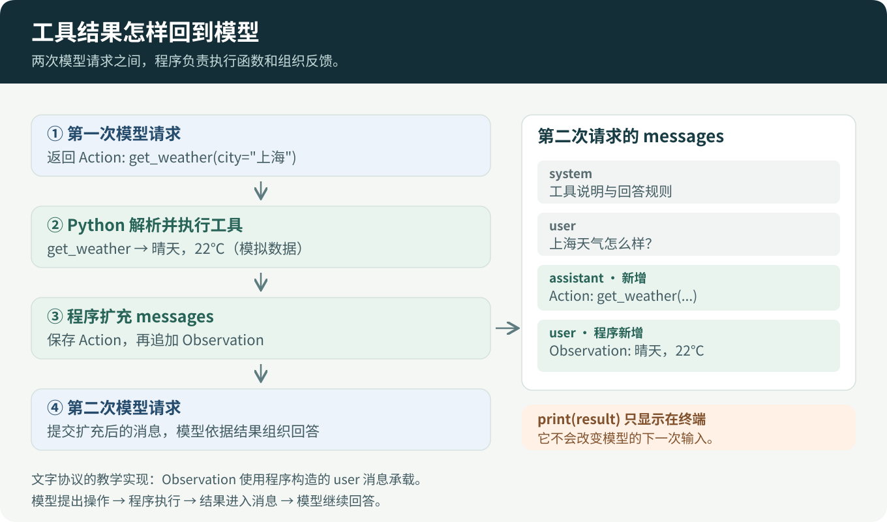

# 第 2 章 · 工具调用与结果回传

[章节目录](../../README.md#章节目录) · [上一章：模型调用](model-calls.md) · [下一章：Agent Loop](agent-loop.md)

本章参考 [Hello-Agents 第一章 §1.2](https://github.com/datawhalechina/hello-agents/blob/main/docs/chapter1/第一章%20初识智能体.md) 与 [第四章 §4.2](https://github.com/datawhalechina/hello-agents/blob/main/docs/chapter4/第四章%20智能体经典范式构建.md)。天气函数与消息组织采用我们自己的教学简化实现。

## 2.1 模型怎样知道有一个工具

第一章让模型直接解释概念。现在的问题变成“上海天气怎么样”，而我们希望它依据程序提供的数据回答。

因此，输入中需要增加工具说明与输出约定。下面节选自天气回传示例的系统提示：

```text
可用工具：
get_weather(city: str)：查询指定城市的模拟天气。

规则：
1. 尚未收到 Observation 时，只输出一行工具请求：
   Action: get_weather(city="城市名称")
2. 收到 Observation 后，用简洁中文回答用户，明确这是模拟数据。
3. 如果工具返回“暂无天气数据”，说明无法依据现有数据回答，不要编造。
```

这段文字告诉模型：可以请求什么操作、参数叫什么、请求应该写成什么格式。此前已有一次模型调用返回：

```text
Action: get_weather(city="上海")
```

它表示“请程序查询上海的模拟天气”。到这里，返回的仍然是一段文字，天气函数尚未因为这段文字自动执行。

## 2.2 真正的工具是 Python 函数

我们的天气工具只有两条模拟记录：

```python
def get_weather(city):
    weather_data = {
        "北京": "下雨，12℃",
        "上海": "晴天，22℃",
    }
    return weather_data.get(city, "暂无天气数据")
```

这个函数的结果由字典确定，与模型无关：

| 调用 | 确定性返回值 |
| --- | --- |
| `get_weather("北京")` | `下雨，12℃` |
| `get_weather("上海")` | `晴天，22℃` |
| `get_weather("广州")` | `暂无天气数据` |

表中是当前函数的固定输出，全部为教学模拟数据。广州没有匹配项，`dict.get` 因而返回默认字符串。

接下来需要把 Action 中的城市名取出来。实际实现如下：

```python
import re

def execute_action(action):
    match = re.fullmatch(
        r'Action:\s*get_weather\(city="([^"\r\n]+)"\)',
        action.strip(),
    )
    if match is None:
        return "错误：无法识别工具请求，请检查工具名称和参数格式。"

    city = match.group(1)
    return get_weather(city)
```

`re.fullmatch` 检查整段输入是否符合约定；捕获组提取双引号内的城市名。最后一行 `get_weather(city)` 才是真正的函数执行。

这不是让模型随意写代码再运行。程序只接受预先支持的工具格式，其他文字得到错误提示。

## 2.3 拿到结果后，为什么还要再次请求模型

执行 `get_weather("上海")` 后，Python 拿到了“晴天，22℃”。但最开始的模型请求只包含工具说明和问题，还没有这条结果。

若希望模型根据工具数据组织回答，需要再发起一次请求，并把结果包含进去。



图 2-1 根据本项目代码原创绘制。右侧消息列表显示第二次请求比第一次多了什么；打印终端与更新消息列表是两个动作。

以下是主流程的讲解节选。`SYSTEM_PROMPT` 使用本章前述的工具规则，`client`、`model`、`options` 沿用上一章的配置：

```python
messages = [
    {"role": "system", "content": SYSTEM_PROMPT},
    {"role": "user", "content": "上海天气怎么样？"},
]

# 第一次模型请求：模型选择工具。
action = ask_model(client, model, messages, options)

# Python 执行工具，取得结果。
result = execute_action(action)
if result.startswith("错误："):
    raise ValueError("工具请求格式不符合约定，未继续请求模型。")

# 把模型请求和实际结果都保留下来。
messages.append({"role": "assistant", "content": action})
messages.append({"role": "user", "content": f"Observation: {result}"})

# 第二次模型请求：这次输入包含刚才的工具结果。
answer = ask_model(client, model, messages, options)
print(answer)
```

两次请求的消息可以这样对照：

| 消息顺序 | 第一次请求 | 第二次请求 |
| --- | --- | --- |
| 1 · system | 工具说明与回答规则 | 同一份说明与规则 |
| 2 · user | 上海天气怎么样？ | 同一个问题 |
| 3 · assistant | 尚无 | 模型刚才输出的 Action |
| 4 · user（程序构造） | 尚无 | `Observation: 晴天，22℃` |

本项目把 Observation 放在程序构造的 `user` 消息里，是文字协议的简化实现。它既不是用户手动输入，也不是 API 原生的 `tool` 消息。

## 2.4 已有结果：工具没有广州的数据

已有真实运行中，将城市设为广州后，输出如下：

```text
[1] 模型提出请求： Action: get_weather(city="广州")
[2] Python 工具结果（模拟数据）： 暂无天气数据
[3] 模型根据工具结果回答： 广州暂无天气数据，无法提供相关信息。
```

逐行看：

- 第一行由模型生成：它遵循工具说明，提出查广州的请求。
- 第二行来自 Python：解析城市，调用函数，得到字典的默认返回值。
- 第三行由第二次模型请求生成：这次输入中已有“暂无天气数据”，所以回答说明现有信息不足。

缺失信息同样是一种有用反馈。若没有把工具结果加入下一次请求，模型就不能可靠地依据**这次**工具执行来判断是否有数据。

## 2.5 Action 与 Observation 的分工

| 概念 | 本项目中的产生者 | 作用 |
| --- | --- | --- |
| Action | 模型 | 表达希望进行的操作 |
| 工具返回值 | Python 工具函数 | 提供这次实际执行获得的数据 |
| Observation | 程序依据执行结果组织 | 将结果或错误反馈给下一次模型请求 |
| 最终自然语言回答 | 模型 | 结合当前消息中的资料组织答复 |

所以，`print(result)` 与 `messages.append(...)` 不能互相替代。前者让人看到结果，后者改变下一次发给模型的输入。

到这里，我们完成了一次固定的“两次请求”流程。如果任务要查两座城市、核对资料或继续追问工具结果，就需要把这条链变成循环。下一章直接展示这个循环的代码与三轮运行结果。

**配套代码**：[天气工具](../../src/agent_learning/tools/weather.py)、[完整回传示例](../../examples/tool_roundtrip.py)。运行方式集中在 [配套说明](../getting-started.md)。

---

本章结合 Hello-Agents 与本项目代码、已有实验重新整理，非教材原文；正文采用 [CC BY-NC-SA 4.0](../../LICENSES/CC-BY-NC-SA-4.0.txt)。图 2-1 为本项目原创图。
