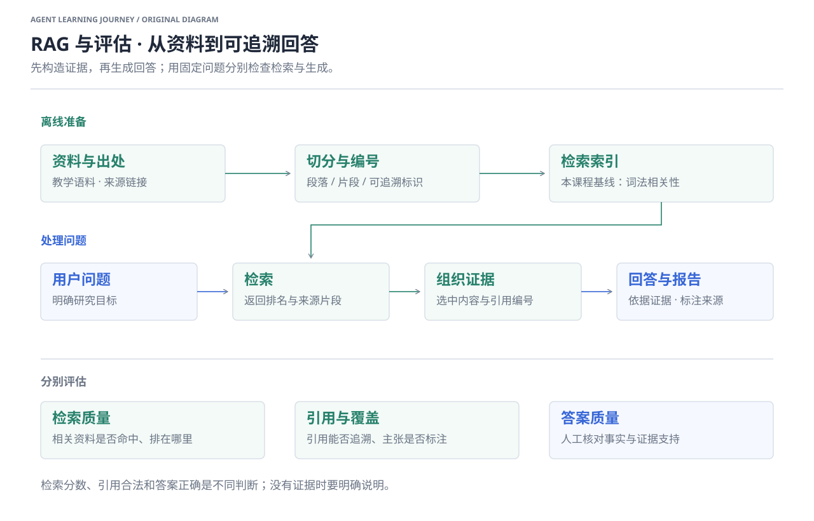

# 专项练习 · 检索、引用与资料不足

[第 04 章](../learning/retrieval-and-citations.md) · [第 08 章](../learning/rag.md) · [第 09 章](../learning/evaluation.md) · [评估附录](../evaluation.md)

本练习对应第 04、08、09 章。任务是：**输入一个课程问题，从指定资料中找到依据，给出带来源的解释，并指出仍缺少的信息。** 通过两种实现，对照模型工具循环与固定 RAG 流程怎样处理同一类资料问题。

例如，读者问“Agent Loop 为什么要有最大步数？”，需要的不只是“防止死循环”这句话，还需要知道它来自哪条资料、预算耗尽与完成任务有什么区别。换成“RAG 服务每月收费多少钱？”，系统则应识别资料中有没有价格依据，不能因为命中了 RAG 这个词就给出金额。

本页给出练习输入、已有结果与核查方法。完成后，可在 [第 12 章医疗险综合实战](../insurance/course-guide.md) 中继续检查产品版本、条款条件和资料缺口。

## 读者要解决的问题

学习概念时，读者常会把模型的解释、程序行为和教材结论混在一起。资料问答练习需要把它们放回各自的位置：回答引用资料，工具提供依据，程序负责执行预算与输出检查。

查资料时，另一个困难是“找到了相关段落”却仍不能回答问题。练习要求保留信息缺口，而不是把每个输入都强行写成完整答案。读者应能沿着来源回到资料，判断结论和证据是否对应。

当前任务范围是本地课程资料问答。正文末尾的纸面迁移练习用于检查能否把证据判断用于新的问题，不要求把这两个示例扩建成另一套研究产品。

## 输入与交付

输入以一个明确问题为起点，资料范围由所选入口决定：

| 输入 | 基础问答入口 | RAG 报告入口 |
| --- | --- | --- |
| 问题 | 非空课程问题，例如“Action 和 Observation 分别由谁产生？” | 非空课程问题，例如“RAG 为什么要保留来源与引用？” |
| 资料 | [3 条 N 系列教学摘要](../../src/agent_learning/data/notes.json) | [14 篇 D 系列教学摘要](../../src/agent_learning/data/corpus.json) |
| 执行预算 | `--max-steps`，默认最多 5 次模型请求 | 最多生成一次；默认检索前 3 块 |
| 证据容量 | 将工具返回结果加入循环消息 | `--context-chars`，默认 1800 字符，包含证据元数据 |
| 交付位置 | 终端中的行动轨迹、最终答复和来源 | 终端中的 Markdown 报告；可用 `--output` 保存文件 |

RAG 的证据字符预算只约束装入请求的资料，不是整个上下文窗口的 token 上限。候选资料放不下时按完整块跳过，因此“检索到的资料”和“模型收到的证据”可能不同。

一份 RAG 报告包含三部分：

1. **检索轨迹**：哪些资料被返回，分数如何，哪些进入了证据列表。
2. **回答或信息缺口**：逐条结论及引用，或者缺少哪些必要信息。
3. **来源**：引用编号、摘要性质和教材章节链接；报告末尾保留语料指纹，便于比较版本。

默认模式交付资料摘录；开启 `--live` 后交付模型回答。生成报告列出引用来源，逐字核对时可按编号查看语料正文；程序返回的 `evidence` 也保留了本次入选资料。本文使用的语料是教材摘要，来源链接与摘要中的字符位置不能当成教材原文行号。

## 当前怎样完成任务

**基础问答入口让模型选择下一步行动。** 模型先提出 `search_notes` 查询，程序按标签检索，将结果作为 Observation 回传，再由模型回答或换关键词。程序会拦截重复查询，检查 Finish 中的引用是否来自本次结果，并在请求上限处结束。它适合研究“模型提出请求、程序执行、结果进入下一轮”这条循环。实现见 [research.py](../../src/agent_learning/agents/research.py) 与 [loop.py](../../src/agent_learning/loop.py)。

**RAG 报告入口由程序固定执行顺序。** 用户问题直接作为查询，经字符分块、BM25 排序和证据选择后，交给模型生成一次回答。程序检查字段类型和引用范围，再把结论及来源组织成报告。它适合研究“如何把资料变成可用证据，以及引用检查能管到哪一步”。实现见 [retrieval.py](../../src/agent_learning/tools/retrieval.py) 与 [rag.py](../../src/agent_learning/agents/rag.py)。



两条入口共享模型配置和调用接口，使用各自的数据与控制流程。天气示例中的动态预算提示、规则摘要尚未接入这两个问答入口；规划、反思、LangGraph 与 MCP 也仍以各自的课程示例展开，没有在当前 RAG 入口中组成一套多轮调研流程。

## 场景一：用资料解释一个概念

问题：“Agent Loop 为什么要有最大步数？”

使用基础问答入口，检查它是否先取得资料，再引用 N03 解释执行预算。回答应区分“达到请求上限”和“任务已经完成”，并把“没有 Finish 就报告未完成”说明为本练习的约定。验收时同时查看行动轨迹与最终答复，不能只看最后一句是否流畅。

问题：“RAG 为什么要保留来源与引用？”

使用 RAG 入口，观察候选资料如何进入回答。报告节选如下：

```text
问题：RAG 为什么要保留来源与引用？
状态：answered；模型请求：1 次。

D08-C01  RAG 的来源与引用        9.823
D05-C01  RAG 的检索增强生成流程  6.664
D04-C01  摘要保留较早证据        6.133

保留来源是 RAG 数据准备阶段的关键步骤，与文档收集、切分和索引构建共同构成检索增强的基础流程。 [D05-C01]
```

这条结论可由 D05 的数据准备步骤支持。验收还要检查其他结论：完整回答中的“确保”需要收紧为设计目标，因为保留来源便于核查，却不能保证生成正确。完整内容见 [回答记录](../runs/2026-11-19/rag-answer.md)，判断依据见 [逐条评估](../runs/2026-11-19/rag-evaluation.md)。

这一场景的完成条件是：问题得到解释，关键结论有对应依据，引用来自本次证据，资料中的限定条件得到保留。`answered` 表示程序已通过格式和引用检查，语义支持仍需逐条审阅。

## 场景二：相关资料不足以回答

问题：“RAG 服务每月收费多少钱？”

当前语料会返回 D05、D08，它们介绍流程和引用规范，没有服务价格。合格的处理是说明缺少具体服务与计费信息，返回 `insufficient_evidence`；不能给出金额、推断免费，或把“当前资料没写”说成“所有 RAG 服务都没有收费”。

[资料不足记录](../runs/2026-11-19/rag-missing.md) 展示了这一分支。它完成的是资料边界判断，用户所问的价格仍未解决。这两项应在评估中分开记录。

基础入口也有对应问题：“LangGraph 的 checkpoint 有什么作用？”三条 N 系列摘要没有检查点机制的资料，允许以明确的资料不足说明结束。引用某条确实存在的 Agent Loop 摘要，并不能补上这个知识缺口。

## 场景三：检查停止与拒绝行为

下表是可以重复执行的验收条件。前两项可直接观察 RAG 的资料分支；后两项检查程序在不合格输入或预算耗尽时怎样处理。

| 条件 | 应观察到的行为 | 验收重点 |
| --- | --- | --- |
| RAG 查询“火星明天的日出时间是多少？” | 当前库无候选，直接返回资料不足，不生成回答 | 没有证据时及时停止 |
| RAG 查询来源问题，并设 `--context-chars 1` | 有候选但完整块放不进预算，说明证据容量不足，不生成回答 | 区分“没检索到”和“没装入请求” |
| 在生成结果中放入本次证据以外的引用编号 | 校验返回 `invalid_answer`，记录原因，不接受这些结论 | 知识库里存在的编号也必须属于本次证据 |
| 基础入口查询最大步数问题，并设 `--max-steps 1` | 首轮检索后已用完请求预算，没有有效 Finish 时返回 `step_limit` | 不追加请求，不把拿到资料当成已完成答复 |

引用拒绝用固定输入检查，相关测试在 [test_retrieval.py](../../tests/test_retrieval.py)。基础入口的检索、纠错和 Finish 都消耗同一份请求预算，工具执行次数另行统计。

一个场景通过时，应记录“哪条条件得到了满足”，而不是统一写成“回答成功”。资料不足、格式拒绝和预算耗尽解决的是不同问题。

## 怎样核查练习结果

[14 道开发题](../../src/agent_learning/data/eval_cases.json) 用于检查 RAG 检索，其中 12 道标注了相关文档，2 道在当前语料中没有答案：

| 指标 | 结果 | 对应范围 |
| --- | ---: | --- |
| 平均 Recall@3 | 0.9583 | 12 道有资料题的相关文档覆盖 |
| MRR@3 | 1.0000 | 12 道有资料题的首个相关结果位置 |
| 无答案题空结果比例 | 0.5000 | 2 道无答案题中返回空候选的比例 |

E06 比较 BM25 和向量检索，只召回了两篇标注资料中的一篇；E14 询问价格，却因主题词重合返回候选。这两题分别暴露了漏召回和命中不等于可答的问题。

答案评估另行检查结论是否受支持、是否覆盖问题、引用是否正确，以及缺失说明是否合理。当前保存的生成样本围绕两道不同问题展开，主要用于分析有依据回答与资料不足，尚不能覆盖课程知识的各种问法。指标定义与记录格式见 [第 9 章](../learning/evaluation.md)，逐项检查表见 [评估附录](../evaluation.md)。

## 当前范围与限制

资料库由 14 篇短摘要组成，默认切分后仍是 14 个块。切分函数能处理长文本，但这组语料没有充分暴露跨块前提丢失、跨章节整合或相互矛盾的来源。模型只能依据输入中的摘要作答，当前入口也不会自动读取教材网页、导入 PDF 或搜索互联网。

检索采用中文相邻双字和英文词的 BM25 基线，尚无向量检索、混合检索或重排序。同义问法可能漏掉资料。应先通过失败题确认瓶颈，再比较新的检索策略。

RAG 入口只检索一次、生成一次，尚不负责拆分复杂问题、自动补查资料或修订报告。基础入口虽然可以换词查询，但使用的仍是三条摘要和有限工具循环；两者不能视为已经具备相同的研究能力。

程序能够检查字段、引用编号和停止条件，不能仅凭这些检查判断论据是否支持结论。现有开发题与语料共同设计，后续需要独立问题和更多逐条审阅，才能评价更广的任务表现。

## 纸面迁移练习

完成上述场景后，尝试这个问题：**“为课程资料库设计检索方案，比较 BM25 与向量检索，解释选择条件及仍需验证的问题。”** 按 [给定材料与参考解析](transfer-exercises.md) 手工完成计划和报告修订，将第 06–09 章的机制用于同一份资料任务。

| 交付物 | 应包含什么 | 核查重点 |
| --- | --- | --- |
| 研究计划 | 子问题、先后依赖和需要查找的证据 | 每一步都服务于原始问题，后一步能取得前一步结果 |
| 证据表 | 资料片段、来源位置、支持的结论与仍缺少的信息 | 概念资料不能被当作本项目的性能或成本测量 |
| 研究报告 | 问题范围、比较依据、建议、引用和未解决事项 | 关键结论可追溯；建议说明适用条件 |
| 核查记录 | 所用证据、逐条修改意见与尚待验证的问题 | 区分资料事实、建议和实验假设，不虚构查询或模型运行 |

上述多轮调研尚未接入当前入口。纸面练习的验收对象是计划、依据与修订，不要求运行不存在的整合命令。综合业务任务继续沿 [医疗险课程指南](../insurance/course-guide.md) 学习。

## 运行入口

安装与配置见 [复现指南](../getting-started.md)。以下命令分别进入基础问答、RAG 报告和检索评估：

```bash
python -m agent_learning --question "Agent Loop 为什么要有最大步数？"

python -m examples.rag_research --live --question "RAG 为什么要保留来源与引用？" --output outputs/research-report.md

python -m examples.evaluate --k 3 --output outputs/retrieval-evaluation.json
```
